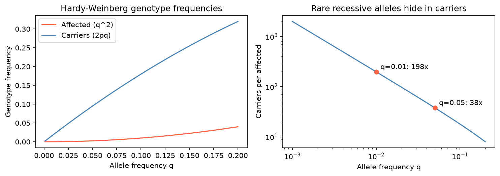

[遺傳學](../README.md) › [基礎概念](README.md) › 變異等位基因頻率

# 變異等位基因頻率 (Variant Allele Frequency)

「頻率」在遺傳學裡有兩種完全不同的意思，混用會導致錯誤判讀：

| | 變異等位基因頻率 (VAF) | 族群等位基因頻率 (population AF) |
| --- | --- | --- |
| 層級 | **單一樣本**內 | **族群**中 |
| 定義 | 支持 ALT 的 reads ÷ 該位置總 reads | 族群中 ALT 等位基因的數量 ÷ 總等位基因數 |
| 來源 | 定序資料（VCF 的 AD / AF，見 [VCF](../../genomics/file-formats/vcf.md)） | [gnomAD](../databases/population-frequency/gnomad.md) 等族群資料庫 |
| 用途 | 判斷基因型、腫瘤純度、嵌合、次選殖 | ACMG BA1 / BS1 / PM2、帶因率估計 |

## VAF：樣本內

| 情境 | 預期 VAF |
| --- | --- |
| Germline 異型合子 | ≈ 50%（因抽樣與比對偏差在 30–70% 間） |
| Germline 同型合子 | ≈ 100% |
| 體細胞突變 | 受腫瘤純度、拷貝數、次選殖比例影響，常 < 50% |
| 嵌合 (mosaic) | 明顯偏離 50%（如 10–30%） |
| 雜訊 / 假象 | 很低，且常有鏈偏差或位置偏差（見 [IGV 複核](../../bioinformatics-tools/visualization/igv.md)） |

### 從 VAF 推算帶突變的腫瘤細胞比例

假設：二倍體、異型合子突變、該位置**沒有拷貝數變化**、正常細胞不帶該突變。

$$\text{帶突變細胞比例（全部細胞）} = 2 \times \text{VAF} \qquad \text{腫瘤細胞中的比例 (CCF)} = \frac{2 \times \text{VAF}}{\text{腫瘤純度}}$$

例：腫瘤含量 50%，某致病變異 VAF = 3.70%

| 步驟 | 計算 |
| --- | --- |
| 100 個細胞共 200 個等位基因 | 200 × 3.70% = 7.4 個帶突變的等位基因 |
| 每個帶突變細胞只有 1 個突變等位基因（異型合子） | 7.4 個細胞帶突變 → 佔所有細胞 7.4%（= 2 × 3.7%） |
| 只有腫瘤細胞可能帶突變 | 7.4% ÷ 50% = **14.8% 的腫瘤細胞帶突變**（次選殖突變） |

若該位置有拷貝數改變（擴增、LOH），上述公式不成立，需用 PyClone、FACETS、PureCN 等同時估計純度與拷貝數。

## 族群頻率：為什麼致病變異可以比疾病更常見？

例：某致病變異的族群等位基因頻率為 1%，疾病盛行率卻只有 0.5%。可能的原因：

| 原因 | 說明 | 例 |
| --- | --- | --- |
| 隱性遺傳 | 患者需兩個致病等位基因（q²），大部分等位基因藏在健康帶因者（2pq）中 | 見下圖 |
| 不完全外顯 (incomplete penetrance) | 帶有致病變異不一定發病 | *BRCA1* 帶因者終生乳癌風險約 60–70%，不是 100% |
| 保護性等位基因 / 修飾基因 | 其他變異降低發病風險 | *APOE* ε2 降低阿茲海默症風險 |
| 晚發 / 環境因子 | 在調查年齡前未發病，或需環境觸發 | G6PD 缺乏症（需接觸蠶豆或特定藥物） |
| 變異其實不致病 | 頻率高於疾病能容許的程度 | 依 ACMG BS1 重新分類為良性 |

Hardy–Weinberg 平衡下，基因型頻率為 p²（正常）、2pq（帶因）、q²（患病，隱性）。等位基因越罕見，帶因者相對患者越多：q = 1% 時，每 1 位患者對應約 198 位帶因者。

### 反推：疾病能容許的最高頻率

ACMG BS1 的門檻可依疾病參數計算（Whiffin et al. 2017）：

$$\text{最大可信族群頻率（顯性）} = \frac{\text{盛行率} \times \text{最大等位基因貢獻度} \times \text{最大基因貢獻度}}{\text{外顯率}}$$

隱性疾病則以 √(盛行率) 取代盛行率（患者需兩個致病等位基因）。例（隱性疾病，盛行率 1 / 10,000、單一變異最多佔該基因致病等位基因的 50%、外顯率 100%）：q ≤ √(1/10,000) × 0.5 = 0.5%；族群頻率高於此的變異不太可能是該疾病的致病原因。

> 保護性等位基因難以研究：帶有它的人多半健康，不會進入病例研究，且與大量無關的良性變異混在一起。

相關：[族群頻率資料庫](../databases/population-frequency/README.md)、[創始者效應](founder-effect.md)、[ACMG/AMP](../variant-interpretation/acmg-amp.md)、[液態切片的低 VAF](../../genomics/sequencing-techniques/liquid-biopsy.md)。
