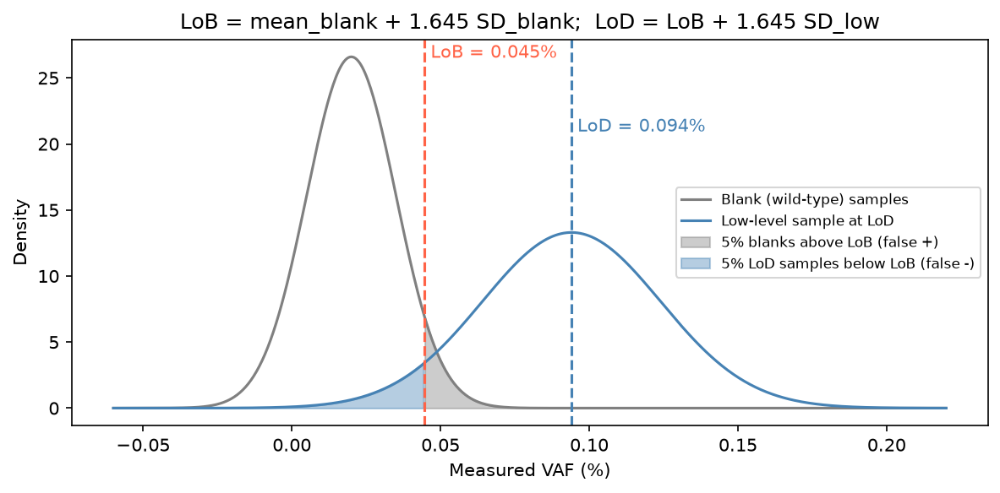
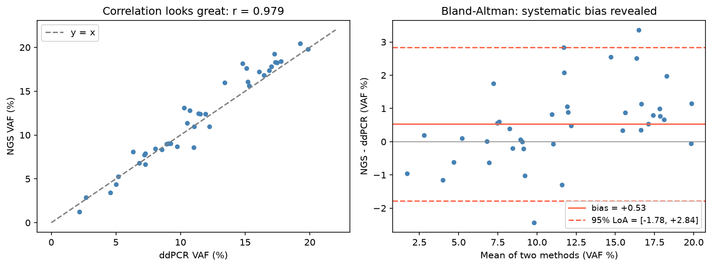

[Biology](../../README.md) › [基因體學](../README.md) › 檢測確效

# 檢測確效 (Assay Validation & Verification)

臨床或研究用的 NGS 檢測，在報告結果前要證明它「量得準、量得穩、知道自己的極限」。這包括濕實驗與生資流程兩部分；改動流程（換比對器、升級版本）也要重新評估。

## Validation vs Verification

| | 確效 (Validation) | 驗證 (Verification) |
| --- | --- | --- |
| 問題 | 這個方法適合預期用途嗎？ | 這個已確效的方法在我的實驗室表現如預期嗎？ |
| 對象 | 實驗室自行開發的檢測 (LDT)、修改過的方法 | 已核准的商業套組（照原廠方式使用） |
| 範圍 | 完整：準確度、精密度、LOD、可報告範圍… | 精簡：確認原廠宣稱的關鍵效能 |

## 評估指標

| 指標 | 定義 | 怎麼做 |
| --- | --- | --- |
| 敏感度 (sensitivity / recall) | TP / (TP + FN)：真實變異被偵測到的比例 | 對照參考標準品的已知變異 |
| 陽性預測值 (PPV / precision) | TP / (TP + FP)：報出的變異是真的比例 | 同上；NGS 常用 PPV 取代特異度 |
| 特異度 (specificity) | TN / (TN + FP) | 「真陰性」是整個基因組中數以百萬計的非變異位置，數值永遠接近 100%，意義有限 |
| 偵測極限 (LoD) | 能穩定偵測（如 ≥ 95%）的最低 VAF 或最低起始量 | 稀釋系列（標準品混合不同比例）；見 [LoB / LoD / LoQ](#lob--lod--loq偵測與定量極限) |
| 精密度 | 重複性（同批）與再現性（跨批、跨人、跨儀器） | 同樣本多次重複 |
| 可報告範圍 | 哪些區域、哪些變異類型可以報告 | 列出低覆蓋區、不支援的變異類型（大型 indel、CNV） |
| 干擾 | 樣本品質（FFPE、溶血、低腫瘤比例）的影響 | 刻意加入干擾條件測試 |

依變異類型（SNV、小 indel、CNV、融合）**分開**計算；整體數字常被大量容易的 SNV 拉高。統計上這是分類器評估的問題，見 [混淆矩陣指標](../../../data-science/machine-learning/evaluation/confusion-metrics.md)；小樣本下的不確定性見 [指標的不確定性](../../../data-science/machine-learning/evaluation/metric-uncertainty.md)。

## LoB / LoD / LoQ：偵測與定量極限

三個極限回答不同問題，依 CLSI EP17 的定義由低到高：LoB ≤ LoD ≤ LoQ。

| 指標 | 問題 | 定義（參數法） | NGS 中的意思 |
| --- | --- | --- | --- |
| 空白極限 (LoB, limit of blank) | 沒有目標物時，量測值最高會到多少？ | LoB = meanblank + 1.645 × SDblank（空白樣本的第 95 百分位） | 野生型樣本中，該位點背景錯誤造成的 VAF / 突變 reads 上限 |
| 偵測極限 (LoD, limit of detection) | 多低的量能和空白**可靠地區分**？ | LoD = LoB + 1.645 × SDlow（低濃度樣本） | 95% 重複中都能叫到的最低 VAF；實務常用稀釋系列 + probit 回歸取 95% 偵測率 |
| 定量極限 (LoQ, limit of quantitation) | 多低的量還能**準確定量**？ | 符合預設準確度目標（如 CV ≤ 20% 或總誤差上限）的最低濃度；LoQ ≥ LoD | VAF 數值本身可報告、可用於追蹤變化的最低值 |

LoB 控制偽陽性（5% 空白樣本超過它），LoD 再往上推到低濃度樣本也只有 5% 低於 LoB（偽陰性）。所以 LoD 不是「偶爾能看到」的最低值，而是兩種錯誤率都控制住的最低值。

| 注意 | 說明 |
| --- | --- |
| 背景依位點而異 | NGS 的錯誤率隨序列情境（homopolymer、C>T 去胺）不同，常需逐位點或分類估計 LoB |
| 極限受分子數限制 | 低起始量時 LoD 由可取得的分子數決定，不只是定序深度，見 [UMI 與一致序列](../ngs-qc/umi-consensus.md#低-vaf-會不會被叫出來) |
| 基質要接近臨床樣本 | 用乾淨細胞株 DNA 估出的極限偏樂觀，見 [參考標準品](reference-standard.md) |

## 方法比較：Bland-Altman 圖

新方法與參考方法（如 NGS 與 ddPCR 的 VAF、兩套 panel 的 TMB）量同一批樣本時，要問的是「**兩者一致嗎**」，而不是「相關嗎」。相關係數只說明兩者一起變大變小；即使有固定偏差或比例偏差，r 仍可接近 1。

| 元素 | 計算 | 解讀 |
| --- | --- | --- |
| x 軸 | 兩方法的平均 | 量測值大小 |
| y 軸 | 兩方法的差（新 − 參考） | 每個樣本的不一致 |
| 偏差 (bias) | 差值的平均 | 系統性高估 / 低估 |
| 一致性界限 (95% limits of agreement, LoA) | bias ± 1.96 × SD差值 | 95% 樣本的差值會落在這個範圍；**是否可接受由臨床需求事先決定** |

模擬資料中 r = 0.98，但 Bland-Altman 圖顯示 NGS 平均高估約 1 個百分點，個別樣本差異可達 −0.8 到 +2.8 個百分點。

| 看到的型態 | 意義 / 處理 |
| --- | --- |
| 點的散布隨 x 變大 | 誤差與量值成比例：改畫百分比差或取 log 後再算 |
| 點呈斜線趨勢 | 比例偏差：用 Deming 或 Passing-Bablok 迴歸估斜率 |
| 少數離群點 | 逐一檢查樣本（品質、低深度、接近 LoD） |

統計上的相關與一致性差別見 [雙變數描述統計](../../../data-science/statistics/descriptive-statistics/bivariate.md)。

## 筆記

| 筆記 | 內容 |
| --- | --- |
| [參考標準品](reference-standard.md) | 商業標準品、Genome in a Bottle (GIAB)、比對工具 hap.py |

## 指引

| 指引 | 適用 |
| --- | --- |
| [AMP / CAP：NGS 腫瘤 panel 確效指引](https://www.amp.org/AMP/assets/File/resources/AssayValidation_Final.pdf?pass=34)（Jennings et al., J Mol Diagn 2017） | 體細胞變異 panel：錯誤導向的設計、最少樣本數、LOD |
| ACMG 臨床 NGS 標準（Rehm et al., Genet Med 2013） | germline 檢測 |
| AMP / CAP 生資流程確效建議（Roy et al., J Mol Diagn 2018） | 生資 pipeline 的確效與版本控管 |

> NGS 的「特異度」很難定義（真陰性位置的數量取決於怎麼數），所以確效報告多用敏感度與 PPV。這個問題的討論見 [Can you determine the specificity of an NGS assay?](https://blog.limbus-medtec.com/can-you-determine-the-specificity-of-an-ngs-assay-b5c811e17dcc)（網站目前無法存取）。
