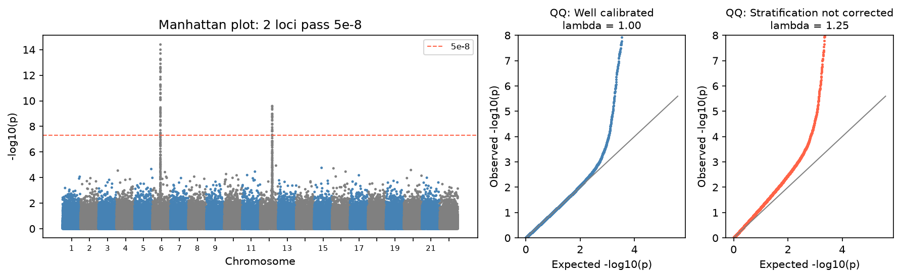

[基因體學](../README.md) › [全基因體分析](README.md) › GWAS 基礎

# 全基因體關聯分析 (GWAS Fundamentals)

在大量個體中，對基因組上數百萬個常見變異逐一檢定與性狀（疾病有無、身高、血脂）的關聯。GWAS 找到的是**關聯位點**，不是致病變異本身：顯著的 SNP 常只是與真正致病變異處於連鎖不平衡 (LD) 的標記。

## 流程

```
基因型（晶片 / 定序）──QC──► 填補 (imputation) ──► 族群結構（PCA）
  ──► 逐 SNP 關聯檢定（共變數：年齡、性別、PCs）──► Manhattan / QQ、λ
  ──► 顯著位點 ──► fine-mapping、colocalization、功能註解 ──► 候選基因
```

| 步驟 | 常見做法 | 為什麼 |
| --- | --- | --- |
| 樣本 QC | 檢查 call rate、性別不符、親緣（移除近親）、異型合子率 | 樣本錯置與污染會產生假關聯 |
| 變異 QC | call rate > 95–98%、MAF > 1%、對照組 HWE p > 10⁻⁶ | 基因分型錯誤常表現為偏離 Hardy–Weinberg |
| 填補 | Michigan / TOPMed imputation server、Beagle | 由參考族群推估未測到的變異，增加覆蓋 |
| 族群結構 | 基因型 PCA，前 10 個 PCs 當共變數；或線性混合模型 | 族群分層 (stratification) 是最大的假陽性來源 |
| 關聯檢定 | 數量性狀：線性迴歸；二元性狀：邏輯斯迴歸；大樣本：REGENIE、SAIGE、BOLT-LMM | 混合模型同時處理親緣與分層 |
| 顯著門檻 | p < 5 × 10⁻⁸ | 約等於對 100 萬個獨立檢定做 Bonferroni |

```bash
# PLINK 2：QC + 關聯檢定
plink2 --pfile data --maf 0.01 --geno 0.02 --hwe 1e-6 --mind 0.02 --make-pgen --out qc
plink2 --pfile qc --pca 10 --out pcs
plink2 --pfile qc --pheno pheno.txt --covar pcs.eigenvec --covar-name PC1-PC10 \
       --glm hide-covar --out assoc
```

## 結果判讀：Manhattan plot 與 QQ plot



| 圖 / 指標 | 看什麼 |
| --- | --- |
| Manhattan plot | 每個點是一個 SNP；高聳的「塔」是一個關聯位點，塔裡的許多 SNP 彼此處於 LD |
| QQ plot | 觀察到的 p 值 vs 均勻分布下的期望；大部分點應貼著對角線，只有尾端（真訊號）上揚 |
| 基因組膨脹係數 λ | 觀察到的卡方統計量中位數 ÷ 期望中位數（0.455）；≈ 1 為良好 |

模擬中，中間的 QQ plot 只在尾端偏離（λ = 1.00）；右邊未校正族群分層，**整條線從一開始就偏離**（λ = 1.25）。λ 偏高要先懷疑分層或親緣未校正；但多基因性狀在超大樣本中，λ 偏高也可能來自大量真實的微小效應，可用 LD score regression 的截距區分。

## 從位點到基因

| 方法 | 問題 | 工具 |
| --- | --- | --- |
| Fine-mapping | 位點中哪幾個變異最可能是致病的？（credible set） | SuSiE、FINEMAP |
| Colocalization | 與 eQTL / pQTL 是否共享同一個致病變異？ | [coloc](colocalization.md) |
| 功能註解 | 變異落在編碼區、增強子、開放染色質？ | VEP、ENCODE、Roadmap |
| 基因層級檢定 | 把位點內的訊號彙整到基因 | MAGMA |
| 孟德爾隨機化 (MR) | 暴露因子是否因果影響結果？ | TwoSampleMR |
| 多基因風險分數 (PRS) | 把全基因組效應加總，預測個人風險 | PRS-CS、LDpred2 |

> PRS 在訓練族群以外（例如以歐洲族群訓練、套用到東亞族群）準確度明顯下降；現有 GWAS 以歐洲族群為主，見 [資料偏差與代表性](../../../data-science/responsible-ai/data-bias-and-representativeness.md)。

## 常見誤解

| 誤解 | 實際 |
| --- | --- |
| 最顯著的 SNP 就是致病變異 | 多半只是 LD 中的標記；需要 fine-mapping |
| 位點最近的基因就是目標基因 | 調控變異常作用在較遠的基因；需要 eQTL / colocalization / 實驗 |
| 效應量小就沒有意義 | 單一變異的 odds ratio 常只有 1.05–1.2，但可指出藥物標的 |
| 只看 p 值不看 QQ plot | 分層造成的整體膨脹會讓許多位點看起來顯著 |

大規模資料處理見 [Spark for Genomics](../../../data-science/data-engineering/spark-for-genomics.md)；統計框架見 [QTL 分析：相關統計方法](qtl-analysis-and-mapping.md#相關統計方法)。參考講義：[Analyzing GWAS data（Stanford GENE 210）](https://stanford.edu/class/gene210/files/lectures/2011/4_Salari_AnalyzingGWASData.pdf)。
