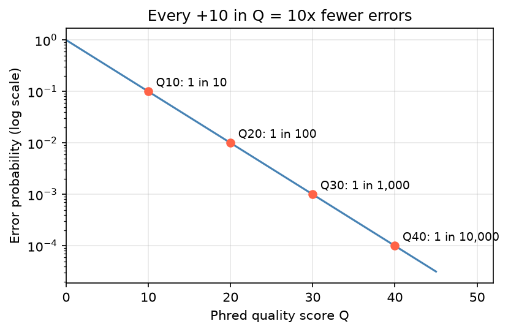

[基因體學](../README.md) › [NGS 品質指標](README.md) › 鹼基品質分數

# 鹼基品質分數 (Base Quality Scores)

定序儀為每個鹼基估計「讀錯的機率」，以 Phred 分數表示，存在 [FASTQ](../file-formats/fastq.md) 第 4 行。它影響修剪、比對信心與變異呼叫：GATK 等工具會用鹼基品質為每個支持 read 加權。

## Phred 分數

$$Q = -10\log_{10} P_{\text{error}} \qquad P_{\text{error}} = 10^{-Q/10}$$

| Q | 錯誤率 | 準確度 | 意義 |
| --- | --- | --- | --- |
| 10 | 1 / 10 | 90% | 很差 |
| 20 | 1 / 100 | 99% | 常見的修剪下限 |
| 30 | 1 / 1,000 | 99.9% | Illumina 規格常以「% ≥ Q30」表示 |
| 40 | 1 / 10,000 | 99.99% | 很好 |



Q 每增加 10，錯誤率降為十分之一。一條 150 bp、平均 Q30 的 read，預期約 0.15 個錯誤鹼基。

## ASCII 編碼 (Phred+33)

FASTQ 用一個字元代表一個品質分數：**字元的 ASCII 碼 − 33 = Q**。

| 字元 | `!` | `#` | `+` | `5` | `?` | `F` | `I` |
| --- | --- | --- | --- | --- | --- | --- | --- |
| ASCII | 33 | 35 | 43 | 53 | 63 | 70 | 73 |
| Q | 0 | 2 | 10 | 20 | 30 | 37 | 40 |

```python
qual = "II5#?F"
[ord(c) - 33 for c in qual]          # [40, 40, 20, 2, 30, 37]
```

> 舊的 Illumina 1.3–1.7 資料使用 Phred+64（`@` 起算），誤當成 +33 會得到過高的分數；現行資料都是 +33。`#`（Q2）常出現在 read 尾端，代表該段品質不可信。

## 品質分箱 (Quality Binning)

新型 Illumina 儀器不輸出 0–41 的完整分數，而是分成少數幾個等級以縮小檔案，例如 NovaSeq 6000（RTA3）只有 4 個值：`#`、`-`、`8`、`F`，即 Q2 / 12 / 23 / 37；較早的 HiSeq X / NextSeq 為 7–8 個。看到 FastQC 的品質圖呈階梯狀是正常的。

## 品質下降的型態

| 型態 | 可能原因 | 處理 |
| --- | --- | --- |
| read 尾端逐漸下降 | 定序化學的相位誤差 (phasing) 累積，正常 | 修剪尾端（見 [fastp](../../bioinformatics-tools/ngs-tools/fastp.md)） |
| 特定 cycle 突然下降 | 儀器問題、氣泡、試劑 | 查看 run 的 tile 品質；嚴重時重跑 |
| R2 整體比 R1 差 | 正常現象 | 依 R2 調整修剪 |
| 整個 run 品質偏低 | cluster 密度過高或過低、library 品質差 | 與定序中心確認 run 指標 |
| 低品質 + polyG 尾巴 | 2-color 化學無訊號被讀成 G | `--trim_poly_g`（見 [Illumina 2-color 化學](../sequencing-techniques/illumina-color-chemistry.md)） |

## 品質在下游的用途

| 步驟 | 怎麼用鹼基品質 |
| --- | --- |
| 修剪 | 低於閾值的尾端或 read 丟棄 |
| 比對 | 錯配發生在低品質鹼基時罰分較低 |
| BQSR（GATK） | 用已知變異位點以外的錯配，重新校正儀器回報的品質分數 |
| 變異呼叫 | 低品質鹼基的貢獻被降權；`samtools mpileup` / `sambamba depth -q` 可直接排除 |

儀器回報的 Q 是**預測值**，不一定準確；BQSR 的目的就是讓它更接近實際錯誤率。參考：[Illumina Q-score 技術說明](https://www.illumina.com/documents/products/technotes/technote_Q-Scores.pdf)。在 R 中讀取與轉換見 [Bioconductor：ShortRead](../../bioinformatics-tools/bioconductor.md#readsshortread)。
