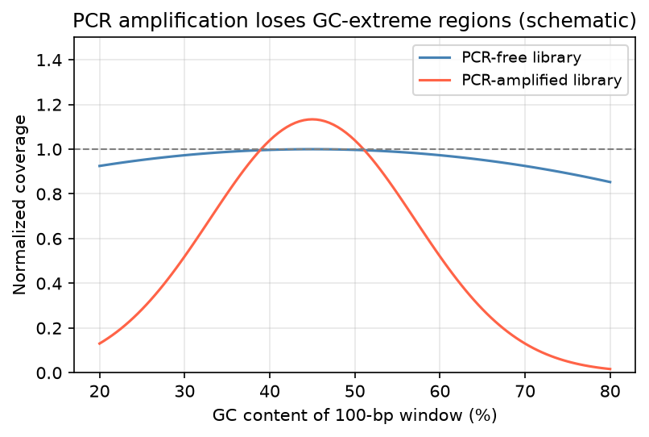

[基因體學](../README.md) › [NGS 品質指標](README.md) › GC 偏差

# GC 偏差 (GC Bias)

GC 含量極高或極低的區域，在定序資料中被系統性地低估。這會造成這些區域覆蓋不足（漏判變異），也會扭曲以 reads 數推估的量（拷貝數、表現量）。



PCR-free library 的覆蓋度在不同 GC 含量下大致平坦；經 PCR 擴增的 library 在 GC < 30% 或 > 60% 的區域覆蓋度明顯下降（示意圖，實際曲線依 library 與儀器而異）。

## 成因

| 來源 | 機制 |
| --- | --- |
| PCR 擴增 | 高 GC 片段不易變性、低 GC 片段 annealing 不穩，擴增效率較差；循環數越多偏差越大 |
| Hybrid capture | 極端 GC 的 probe 雜交效率差 |
| 片段化 | 酵素片段化有序列偏好 |
| 定序化學 | cluster 生成與定序效率受 GC 影響 |

## 常見受影響區域

| 區域 | GC 特性 | 影響 |
| --- | --- | --- |
| 第一外顯子、啟動子、CpG island | 高 GC | WES / panel 常覆蓋不足（如 *CEBPA*、*GNAS* 部分區域） |
| AT-rich 區域、某些內含子 | 低 GC | WGS 深度下降 |

## 指標與工具

```bash
picard CollectGcBiasMetrics -I sample.bam -O gc_metrics.txt -CHART gc_chart.pdf -S gc_summary.txt -R ref.fa
```

| 指標 | 意義 |
| --- | --- |
| `AT_DROPOUT` | GC ≤ 50% 區域中「應有但缺少」的 reads 比例；越接近 0 越好 |
| `GC_DROPOUT` | GC ≥ 50% 區域的同上指標 |
| Normalized coverage vs GC 曲線 | 理想上是一條接近 1 的水平線 |

FastQC 的 *Per sequence GC content*（reads 的 GC 分布）是不同的指標：它看的是 read 本身的組成是否異常（污染、adapter dimer），不是覆蓋度偏差，見 [FastQC](../../bioinformatics-tools/ngs-tools/fastqc.md)。

## 對策

| 層面 | 做法 |
| --- | --- |
| 實驗 | PCR-free library、減少 PCR 循環、使用 GC 友善的聚合酶或添加劑 |
| 拷貝數 (CNV) 分析 | 依 GC 校正深度（CNVkit、GATK 的 GC 校正、loess 迴歸） |
| RNA-seq | 多數差異表現分析在**同一基因跨樣本比較**，GC 效應大致抵消；樣本間 GC 偏差不同時用 EDASeq / cqn 校正，Salmon 有 `--gcBias` |
| 報告 | 列出未達深度門檻的區域 |

相關：[均勻度](uniformity.md)、[定序深度與覆蓋度](sequencing-depth-coverage.md)。
