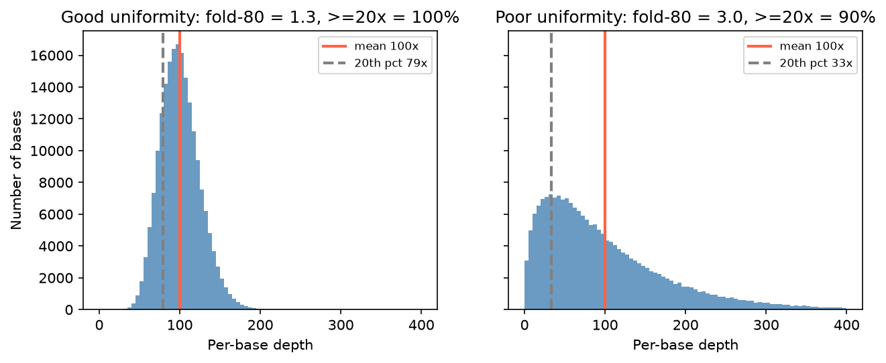

[基因體學](../README.md) › [NGS 品質指標](README.md) › 定序深度與覆蓋度

# 定序深度與覆蓋度 (Sequencing Depth & Coverage)

「30× WGS」說的是平均深度，但臨床與研究真正在意的是：**目標區域中有多少比例達到足以判斷的深度**。平均深度高不代表沒有漏洞。

## 定義

| 名詞 | 定義 | 例 |
| --- | --- | --- |
| 深度 (depth) | 覆蓋某一個鹼基的 reads 數 | 該位置 87× |
| 平均深度 (mean depth) | 目標區域所有鹼基深度的平均 | 30× WGS |
| 覆蓋度 (coverage / breadth) | 目標鹼基中，深度 ≥ 閾值的比例 | 98% 的目標鹼基 ≥ 20× |
| 均勻度 (uniformity) | 深度分布有多集中，見 [均勻度](uniformity.md) | fold-80 = 1.3 |
| on-target 比例 | 落在目標區域內的 reads 比例（capture / amplicon） | 75% |

> 很多文件把 depth 和 coverage 混用（「30× coverage」）。報告時寫清楚：平均深度多少、≥ 多少 × 的比例多少。

## 需要多少 reads？

Lander–Waterman 公式：

$$\text{平均深度} = \frac{\text{reads 數} \times \text{read 長度}}{\text{目標區域大小}}$$

| 例 | 計算 |
| --- | --- |
| 30× 人類 WGS（3.1 Gb）、150 bp reads | 3.1×10⁹ × 30 ÷ 150 ≈ 6.2 億條 reads（3.1 億對） |
| 100× WES（目標約 35 Mb）、150 bp、on-target 70%、重複 15% | 35×10⁶ × 100 ÷ 150 ÷ 0.7 ÷ 0.85 ≈ 3,900 萬條 reads |

實際需求要再考慮 on-target 比例、重複率與均勻度：上例若均勻度差，就得再多定序才能讓「≥ 20× 的比例」達標。

## 建議深度（常見做法）

| 應用 | 常見平均深度 | 原因 |
| --- | --- | --- |
| Germline WGS | 30× | 異型合子（VAF ≈ 50%）在 30× 下漏判機率很低 |
| Germline WES | 100× | 捕捉均勻度較差，需要較高平均才能讓多數目標 ≥ 20× |
| 臨床 germline panel | 200–500× | 要求幾乎所有目標鹼基都 ≥ 20–30× |
| 腫瘤組織（體細胞） | 200–1,000× | 腫瘤純度低、次選殖變異 VAF 5–10% |
| cfDNA / ctDNA | 原始 10,000× 以上（去重複後數千×） | 偵測 VAF 0.1–1% 的變異 |
| RNA-seq（差異表現） | 每個樣本 20–30 M reads | 以 reads 數而非深度計；生物重複數比深度更重要 |
| 單細胞 RNA-seq | 每個細胞 20,000–50,000 reads | 依實驗目的調整 |

## 深度分布與均勻度



兩個 library 平均深度都是 100×：左邊 99% 的鹼基 ≥ 50×；右邊只有 68% ≥ 50×，≥ 20× 也只有 90%，等於有一成的目標區域可能漏掉變異。判斷 library 品質要看分布，不能只看平均值；分布的指標見 [均勻度](uniformity.md)。

## 怎麼算

```bash
mosdepth -t 4 --by targets.bed --thresholds 1,10,20,30 sample sample.bam   # 最快；輸出 ≥ 各閾值的鹼基數
samtools depth -a -b targets.bed sample.bam | awk '{s+=$3; n++} END {print s/n}'   # 平均深度
picard CollectHsMetrics -I sample.bam -O hs.txt -R ref.fa -BI baits.interval_list -TI targets.interval_list
```

| 低覆蓋的常見原因 | 對策 |
| --- | --- |
| GC 極端區域 | 見 [GC 偏差](gc-bias.md) |
| 重複序列、假基因（MAPQ 低被過濾） | 見 [比對品質](mapping-quality.md)；必要時用其他方法確認 |
| capture probe 設計不佳 | 回報給 panel 設計方，或補 probe |
| 重複率高、library complexity 低 | 見 [重複率](duplication-rate.md) |

工具：[samtools depth / bedcov](../../bioinformatics-tools/ngs-tools/samtools.md#深度輸出)、[sambamba depth](../../bioinformatics-tools/ngs-tools/sambamba.md)、[bedtools coverage](../../bioinformatics-tools/ngs-tools/bedtools.md)。參考：[Sequencing depth vs coverage（3billion）](https://3billion.io/blog/sequencing-depth-vs-coverage)。
