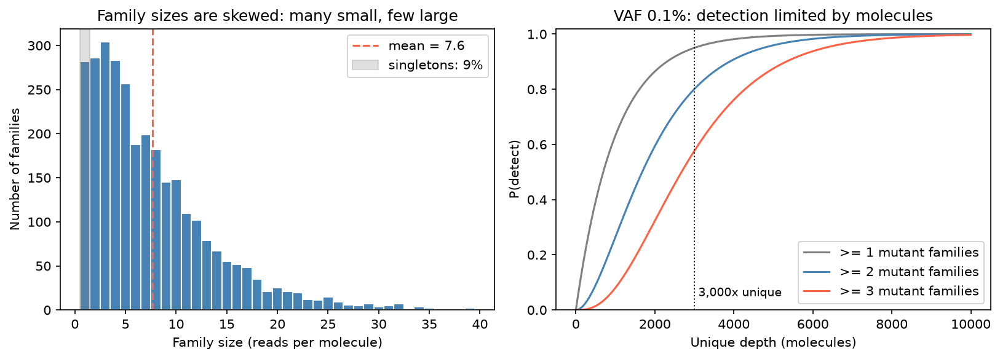

[基因體學](../README.md) › [NGS 品質指標](README.md) › UMI 與一致序列

# UMI 與一致序列 (UMI & Consensus Reads)

UMI (unique molecular identifier) 是建庫時接在每個原始 DNA 分子上的隨機短序列，像分子的身分證。有了它就能把「同一個分子的多份 PCR 拷貝」和「不同分子」分開，用一致序列 (consensus) 扣掉 PCR 與定序錯誤。這是 cfDNA、低頻體細胞變異偵測的核心技術；沒有 UMI 時的重複處理見 [重複率](duplication-rate.md)。

## 核心名詞

| 名詞 | 意思 | 數的是什麼 |
| --- | --- | --- |
| UMI | 接在原始分子上的隨機短序列（分子條碼） | — |
| 家族 (family) | 同一 UMI + 同一片段位置（起點與終點）的 reads | 代表一個原始分子 |
| Family size | 一個家族裡的 reads 數 | 這個分子被讀到幾次 |
| Raw depth | 蓋到某位置的 **reads 數** | reads |
| Unique depth | 蓋到某位置的 **原始分子數**（家族數） | 分子 |
| Mean family size | raw depth ÷ unique depth | 平均每個分子被讀到幾次 |
| Raw BAM | 比對後、尚未合併的 BAM | 每條 read 都保留 |
| Consensus BAM | 每個家族合併成一條一致序列 | 一條 read 代表一個分子 |

```text
mean family size = raw depth ÷ unique depth
帶變異的分子數   ≈ unique depth × VAF
```

| | Raw BAM | Consensus BAM |
| --- | --- | --- |
| 一條 read 代表 | 一次定序讀取 | 一個原始分子 |
| 深度 | raw depth | unique depth |
| 錯誤背景 | 較高 | 低（多數決扣掉隨機錯誤） |
| 低 VAF 偵測 | 易被雜訊干擾 | 較好 |

> 比喻：3,000 個原始分子是 3,000 個「人」；PCR 把每個人影印很多份混在一起；定序是從這池裡隨機抽 22,500 張。unique depth = 有幾個人 (3,000)，raw depth = 抽了幾張 (22,500)，mean family size = 平均每人被抽到幾張 (7.5)。7.5 是**被讀到的次數**，不是擴增次數；有人 1 張、有人 15 張。

## 流程

```text
BCL → demultiplex → FASTQ（R1、R2）
  → 取出 UMI（存進 RX tag，從序列切掉）
  → 比對 → raw BAM
  → 依 UMI + 位置分組 → 分子 ID（MI tag）
  → 每組多數決 → consensus reads
  → 重新比對 → 過濾（最小 family size、鹼基品質）→ consensus BAM → 變異呼叫
```

```bash
# fgbio 範例：R1、R2 各有 8 nt inline UMI（read structure 8M142T：8 nt 分子條碼 + 142 nt 模板）
fgbio FastqToBam --input R1.fq.gz R2.fq.gz --read-structures 8M142T 8M142T \
  --sample s1 --library lib1 --output unmapped.bam
# unmapped.bam → bwa mem 比對 → 用 fgbio ZipperBams 把 RX 等 tag 帶回 → mapped.bam
fgbio GroupReadsByUmi --input mapped.bam --strategy adjacency --edits 1 \
  --family-size-histogram fam_sizes.txt --output grouped.bam   # duplex 改用 --strategy paired
fgbio CallMolecularConsensusReads --input grouped.bam --min-reads 1 --output cons.unmapped.bam
# cons.unmapped.bam 重新比對 → cons.mapped.bam
fgbio FilterConsensusReads --input cons.mapped.bam --ref ref.fa \
  --min-reads 2 --min-base-quality 30 --output cons.filtered.bam
```

替代工具：`umi_tools`（`extract` → `group` / `dedup`，常用於 RNA-seq 與單細胞）、[fastp](../../bioinformatics-tools/ngs-tools/fastp.md) 的 `--umi` 只負責把 UMI 移到 read 名稱。只想標記重複而不建一致序列時，見 [Picard MarkDuplicates](../../bioinformatics-tools/ngs-tools/picard-markduplicates.md#什麼時候不要或要特別處理去重複)。

## 配成同一家族的條件

| 條件 | 說明 |
| --- | --- |
| 片段位置相同 | R1、R2 的起點與終點一起看 |
| UMI 相同，或相差 ≤ 1 個鹼基 | UMI 本身的定序錯誤會製造假家族（多為 size 1），讓家族數虛高；fgbio `--edits`、UMI-tools 的 directional 方法會合併 |
| Duplex（雙股） | 正股 UMI `ACGT-TTGA`、反股 `TTGA-ACGT` 視為同一分子的 A、B 股；各自 consensus 後再合併成 duplex consensus，可扣掉只出現在單股的錯誤 |

## UMI 要多長：碰撞

UMI 種類數 = 4^長度。種類太少時，同位置兩個不同分子拿到同一個 UMI，被誤併成一個家族：unique depth 被低估，甚至把真變異當錯誤扣掉。

| 長度 | 種類數（約） |
| --- | --- |
| 6 nt | 4,096 |
| 8 nt | 65,536 |
| 10 nt | 105 萬 |
| 12 nt | 1,700 萬 |

判斷標準是**同一位置的分子數**，不是總 reads 數。R1 + R2 各 8 nt 的組合約 43 億種，再加上片段位置一起看，同位置 3,000 個分子幾乎不會碰撞。UMI 夠用即可，不是越長越好。

## 多定序 vs 多投 DNA

同一區域原本 100 條 reads、30 個家族：

| 情況 | reads | 家族數 | mean family size | 說明 |
| --- | --- | --- | --- | --- |
| 同一 library 多定序 | 100 → 500 | 約 30（略增後持平） | 3.3 → 16.7 | 分子數不變，只是讀更多次 |
| 投入更多 DNA | 500 | 150 | 約 3.3 | 分子變多，unique depth 才增加 |

> reads 數決定 mean family size（讀得夠不夠多次）；**起始 DNA 量與建庫效率決定 unique depth**，也決定低 VAF 的偵測極限。多定序到 family size 約 3–5 以上後，再加 reads 幾乎不增加 unique depth (saturation)。

## 實例：cfDNA + hybrid capture（Illumina）

| 項目 | 典型值（非固定規格） |
| --- | --- |
| 起始 cfDNA | 30 ng ≈ 9,000 個單倍體基因組拷貝（每拷貝約 3.3 pg） |
| 建庫效率 | 約 35% → 每位置約 3,000 個分子 |
| Panel 大小 | 200 kb |
| 總 reads | 約 25M read pairs，on-target 約 60% |
| UMI 配置 | inline，R1、R2 各 8 nt；有些產品放在 I1 / I2 index read，原理相同 |

```text
raw depth        ≈ 15M pairs × 300 bp ÷ 200 kb ≈ 22,500×
unique depth     ≈ 3,000×
mean family size ≈ 22,500 ÷ 3,000 = 7.5
```

| 結果 | 通常情況 |
| --- | --- |
| 家族大小分布 | 偏斜：很多 size 1–2 的小家族，少數很大的家族 |
| 最小 family size 門檻 | 常設 ≥ 2 或 ≥ 3 |
| 通過門檻的有效分子 | 約 2,000–2,500× |
| 低 VAF 呼叫 | 通常要求 ≥ 2–3 個獨立家族支持 |



左圖模擬上述參數：多數分子被讀到 2–10 次，約 9% 是 singleton（只讀到一次，無法做多數決）。右圖是 VAF 0.1% 時，依 Poisson 抽樣偵測到 ≥ k 個帶變異家族的機率：3,000× unique depth 下，期望只有 3 個突變分子，有 5% 機率一個都沒抽到；要求 ≥ 3 個家族時偵測率只有約 58%。

## 低 VAF 會不會被叫出來

```text
帶變異的分子數 = 3,000 × 0.001 = 3
raw BAM 中帶變異的 reads ≈ 3 × 7.5 ≈ 22
```

22 條 reads 看起來很多，但可能全部來自同一個家族（PCR 早期錯誤），所以要看**獨立家族數**。要穩定偵測 0.1%，應提高 unique depth（更多起始 DNA、更好的建庫效率），而不是只加 reads。

| 情況 | 結果 | 原因 / 對策 |
| --- | --- | --- |
| 真變異 | 整個家族的 reads 都帶著它，多數決保留 | — |
| 隨機 PCR / 定序錯誤 | 只在家族中少數 reads 出現，多數決扣掉 | — |
| 漏叫 | 帶變異的分子太少、變異家族是 singleton、family size 門檻太嚴 | 提高起始量；調整門檻 |
| 誤叫 | PCR 第一輪錯誤或模板損傷（氧化 G>T、去胺 C>T）讓整個家族帶同一個錯 | duplex consensus、損傷校正、[panel of normals](../workflows/variant-calling.md#panel-of-normals-pon) |

看報告時注意：unique depth、支持家族數、family size 分布、是否 duplex。偵測極限的正式定義見 [檢測確效：LoB / LoD / LoQ](../assay-validation/README.md#lob--lod--loq偵測與定量極限)；臨床應用見 [液態切片](../sequencing-techniques/liquid-biopsy.md)；VAF 的定義見 [變異等位基因頻率](../../genetics/foundations/variant-allele-frequency.md)。
