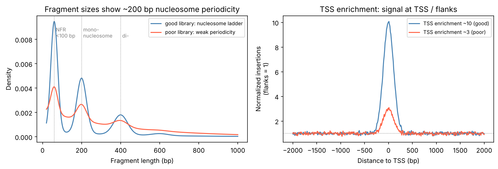

[基因體學](../README.md) › [定序技術](README.md) › ATAC-seq

# ATAC-seq (Assay for Transposase-Accessible Chromatin)

用高活性的 Tn5 轉位酶 (transposase) 把定序接頭直接插進**開放染色質**，再定序插入位置，得到全基因組的染色質可及性 (chromatin accessibility) 圖譜。它不需要抗體、起始量低（數萬顆細胞，單細胞版本也成熟），是找啟動子、增強子等調控區最常用的方法。

## 原理與資料特性

| 特性 | 說明 | 對分析的影響 |
| --- | --- | --- |
| Tagmentation | Tn5 同時切斷 DNA 並接上接頭；核小體 (nucleosome) 纏繞的 DNA 較難被插入 | 訊號 = 插入位點密度，不是 reads 覆蓋 |
| 9 bp 重複 | Tn5 插入時在兩端造成 9 bp 的重複 | 精確定位插入點要平移：+ 股 +4、− 股 −5（`--ATACshift`） |
| 片段長度分布 | 無核小體區 (NFR) < 100 bp、單核小體約 200 bp、雙核小體約 400 bp… | 呈現約 200 bp 週期的「核小體階梯」是品質好的標誌 |
| 粒線體 DNA | 沒有核小體保護，Tn5 大量插入 | 粒線體 reads 可佔 20–80%；Omni-ATAC 等改良方法可降低；分析前移除 |
| 背景 | 沒有 input 對照 | peak calling 用局部背景模型；重複區會出假 peak，要用 ENCODE blacklist 過濾 |

| ATAC-seq | ChIP-seq | DNase-seq / MNase-seq |
| --- | --- | --- |
| 開放染色質（所有調控區） | 特定蛋白質或組蛋白修飾的位置（見 [ChIP-seq](chip-seq.md)） | DNase：可及性（舊方法，需大量細胞）；MNase：核小體位置 |
| 不需抗體、低起始量、一天內完成 | 依賴抗體品質；需 input | 步驟多、起始量高 |

## 分析流程

```text
FASTQ ──修剪 Nextera 接頭（fastp / Trim Galore）
  ──► 比對（Bowtie2 --very-sensitive -X 2000）──► BAM
  ──► 過濾：移除 chrM、重複、MAPQ < 30、未成對、blacklist
  ──► Tn5 平移（+4 / −5）
  ──► QC：片段長度分布、TSS enrichment、FRiP、重複一致性
  ──► peak calling（MACS3 BAMPE / Genrich）──► 共識 peak ──► 計數
  ──► 差異可及性（DiffBind / DESeq2）、motif 富集（HOMER、chromVAR）、footprinting（TOBIAS）
```

標準化 pipeline：[nf-core/atacseq](https://nf-co.re/atacseq)、ENCODE ATAC-seq pipeline（執行方式見 [Nextflow](../../../computing/workflow-engines/nextflow/README.md)）。

```bash
# 1. 比對：-X 2000 允許長片段（多核小體）
bowtie2 --very-sensitive -X 2000 -p 8 -x hg38 -1 s1_R1.trim.fq.gz -2 s1_R2.trim.fq.gz \
  | samtools sort -n -o s1.nsort.bam -               # 依名稱排序，給 fixmate 用

# 2. 標記並移除重複（samtools 流程；亦可用 Picard MarkDuplicates）
samtools fixmate -m s1.nsort.bam - | samtools sort -o s1.pos.bam -
samtools markdup -r s1.pos.bam s1.dedup.bam && samtools index s1.dedup.bam

# 3. 過濾：成對且正確比對 (-f 2)、排除 unmapped / secondary / QC fail / dup (-F 1804)、MAPQ ≥ 30、排除 chrM
samtools idxstats s1.dedup.bam | awk '$1=="chrM"{m=$3} {t+=$3} END{print "chrM fraction:", m/t}'
chroms=$(samtools idxstats s1.dedup.bam | cut -f1 | grep -Ev '^(chrM|\*)$')
samtools view -b -f 2 -F 1804 -q 30 s1.dedup.bam $chroms \
  | bedtools intersect -v -abam stdin -b hg38-blacklist.v2.bed > s1.filt.bam
samtools index s1.filt.bam

# 4. Tn5 平移（輸出未排序，要重新排序）與片段長度 QC
alignmentSieve --ATACshift -b s1.filt.bam -o s1.shift.tmp.bam
samtools sort -o s1.shift.bam s1.shift.tmp.bam && samtools index s1.shift.bam
bamPEFragmentSize -b s1.filt.bam --histogram s1.fragsize.png

# 5. Peak calling：BAMPE 直接使用實際片段；重複已移除，--keep-dup all 避免再次過濾
macs3 callpeak -t s1.shift.bam -f BAMPE -g hs -n s1 -q 0.01 --keep-dup all --outdir peaks/
```

指令細節見 [samtools](../../bioinformatics-tools/ngs-tools/samtools.md)、[bedtools](../../bioinformatics-tools/ngs-tools/bedtools.md)、[Picard MarkDuplicates](../../bioinformatics-tools/ngs-tools/picard-markduplicates.md)。

## 品質指標

| 指標 | 意義 | 參考值（ENCODE 標準，依版本調整） |
| --- | --- | --- |
| 有效 reads 數 | 非重複、非粒線體、已比對 | 每個重複 ≥ 50 M reads（成對 = 25 M 片段） |
| TSS enrichment | TSS 處插入密度 ÷ 兩側背景 | 依註解版本而異；GRCh38 約 < 5 需注意、> 7 理想 |
| FRiP | 落在 peak 內的 reads 比例 | > 0.2 可接受、> 0.3 理想 |
| 片段長度分布 | 核小體階梯是否清楚 | NFR 峰明顯、可見 200 / 400 bp 峰 |
| 粒線體比例 | 細胞核是否乾淨 | 越低越好；過高代表有效深度被浪費 |
| 重複率、NRF / PBC | library complexity | 見 [重複率](../ngs-qc/duplication-rate.md) |
| 重複一致性 | IDR、peak 重疊 | 與 [ChIP-seq](chip-seq.md#peak-calling-與-qc) 相同做法 |



左：好的 library 有清楚的 NFR 峰與約 200 bp 的核小體週期；週期模糊、長片段拖尾代表過度或不足的 tagmentation、細胞狀態差。右：TSS enrichment 是單一最好用的品質分數，數值低通常代表訊號雜訊比差（細胞死亡、核製備不佳）。（示意圖，模擬資料）

## 下游分析

| 問題 | 方法 / 工具 | 注意 |
| --- | --- | --- |
| 條件間哪些區域可及性改變？ | 共識 peak → 計數 → DiffBind、DESeq2 / edgeR | 與 RNA-seq 相同的 [負二項模型](../../../data-science/statistics/regression-analysis/glm-count-models.md#過度離散與負二項迴歸)；樣本間 FRiP / TSS 差異大時標準化要小心（考慮背景 bin 標準化） |
| 哪些轉錄因子在驅動？ | HOMER、MEME-SM（motif 富集）、chromVAR（每樣本 motif 偏差分數） | motif 相似的 TF 家族難以區分，需搭配表現量 |
| 轉錄因子是否實際結合？ | Footprinting（TOBIAS、HINT-ATAC） | 需高深度；Tn5 序列偏好要校正 |
| peak 調控哪個基因？ | 最近基因、ChIPseeker、GREAT；與 Hi-C / eQTL 整合 | 增強子常不調控最近的基因 |
| 多組學整合 | 與 RNA-seq、[eQTL](../genome-wide-analysis/eqtl.md)、GWAS 風險位點交集 | 細胞類型特異性很強，要用相關組織 |

多個條件比較時，peak 也要做 [多重檢定校正](../../../data-science/statistics/inferential-statistics/multiple-testing.md)；批次效應與定序深度差異是常見的假陽性來源。

## 單細胞 ATAC (scATAC-seq)

| 項目 | 說明 |
| --- | --- |
| 平台 | 10x Genomics Single Cell ATAC、Multiome（同一顆細胞同時測 ATAC + RNA） |
| 資料特性 | 極度稀疏（每個區域多為 0 或 1–2 個插入），近乎二元 |
| 降維 | TF-IDF + SVD（LSI），第一個成分常與深度相關要捨棄 |
| 工具 | Signac（Seurat 生態）、ArchR、SnapATAC2 |
| 基因活性 | 以基因體周邊的可及性估計 gene activity score，再與 scRNA-seq 對應 |

單細胞分析的共通概念見 [單細胞 RNA-seq](single-cell-rna-seq/README.md)。

## 常見問題

| 狀況 | 可能原因 | 處理 |
| --- | --- | --- |
| 粒線體 reads > 50% | 細胞質未充分去除 | 改用 Omni-ATAC / 加去垢劑步驟；分析時移除 chrM 並注意有效深度 |
| 沒有核小體階梯 | Tn5 與細胞數比例不對、細胞死亡、凍存損傷 | 調整 Tn5 量；死細胞多時先用 DNase 或分選 |
| TSS enrichment 低但 reads 很多 | 背景高（死細胞 DNA 片段化） | 增加深度無法解決，需改善樣本 |
| 差異 peak 集中在高 GC / 特定染色體 | 技術偏差或批次 | 檢查 [GC 偏差](../ngs-qc/gc-bias.md)、PCA 是否依批次分群 |
