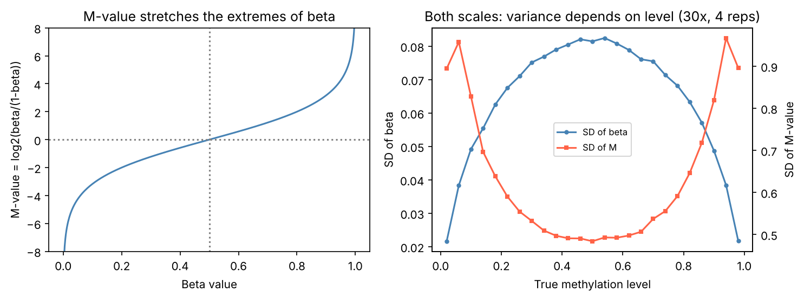

[基因體學](../README.md) › [定序技術](README.md) › DNA 甲基化定序

# DNA 甲基化定序 (DNA Methylation Sequencing)

DNA 甲基化（哺乳類主要是 CpG 上的 5-甲基胞嘧啶，5mC）是最穩定、最常被量測的表觀遺傳標記，與基因沉默、印記 (imprinting)、X 染色體失活、細胞分化與癌症有關。量測的核心是：**把「有沒有甲基」轉換成序列上看得到的差異**，再在每個 CpG 計算甲基化比例。

## 量測原理

| 方法 | 原理 | 優點 | 限制 |
| --- | --- | --- | --- |
| 亞硫酸鹽轉換 (bisulfite) | 未甲基化 C → U（PCR 後讀成 T）；5mC / 5hmC 不變 | 金標準、工具成熟 | DNA 嚴重斷裂與損失；GC 偏差；無法區分 5mC 與 5hmC |
| 酶轉換（EM-seq） | TET2 + APOBEC 酶反應，達到與 bisulfite 相同的 C → T 結果 | DNA 損傷少、低起始量、覆蓋更均勻 | 試劑較貴；分析流程與 bisulfite 相同 |
| oxBS / TAB-seq | 額外化學步驟區分 5mC 與 5hmC | 能分出 5hmC（腦組織重要） | 需兩組定序相減，雜訊大 |
| 長讀直接偵測 | PacBio（聚合酶動力學）、ONT（電流訊號）；不需轉換 | 同時得到單倍型與甲基化、重複區 | 準確度依模型與版本；結果存在 BAM 的 `MM` / `ML` tag |
| 甲基化陣列 | bisulfite 轉換後以探針雜交（Illumina EPIC 系列） | 便宜、大樣本、標準化流程成熟 | 只涵蓋預先設計的 CpG；探針交叉雜交、SNP 干擾 |

長讀平台的特性見 [定序平台](sequencing-platforms.md)。

## 實驗設計

| 方法 | 範圍 | 典型深度 | 適用 |
| --- | --- | --- | --- |
| WGBS / 全基因組 EM-seq | 全部約 2800 萬個 CpG | 每股約 10–30× | 探索性研究、參考圖譜、DMR |
| RRBS | MspI（CCGG）酶切富集 CpG island、啟動子；約數百萬 CpG | 高 | 成本低；遠端調控區涵蓋差 |
| 標靶甲基化定序 | 雜交捕捉或 amplicon | 很高 | 臨床檢測、cfDNA 甲基化（見 [液態切片](liquid-biopsy.md)） |
| 甲基化陣列 | 預選的數十萬 CpG | — | 流行病學、EWAS、表觀遺傳時鐘 |

> 生物重複比單一樣本的深度重要；組織樣本的**細胞組成差異**常是最大的變異來源（例如血液中嗜中性球比例），設計時就要記錄或估計。

## 分析流程（bisulfite / EM-seq）

```text
FASTQ ──修剪（Trim Galore；RRBS 加 --rrbs）
  ──► 比對到「轉換後」的參考基因組（Bismark / bwa-meth）
  ──► 去重複（WGBS 要；RRBS 不要：酶切片段本來就同起點）
  ──► 甲基化呼叫：每個 CpG 的 甲基化 reads / 總 reads
  ──► QC：轉換率、M-bias、CpG 覆蓋度
  ──► 差異甲基化：DMC（單一 CpG）/ DMR（區域）──► 註解與富集
```

```bash
# Bismark：以 Bowtie2 比對到 C→T 與 G→A 轉換後的基因組
bismark_genome_preparation --parallel 4 genome/
bismark --genome genome/ -1 s1_R1_val_1.fq.gz -2 s1_R2_val_2.fq.gz --parallel 4 -o align/
deduplicate_bismark --paired --bam align/s1_R1_val_1_bismark_bt2_pe.bam
bismark_methylation_extractor --paired-end --gzip --bedGraph --cytosine_report \
  --genome_folder genome/ align/s1_R1_val_1_bismark_bt2_pe.deduplicated.bam
bismark2report && bismark2summary                    # HTML 報告：比對率、轉換率、M-bias
# 輸出 *.bismark.cov.gz：chr  start  end  甲基化%  甲基化 reads 數  未甲基化 reads 數
```

替代流程：`bwa-meth` + `MethylDackel`（較快）；標準化 pipeline：[nf-core/methylseq](https://nf-co.re/methylseq)。

## 品質指標

| 指標 | 意義 | 參考值 / 判讀 |
| --- | --- | --- |
| 轉換率 (conversion rate) | 未甲基化 C 被轉換的比例；用非 CpG 情境（CHH）甲基化或 lambda DNA spike-in 估計 | > 99%；不足會高估甲基化 |
| M-bias 圖 | 甲基化比例沿 read 位置的變化 | 平坦為佳；兩端偏移要在 extractor 中忽略（`--ignore`、`--ignore_r2`） |
| 比對率 | 轉換後序列複雜度降低，比對率比一般 DNA-seq 低 | WGBS 常見 60–80% |
| CpG 覆蓋度 | 每個 CpG 的 reads 數 | 單一 CpG 分析通常要求 ≥ 10×；低覆蓋改用區域分析 |
| C>T SNP | 真正的 C>T 變異會被誤判為未甲基化 | 用另一股（G>A）資訊或排除已知 SNP 位置 |

## Beta 值與 M 值

| 指標 | 定義 | 用途 |
| --- | --- | --- |
| Beta (β) | 甲基化 / (甲基化 + 未甲基化)；陣列加常數 α = 100 穩定分母 | 解讀與報告（0–1，即甲基化比例） |
| M-value | log₂(β / (1 − β)) | 陣列資料的統計檢定（較接近常態、變異較穩定） |



左：M 值把接近 0 或 1 的 β 拉開。右：以 30× 覆蓋、4 個重複模擬，β 的標準差在中間最大、兩端被壓縮；M 值在兩端反而被放大。兩種尺度的變異都與甲基化程度有關，所以**定序資料通常直接對甲基化 / 未甲基化 reads 計數建模**（beta-binomial），而不是對 β 做 t 檢定。（模擬資料）

## 差異甲基化

| 資料 | 工具 | 模型 |
| --- | --- | --- |
| 定序（WGBS / RRBS / EM-seq） | methylKit、DSS、dmrseq、bsseq | logistic / beta-binomial；DSS 用經驗貝氏收縮離散度；dmrseq 以區域為單位控制 FDR |
| 陣列 | minfi、sesame（前處理）；limma（對 M 值） | 線性模型 + 經驗貝氏，見 [limma](../workflows/limma-differential-expression.md) |
| 細胞組成校正 | EpiDISH、Houseman 法（參考甲基化圖譜去卷積） | 把估計的細胞比例當共變數 |

```r
library(methylKit)
files <- list("ctrl1.bismark.cov.gz", "ctrl2.bismark.cov.gz", "trt1.bismark.cov.gz", "trt2.bismark.cov.gz")
obj <- methRead(files, sample.id = list("c1", "c2", "t1", "t2"), assembly = "hg38",
                treatment = c(0, 0, 1, 1), context = "CpG", pipeline = "bismarkCoverage")
obj  <- filterByCoverage(obj, lo.count = 10, hi.perc = 99.9)   # 去掉低覆蓋與極端高覆蓋（PCR 重複）
obj  <- normalizeCoverage(obj)
meth <- unite(obj, destrand = TRUE)                             # 合併兩股、保留所有樣本都有覆蓋的 CpG
diff <- calculateDiffMeth(meth, covariates = NULL, mc.cores = 4) # logistic 回歸 + 過度離散校正（overdispersion = "MN" 可選）
sig  <- getMethylDiff(diff, difference = 25, qvalue = 0.01)      # |Δ甲基化| ≥ 25% 且 q < 0.01
```

## 常見陷阱

| 陷阱 | 說明 |
| --- | --- |
| 細胞組成混淆 | 疾病組的細胞比例不同，就會出現「差異甲基化」；先估計並校正 |
| 只看單一 CpG | 相鄰 CpG 高度相關，DMR 比 DMC 更穩健也更容易解讀 |
| 效應量太小 | 統計顯著但 Δβ < 5% 的差異生物意義常有限；同時報告效應量 |
| 陣列探針問題 | 交叉雜交探針、含 SNP 探針、性染色體探針要過濾；批次（晶片、位置）明顯 |
| 5hmC 被當成 5mC | bisulfite 與 EM-seq 都無法區分；腦組織尤其重要 |
| 多重檢定 | 數百萬 CpG 同時檢定，必須控制 FDR，見 [多重檢定](../../../data-science/statistics/inferential-statistics/multiple-testing.md) |

## 應用

| 應用 | 例子 |
| --- | --- |
| 癌症 | 腫瘤抑制基因啟動子高甲基化（*MGMT* 甲基化預測 temozolomide 反應）、甲基化分類器（中樞神經腫瘤分型） |
| 液態切片 | cfDNA 甲基化判斷組織來源、早期多癌篩檢 |
| 表觀遺傳時鐘 | Horvath、GrimAge 等以數百個 CpG 預測年齡 / 生物年齡 |
| 印記疾病 | Prader–Willi / Angelman（15q11-13 甲基化分析） |
| 重複擴增 | FMR1 全突變伴隨甲基化，見 [Southern blot](../../molecular-biology/experimental-methods/southern-blot.md) |
