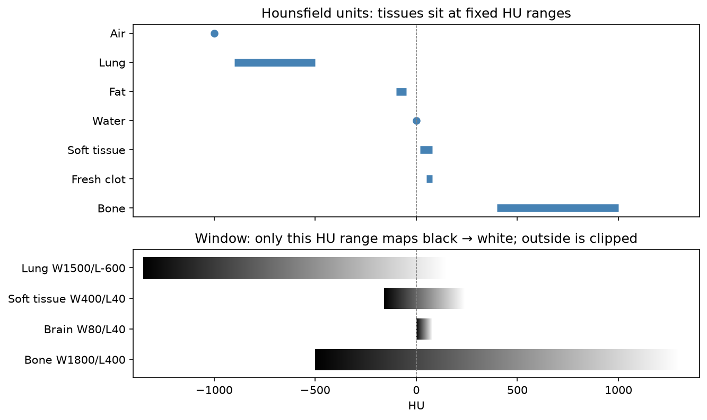

[Biology](../README.md) › [醫學影像](README.md) › X 光與 CT

# X 光與電腦斷層 (X-ray and CT)

X 光與 CT 都是量測 X 光穿過人體後的**衰減**：X 光得到一張投影影像（所有結構疊在一起），電腦斷層 (computed tomography, CT) 從多個角度量測後重建出橫切面，每個 voxel 有一個有絕對意義的衰減值（Hounsfield unit）。

## X 光 vs CT

| 項目 | X 光 | CT |
| --- | --- | --- |
| 影像 | 2D 投影，結構重疊 | 3D 斷層 volume |
| 典型劑量 | 胸部 X 光約 0.1 mSv 以下 | 胸部 / 腹部 CT 約數 mSv 至 10 mSv（依部位與協定） |
| 用途 | 骨折、胸部初步評估、管路位置 | 急診（出血、創傷）、肺結節、癌症分期、術前規劃 |
| 軟組織對比 | 差 | 中等；需要時打碘顯影劑 |

> 一般人每年自然背景輻射約 2–3 mSv，可用來理解劑量大小。CT 的劑量比 X 光高一到兩個數量級，兒童與重複檢查要特別注意「合理抑低」(ALARA)。

## Hounsfield Unit 與 Windowing

HU 以水為 0、空氣為 −1000 定義：$HU = 1000 \times (\mu - \mu_{water}) / (\mu_{water} - \mu_{air})$。因為是絕對單位，同一組織在不同機器上的 HU 大致相同，這是 CT 能直接用閾值分割（肺、骨）的原因。

| 組織 | HU（約） |
| --- | --- |
| 空氣 | −1000 |
| 肺 | −900 至 −500 |
| 脂肪 | −100 至 −50 |
| 水 / 腦脊髓液 | 0 |
| 軟組織、肌肉 | +20 至 +80 |
| 新鮮血塊 | +50 至 +80（比腦實質亮，所以 CT 能快速看出血） |
| 骨 | +400 至 +1000 以上 |

CT 的數值範圍約 −1000 到 +3000，螢幕只能顯示 256 階灰階，所以用 **window**：選一段 HU 範圍（寬度 W、中心 L）拉成黑到白，範圍外全黑或全白。

| Window | W / L（常見值） | 看什麼 |
| --- | --- | --- |
| 肺 | 1500 / −600 | 肺實質、結節 |
| 軟組織 / 縱膈 | 400 / 40 | 腹部器官、淋巴結 |
| 腦 | 80 / 40 | 腦實質、出血 |
| 骨 | 1800 / 400 | 骨折、骨轉移 |

> 腦 window 只有 80 HU 寬，灰白質差幾 HU 就看得出來；同一張影像用骨 window 看，腦就是一片灰。深度學習前處理時常把 HU clip 到任務相關的 window 再正規化，或把多個 window 當成多個 channel。

## 顯影劑與假影

| 項目 | 說明 |
| --- | --- |
| 碘顯影劑 | 提高血管與富血流組織的對比；分動脈期、門脈期、延遲期。風險：過敏樣反應、腎功能差者的顯影劑腎病變 |
| 金屬假影 (metal artifact) | 植入物周圍的放射狀條紋；有專用的金屬假影抑制重建 |
| 射束硬化 (beam hardening) | 骨頭之間出現暗帶（如後顱窩） |
| 部分體積效應 (partial volume) | 一個 voxel 包含多種組織，小結構的 HU 被平均；切片越厚越嚴重 |
| 移動假影 | 呼吸、心跳造成模糊或重影 |

## 資料分析時的注意

| 問題 | 說明 |
| --- | --- |
| 原始值轉 HU | DICOM 像素要乘 `RescaleSlope` 再加 `RescaleIntercept` 才是 HU（`pydicom` / SimpleITK 讀取時可自動處理） |
| 切片厚度與重建 kernel | 薄切 + 銳利 kernel 雜訊多；radiomics 特徵對這些參數敏感，跨醫院資料要記錄並統一 |
| 各向異性 spacing | 平面內 0.7 mm、切片間 5 mm 很常見，3D 模型前要 resample，見 [Resampling](../../data-science/image-analysis/biomedical-image-analysis.md#resampling-與-interpolation) |

相關：[生醫影像分析](../../data-science/image-analysis/biomedical-image-analysis.md)、[PET](pet.md)（PET-CT 用 CT 做衰減校正）。
