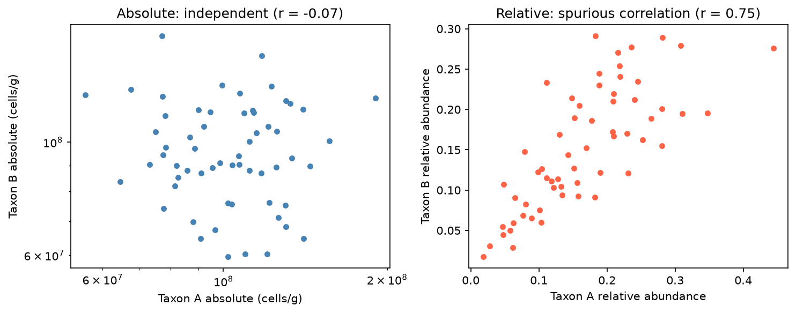

[Biology](../README.md) › [微生物體](README.md) › 16S 分析

# 16S rRNA 擴增子分析 (16S rRNA Amplicon Analysis)

16S rRNA 基因（約 1,500 bp）同時有保守區與 9 個高變異區 (V1–V9)：保守區用來設計通用引子，高變異區用來區分分類群。只定序這一個標記基因就能便宜地描述大量樣本的細菌群落組成。

## 擴增區選擇

| 區域 | 常用引子 | 讀長 | 特性 |
| --- | --- | --- | --- |
| V4 | 515F / 806R（Earth Microbiome Project） | Illumina 2×250 | 擴增子約 250 bp，雙端完全重疊、錯誤率低；最常見 |
| V3–V4 | 341F / 805R（Illumina 16S protocol） | Illumina 2×300 | 約 460 bp，屬層級解析度稍好；read 尾端品質差時接合困難 |
| 全長 V1–V9 | 27F / 1492R | PacBio HiFi、ONT | 可到種層級；成本較高 |

> 不同區域、引子得到的菌相不能直接合併比較；跨研究整合要用同一區域或改用 shotgun。

## 流程

```text
raw FASTQ → 去引子（cutadapt）→ 品質過濾 / 去噪（DADA2 或 Deblur）→ ASV 表 + 代表序列
→ 去嵌合體 (chimera) → 分類指派（naive Bayes 分類器 + SILVA / Greengenes2）
→ 去除粒線體 / 葉綠體 / 汙染 → 演化樹 → α / β 多樣性 → 差異豐度
```

| 步驟 | 輸出 | 檢查點 |
| --- | --- | --- |
| 去噪 | ASV × 樣本計數表 | 每步保留的 reads 比例（過濾、接合、去嵌合後應仍有大部分） |
| 分類指派 | 每個 ASV 的界→屬（→種） | 未分類比例；屬以下的指派信心較低 |
| 汙染控制 | 清理後的表 | 萃取空白、PCR 空白；低菌量檢體用 `decontam` |
| 定序深度 | 每樣本 reads 數 | 稀釋曲線 (rarefaction curve) 是否趨於平緩 |

### ASV vs OTU

| | OTU（operational taxonomic unit） | ASV（amplicon sequence variant） |
| --- | --- | --- |
| 方法 | 序列以 97% 相似度聚類 | 建立錯誤模型，推回真實序列（單鹼基解析） |
| 跨研究比較 | 聚類結果依資料集而變 | 序列本身就是 ID，可直接合併 |
| 現況 | 舊工具（mothur、UPARSE） | DADA2、Deblur、UNOISE3；目前主流 |

```r
library(dada2)
# V4、Illumina 2×250：截短長度要保留足夠重疊（約 250 bp 擴增子 + ≥ 12 bp 重疊）
filterAndTrim(fnF, filtF, fnR, filtR, truncLen = c(240, 160), maxEE = c(2, 2),
              rm.phix = TRUE, multithread = TRUE)
errF <- learnErrors(filtF, multithread = TRUE)        # 學習錯誤模型
errR <- learnErrors(filtR, multithread = TRUE)
ddF  <- dada(filtF, err = errF, multithread = TRUE)   # 去噪 → ASV
ddR  <- dada(filtR, err = errR, multithread = TRUE)
merged <- mergePairs(ddF, filtF, ddR, filtR)
seqtab <- removeBimeraDenovo(makeSequenceTable(merged), method = "consensus")
taxa   <- assignTaxonomy(seqtab, "silva_nr99_train_set.fa.gz")  # DADA2 網站提供的格式化 SILVA
```

QIIME 2 以同樣演算法包成外掛（`qiime dada2 denoise-paired`、`qiime feature-classifier classify-sklearn`），並自動記錄資料來源 (provenance)。

## 多樣性 (Diversity)

| 類型 | 指標 | 意義 |
| --- | --- | --- |
| α（樣本內） | Observed ASVs、Chao1 | 豐富度 (richness) |
| | Shannon、Simpson | 豐富度 + 均勻度 (evenness) |
| | Faith's PD | 考慮演化距離的多樣性 |
| β（樣本間） | Bray–Curtis | 依豐度的差異 |
| | Jaccard | 只看有 / 無 |
| | UniFrac（unweighted / weighted） | 考慮演化樹；unweighted 對稀有菌敏感 |

β 多樣性通常以 PCoA 視覺化，用 PERMANOVA（`vegan::adonis2`）檢定組間差異；PERMANOVA 對組內離散度不同也敏感，需搭配 `betadisper` 檢查。降維的概念見 [PCA](../../data-science/machine-learning/unsupervised-learning/dimensionality-reduction/pca.md)。

## 組成資料與差異豐度

定序深度是儀器決定的，不代表菌量，因此每個樣本只能得到**相對豐度**（加總為 1）。一個優勢菌增加，其他菌的比例都會下降，即使它們的絕對量沒變。



模擬 60 個樣本：A、B 的絕對量彼此獨立 (r = −0.07)，但優勢菌 C 大幅波動時兩者同時被稀釋，相對豐度出現 r = 0.75 的假相關。

| 議題 | 做法 |
| --- | --- |
| 正規化 | CLR (centered log-ratio) 轉換；稀釋抽樣 (rarefying) 用於多樣性仍常見，但丟資料，差異豐度不建議 |
| 零值多 | CLR 前需加 pseudocount；或用處理零膨脹的模型 |
| 差異豐度 | ANCOM-BC2、ALDEx2、MaAsLin 2/3、LinDA；不同方法結果常不一致，建議至少用兩種並報告交集 |
| 絕對量 | 需加 spike-in、qPCR 測總 16S 拷貝數或流式細胞計數 |
| 多重檢定 | 數百個分類群同時檢定，需 [FDR 校正](../../data-science/statistics/inferential-statistics/multiple-testing.md) |

## 限制

| 限制 | 說明 |
| --- | --- |
| 解析度 | V4 通常只到屬；近緣種（如 *E. coli* vs *Shigella*）無法區分 |
| 16S 拷貝數 | 不同菌每個基因體有 1–15 個拷貝，豐度會偏向高拷貝菌 |
| 引子偏差 | 引子錯配讓某些類群被低估（如 27F 低估 *Bifidobacterium*；原始 515F/806R 低估 SAR11，後經 Parada / Apprill 修正） |
| 無功能資訊 | PICRUSt2 只能從近緣基因體推測，不能取代 [shotgun](shotgun-metagenomics.md) |
| 批次效應 | 萃取試劑組、定序批次影響大；用 mock community（如 ZymoBIOMICS）監控 |

分類學指派原理（RDP Classifier 以 8-mer + Naive Bayes）見 [Naive Bayes](../../data-science/machine-learning/supervised-learning/classification/naive-bayes.md)；參考資料庫見[微生物體資料庫](microbiome-databases.md)。
