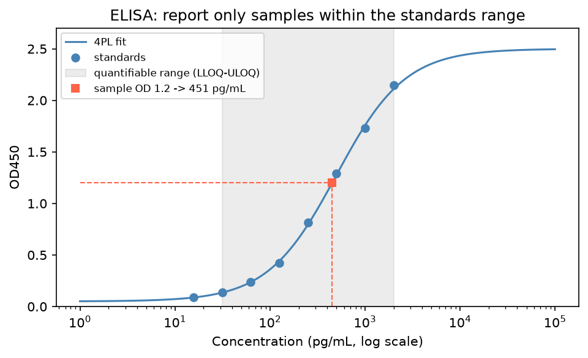

[分子生物學](../README.md) › [實驗方法](README.md) › ELISA

# 酵素連結免疫吸附分析 (ELISA)

以抗體專一辨認抗原、再用酵素反應（常為 HRP + TMB 呈色）放大訊號，定量檢體中的蛋白質（抗原）或抗體。血清細胞激素、腫瘤標記、感染後抗體力價都常用 ELISA 量測。

## 四種格式

| 格式 | 結構 | 測什麼 | 特性 |
| --- | --- | --- | --- |
| 直接 (direct) | 抗原固定在盤上 → 酵素標記一級抗體 | 抗原 | 步驟少；無二級放大，靈敏度較低 |
| 間接 (indirect) | 抗原固定 → 一級抗體（檢體中的抗體）→ 標記二級抗體 | 抗體（血清學） | 二級抗體放大訊號；用於抗體力價 |
| 夾心 (sandwich) | 捕捉抗體 → 抗原 → 偵測抗體 → 酵素 | 抗原 | 需兩個不同表位的抗體配對；專一與靈敏度最高，細胞激素最常用 |
| 競爭 (competitive) | 檢體抗原與標記抗原競爭有限的抗體 | 小分子 / 單一表位抗原 | 訊號與濃度**成反比** |

## 標準曲線與定量

用已知濃度的標準品做系列稀釋，以四參數邏輯迴歸 (4PL) 擬合，再由樣本吸光值反推濃度：

$$y = d + \frac{a - d}{1 + (x / c)^b}$$

| 參數 | 意義 |
| --- | --- |
| a / d | 濃度 0 / 無限大時的吸光值（下 / 上平台） |
| c | 反曲點（約為 EC50） |
| b | 斜率（Hill slope） |

樣本只在最低與最高標準品之間（定量下限 LLOQ 至上限 ULOQ）可信；高於上限要稀釋重測，低於下限報「< LLOQ」，不要用曲線外推。平台區的 OD 稍微變動就對應很大的濃度差。

## 品質指標

| 指標 | 一般要求 | 說明 |
| --- | --- | --- |
| 重複孔 CV | < 10–15% | 移液與洗盤一致性 |
| 標準品回算 | 回算值在名目濃度 ±20% 內 | 擬合是否合適 |
| Spike recovery | 約 80–120% | 檢體基質（血清、血漿）是否干擾 |
| 稀釋線性 | 稀釋後回算濃度一致 | 基質效應、hook effect |
| 空白 / 背景 | 低且穩定 | blocking 與洗盤是否足夠 |

| 常見問題 | 原因 |
| --- | --- |
| Hook effect | 夾心法中抗原極高時同時飽和兩種抗體，訊號反而下降 → 偽低值；稀釋後重測 |
| 異嗜性抗體 / 類風濕因子 | 橋接捕捉與偵測抗體造成偽陽性 |
| 跨批差異 | 不同批號套組的絕對值可能不同；縱向研究盡量同批或以對照校正 |

> 不同廠牌的 ELISA 套組量測的是同一蛋白的不同表位，絕對濃度常不可直接比較。多標的同時量測可用 Luminex、Olink、MSD 等多重平台；檢體前處理（血清 vs 血漿、溶血）的影響見[檢體類型](../../laboratory-medicine/sample-types/README.md)。

相關：[細胞激素](../../immunology/cytokines.md)、[免疫標記的量測方法](../../immunology/immune-marker.md#量測方法)、[Western blot](western-blot.md)、[病毒檢測（血清學）](virus-detection-method.md)。
