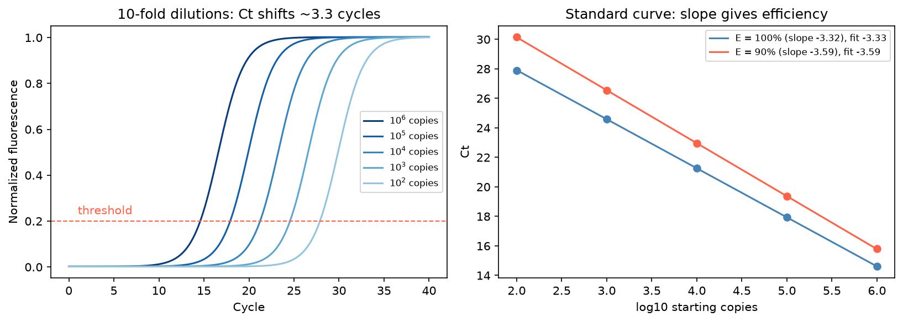

[分子生物學](../README.md) › [實驗方法](README.md) › qPCR

# 即時定量 PCR (qPCR)

在 PCR 每個循環即時偵測螢光，用「螢光越過閾值所需的循環數」反推起始模板量。它是基因表現、病毒量與拷貝數定量最常用的方法，也是驗證 RNA-seq 差異表現的標準工具。

## PCR 家族

| 名稱 | 起始模板 | 輸出 | 典型用途 |
| --- | --- | --- | --- |
| PCR | DNA | 終點產物（跑膠看有無 / 大小） | 選殖、基因分型、產物定序 |
| RT-PCR | RNA → cDNA（反轉錄） | 終點產物 | 偵測轉錄本、剪接型 |
| qPCR (real-time PCR) | DNA | 每循環的螢光 → Ct | 拷貝數、病原 DNA 定量 |
| RT-qPCR | RNA → cDNA | Ct | 基因表現、RNA 病毒（如 SARS-CoV-2）|
| 數位 PCR (dPCR / ddPCR) | DNA / cDNA | 陽性分區比例 → 絕對拷貝數 | 低頻突變、[液態切片](../../genomics/sequencing-techniques/liquid-biopsy.md)、不需標準曲線 |

> 「RT-PCR」常被誤用來指 real-time PCR；嚴謹寫法是 RT-qPCR（反轉錄 + 即時定量）。

## 偵測化學

| | SYBR Green | TaqMan（水解探針） |
| --- | --- | --- |
| 原理 | 染料嵌入任何雙股 DNA | 探針 5' 螢光 / 3' 淬滅；聚合酶 5'→3' 外切活性切開探針後發光 |
| 專一性 | 依賴引子；primer dimer 與非專一產物也會發光 | 引子 + 探針雙重專一 |
| 檢查 | 必做熔解曲線 (melt curve)：單一峰 = 單一產物 | 不需熔解曲線 |
| 多重 (multiplex) | 不行 | 可用不同螢光同管測多個目標 |
| 成本 | 低 | 高（每個目標一條探針） |

## Ct 與擴增效率

閾值循環數 (Ct / Cq) 是螢光越過背景閾值的循環數。理想效率下每循環產物加倍，因此起始量差 10 倍，Ct 差 log₂10 ≈ 3.32 個循環。

用 10 倍系列稀釋做標準曲線，以斜率估計效率：

$$E = 10^{-1/\text{slope}} - 1$$

| 斜率 | 效率 | 判讀 |
| --- | --- | --- |
| −3.32 | 100% | 理想 |
| −3.1 ~ −3.6 | 約 90–110% | 一般可接受範圍（另要求 R² > 0.98） |
| < −3.6（如 −3.9） | < 90% | 引子設計不佳、抑制物、反應條件 |
| > −3.1 | > 110% | 常見於抑制物在高濃度點、primer dimer、移液誤差 |



左：10 倍稀釋的擴增曲線間隔約 3.3 個循環；右：效率 90% 時斜率變陡（−3.59），同樣的 Ct 差代表更大的量差，若仍假設 100% 會低估倍數變化。

## 相對定量：ΔΔCt

```text
ΔCt  = Ct(目標基因) − Ct(參考基因)            # 每個樣本先對參考基因正規化
ΔΔCt = ΔCt(處理組) − ΔCt(對照組)
倍數變化 = 2^(−ΔΔCt)
```

例：處理組 目標 24 / 參考 18 → ΔCt = 6；對照組 目標 26 / 參考 18 → ΔCt = 8；ΔΔCt = −2 → 倍數變化 2² = 4（處理組表現量為 4 倍）。

| 前提 / 問題 | 處理 |
| --- | --- |
| 目標與參考基因效率都接近 100% | 效率不同時改用 Pfaffl 法（以各自的實測效率取代 2） |
| 參考基因在各條件下穩定 | 用 geNorm / NormFinder 從多個候選挑選，建議用 ≥ 2 個參考基因的幾何平均 |
| 統計檢定 | 對 ΔCt（已是 log₂ 尺度）做 t 檢定 / 線性模型，不要對 2^(−ΔΔCt) 倍數直接做檢定 |
| 重複 | 技術重複（同 cDNA 多孔）只降低量測誤差；推論需要**生物重複**，見[生物 vs 技術重複](../../../data-science/statistics/experimental-design/core-concepts.md#生物實驗中的重複) |

```python
import numpy as np
from scipy import stats

# 每列一個生物重複：目標與參考基因的 Ct（技術重複先取平均）
ctrl = {"target": np.array([26.1, 25.8, 26.3]), "ref": np.array([18.0, 17.9, 18.2])}
trt  = {"target": np.array([24.0, 24.3, 23.8]), "ref": np.array([18.1, 18.0, 17.9])}

d_ctrl = ctrl["target"] - ctrl["ref"]            # ΔCt
d_trt  = trt["target"] - trt["ref"]
ddct = d_trt.mean() - d_ctrl.mean()               # -2.0
fold = 2 ** -ddct                                 # 4.0
stats.ttest_ind(d_trt, d_ctrl)                    # 在 ΔCt 尺度檢定：t = -13.4, p = 0.0002
```

## 品質控制（MIQE 要點）

| 項目 | 目的 |
| --- | --- |
| NTC（無模板對照） | 偵測試劑汙染、primer dimer |
| No-RT 對照 | 偵測基因體 DNA 汙染（另可讓引子跨越外顯子接合處） |
| RNA 品質 | RIN / DV200、A260/280；降解會讓長擴增子 Ct 變大 |
| 擴增子 | 70–200 bp、專一性以 Primer-BLAST 檢查，見[引子設計](../../bioinformatics-tools/primer-design/README.md) |
| 高 Ct | Ct > 35 接近單拷貝，Poisson 抽樣變異大，結果不可靠 |
| 報告 | MIQE 指引（Bustin 2009；2025 年更新為 MIQE 2.0）要求列出引子序列、效率、參考基因與重複數 |

## 驗證 RNA-seq 結果

| 原則 | 說明 |
| --- | --- |
| 選基因 | 涵蓋上調、下調、無差異，且不只挑最顯著的 |
| 樣本 | 理想上用獨立的生物樣本，而非同一份 RNA |
| 比較 | 比較 log₂ 倍數變化的方向與相關性，而不是要求數值完全相同 |
| 低表現基因 | RNA-seq 計數少時本來不穩定，qPCR 不一致不一定代表錯誤 |

相關：[RNA-seq 差異表現](../../genomics/workflows/rna-seq/07-differential-expression.md)、[病毒檢測方法](virus-detection-method.md)、[寡核苷酸純化等級](oligonucleotide-synthesis-and-purification.md)。

<sub>參考：[Enzo：PCR / RT-PCR / qPCR / RT-qPCR 的差異](https://www.enzo.com/note/what-are-the-differences-between-pcr-rt-pcr-qpcr-and-rt-qpcr/)、[QIAGEN FAQ](https://www.qiagen.com/us/resources/faq/2672)、[SYBR vs TaqMan（中文）](https://yourgene.pixnet.net/blog/posts/7088168005)</sub>
