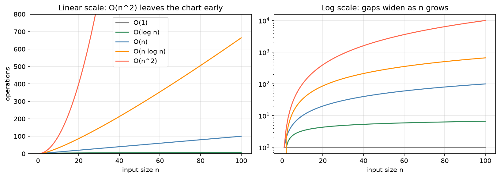

[Computing](../README.md) › [CS 基礎](README.md) › 演算法與複雜度

# 演算法與複雜度 (Algorithms and Complexity)

演算法 (algorithm) 是解決問題的明確步驟；同一個問題通常有多種演算法，取捨在於正確性與效率。複雜度分析問的是：**輸入變大時，時間與記憶體怎麼成長**。這比實際計時更有用，因為硬體會變，成長型態不會。

## 時間與空間複雜度

| 指標 | 問題 |
| --- | --- |
| 時間複雜度 (time complexity) | 執行步驟數隨輸入大小 n 如何成長？ |
| 空間複雜度 (space complexity) | 額外記憶體隨 n 如何成長？（不含輸入本身） |

| 情況 | 意義 | 例：線性搜尋 |
| --- | --- | --- |
| 最佳 (best case) | 最幸運的輸入 | 第一個就找到，`O(1)` |
| 平均 (average case) | 典型輸入的期望值 | `O(n)` |
| 最壞 (worst case) | 最不利的輸入；最常報告的保證 | 不存在或在最後，`O(n)` |
| 攤銷 (amortized) | 一連串操作平均到每次的成本 | Python `list.append` 偶爾要擴容，攤銷 `O(1)` |

## Big-O

Big-O 描述成長的**上界**，忽略常數與低次項，只留主導項：`3n² + 10n + 5` → `O(n²)`。

| 複雜度 | 名稱 | n = 10⁶ 時約略步數 | 典型例子 |
| --- | --- | --- | --- |
| `O(1)` | 常數 | 1 | 陣列索引、`dict` 查詢 |
| `O(log n)` | 對數 | 20 | 二分搜尋、平衡樹查詢 |
| `O(n)` | 線性 | 10⁶ | 掃過一次、線性搜尋 |
| `O(n log n)` | 線性對數 | 2 × 10⁷ | 合併排序、`sorted()` |
| `O(n²)` | 平方 | 10¹² | 兩兩比較、氣泡排序、巢狀迴圈 |
| `O(2ⁿ)` | 指數 | 天文數字 | 列舉所有子集 |

左圖 n 只到 100，`O(n²)` 早已超出畫面；右圖用對數軸，各類別的差距隨 n 持續拉大。n 小時常數因子可能讓「慢」的演算法更快，n 大時成長率決定一切。

| 相關記號 | 意義 |
| --- | --- |
| `O(f)` | 上界：不會比 f 成長得快 |
| `Ω(f)` | 下界：至少和 f 一樣快 |
| `Θ(f)` | 緊界：上下界都是 f |

> 比較型排序的下界是 `Ω(n log n)`：只靠「比大小」的排序不可能更快。

## 如何估算

| 程式結構 | 複雜度 |
| --- | --- |
| 依序執行的區塊 | 取最大的那一個 |
| 迴圈跑 n 次，內部 `O(1)` | `O(n)` |
| 兩層巢狀迴圈各 n 次 | `O(n²)` |
| 每步把問題砍半 | `O(log n)` |
| 切半遞迴 + 每層線性合併 | `O(n log n)` |
| 迴圈內呼叫 `x in list` | `O(n)` × 迴圈次數，常是隱藏的 `O(n²)` |

## 實務上的意義

| 情境 | 慢的寫法 | 快的寫法 |
| --- | --- | --- |
| 判斷成員 | `x in my_list`，`O(n)` | `x in my_set`，`O(1)` 平均 |
| 兩表比對 ID | 雙層迴圈，`O(n·m)` | 一邊轉成 `set` / `dict`，`O(n + m)`；或 pandas `merge` |
| 重疊區間（基因組區段） | 每對區間都比 | 先排序再掃描，或區間樹（[bedtools](../../biology/bioinformatics-tools/ngs-tools/bedtools.md)） |
| 序列比對到參考基因組 | 每個位置都試 | 建索引（FM-index、雜湊）後查詢 |
| 數值運算 | Python 迴圈 | NumPy 向量化（複雜度相同，常數小上百倍） |

> 時間與空間常互相交換：建索引或雜湊表用記憶體換時間。依工作負載的限制（記憶體上限、查詢次數）選擇，而不是只看單一指標。效能調校的實務見 [效能與擴展](../../data-science/python-foundations/performance-and-scaling/README.md)。

## 演算法家族

| 家族 | 任務 | 筆記 |
| --- | --- | --- |
| 搜尋 | 找某個值在不在、在哪 | [搜尋演算法](search-algorithms.md) |
| 排序 | 依規則重新排列 | [排序演算法](sorting-algorithms.md) |
| 圖演算法 | 在關係上走訪、找最短路徑 | [圖走訪](graph-traversal.md) |
| 資料結構 | 決定哪些操作快 | [線性](linear-data-structures.md)、[非線性](non-linear-data-structures.md) |

| 設計策略 | 想法 | 例子 |
| --- | --- | --- |
| 暴力法 (brute force) | 試所有可能 | 線性搜尋 |
| 分治法 (divide and conquer) | 切成子問題、遞迴解、合併 | 合併排序、快速排序、二分搜尋 |
| 貪婪法 (greedy) | 每步選當下最好的 | Dijkstra 最短路徑 |
| 動態規劃 (dynamic programming) | 子問題重疊時，記住答案不重算 | 序列比對（Needleman-Wunsch、Smith-Waterman）、編輯距離 |
