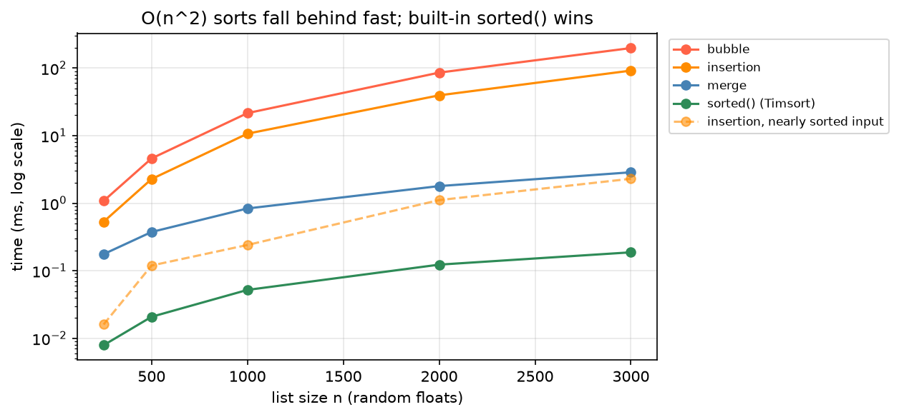

[Computing](../README.md) › [CS 基礎](README.md) › 排序演算法

# 排序演算法 (Sorting Algorithms)

排序把資料依規則（升冪、降冪、自訂 key）重新排列。排序常不是目的，而是後續操作的準備：讓[二分搜尋](search-algorithms.md)可行、讓重複值相鄰以便去重、讓兩個序列能線性合併。實務上直接用 `sorted()`；學排序是為了建立複雜度與分治法的直覺。

## 比較

| 演算法 | 想法 | 平均 | 最壞 | 額外空間 | 穩定 | 教學重點 |
| --- | --- | --- | --- | --- | --- | --- |
| 氣泡排序 (bubble) | 反覆比較相鄰元素，順序錯就交換 | `O(n²)` | `O(n²)` | `O(1)` | 是 | 重複掃描與相鄰交換 |
| 選擇排序 (selection) | 每輪找剩餘最小值放到前面 | `O(n²)` | `O(n²)` | `O(1)` | 否 | 選出下一個正確元素；交換次數少 |
| 插入排序 (insertion) | 把新元素插入前面已排序區段 | `O(n²)` | `O(n²)` | `O(1)` | 是 | 維持已排序前綴；**近乎排序時接近 `O(n)`** |
| 合併排序 (merge) | 切半、各自排序、合併 | `O(n log n)` | `O(n log n)` | `O(n)` | 是 | 分治法 |
| 快速排序 (quick) | 選 pivot 分區，左右遞迴 | `O(n log n)` | `O(n²)` | `O(log n)` | 否 | 分區；pivot 選不好會退化 |
| 堆積排序 (heap) | 建 [heap](non-linear-data-structures.md#堆積-heap) 後反覆取最小值 | `O(n log n)` | `O(n log n)` | `O(1)` | 否 | 用資料結構排序 |
| Timsort（Python `sorted`） | 合併排序 + 插入排序，利用既有的已排序片段 | `O(n log n)` | `O(n log n)` | `O(n)` | 是 | 實務標準 |

> **穩定 (stable)**：鍵值相同的元素維持原本的相對順序。先依次要欄位排、再依主要欄位穩定排序，就能做多欄排序；pandas `sort_values(kind="stable")`。

## 實作

```python
def bubble_sort(values):
    items = values[:]
    for end in range(len(items) - 1, 0, -1):
        swapped = False
        for i in range(end):
            if items[i] > items[i + 1]:
                items[i], items[i + 1] = items[i + 1], items[i]
                swapped = True
        if not swapped:                          # 一輪都沒交換 → 已排序，提早結束
            break
    return items

def selection_sort(values):
    items = values[:]
    for i in range(len(items)):
        m = min(range(i, len(items)), key=items.__getitem__)   # 剩餘區段最小值的位置
        items[i], items[m] = items[m], items[i]
    return items

def insertion_sort(values):
    items = values[:]
    for i in range(1, len(items)):
        key, j = items[i], i - 1
        while j >= 0 and items[j] > key:         # 比 key 大的往右挪
            items[j + 1] = items[j]
            j -= 1
        items[j + 1] = key
    return items

def merge_sort(values):
    if len(values) <= 1:
        return values
    mid = len(values) // 2
    left, right = merge_sort(values[:mid]), merge_sort(values[mid:])   # 1. 切半遞迴
    merged, i, j = [], 0, 0
    while i < len(left) and j < len(right):                            # 2. 合併兩個已排序串列
        if left[i] <= right[j]:                  # <= 保持穩定
            merged.append(left[i]); i += 1
        else:
            merged.append(right[j]); j += 1
    return merged + left[i:] + right[j:]

def quick_sort(values):                          # 易讀版（非原地）
    if len(values) <= 1:
        return values
    pivot = values[len(values) // 2]
    return (quick_sort([v for v in values if v < pivot])
            + [v for v in values if v == pivot]
            + quick_sort([v for v in values if v > pivot]))
```

快速排序的效能取決於 pivot：每次都選到最大或最小值（例如已排序資料選第一個元素）會退化成 `O(n²)`；實務用隨機 pivot 或三數取中。

## 實測

上面的 Python 實作在亂數 list 上的耗時（對數軸）：



| 觀察 | 說明 |
| --- | --- |
| n 增為 2 倍，`O(n²)` 耗時約 4 倍 | n = 1000 → 2000：氣泡排序約 20 → 88 ms |
| 合併排序 n = 3000 只要約 3 ms | 比氣泡排序快約 70 倍，且差距隨 n 擴大 |
| `sorted()` 比手寫合併排序再快約 15 倍 | 同樣 `O(n log n)`，但以 C 實作（常數小） |
| 插入排序在近乎排序的資料上快很多 | 只需少量移動，接近 `O(n)`；Timsort 利用了這點 |

## 實務用法

```python
sorted(genes, key=lambda g: (g.chrom, g.start))           # 多欄排序：tuple 依序比較
sorted(samples, key=lambda s: s.score, reverse=True)       # 降冪
data.sort()                                                # list 原地排序，回傳 None

import heapq
heapq.nlargest(10, scores)        # 只要前 k 名：O(n log k)，不必整個排序

df.sort_values(["chrom", "start"], kind="stable")          # pandas
```

| 情境 | 工具 |
| --- | --- |
| 超過記憶體的大檔 | 外部排序：`sort -k1,1 -k2,2n --parallel=8 -S 4G big.tsv`（見 [命令列資料處理](../operating-system/command-line-data-processing.md)） |
| BAM 依座標排序 | `samtools sort`（見 [samtools](../../biology/bioinformatics-tools/ngs-tools/samtools.md)） |
| 染色體名稱的自然排序（chr2 在 chr10 前） | `sort -V`；Python 自訂 key |
