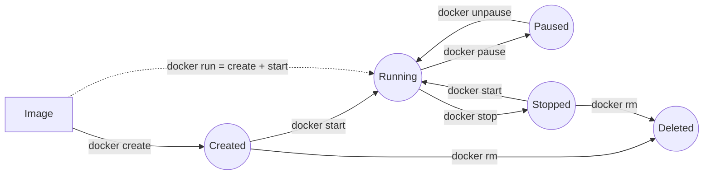

[Computing](../../README.md) › [容器與環境](../README.md) › Docker

# Docker

Docker 把應用程式與其相依套件打包成可攜的映像檔 (image)，再以容器 (container) 執行。對資料工作者：把分析環境（R / Python 版本、系統函式庫、生資工具）固定下來，在筆電、伺服器、雲端得到一樣的結果；HPC 上則用 [Apptainer](../apptainer.md) 執行同一個映像檔。概念與 VM 的比較見 [容器與虛擬化](../containerization-and-virtualization.md)。

```text
Dockerfile ──docker build──► Image ──docker run──► Container
                               │  ▲
                   docker push │  │ docker pull
                               ▼  │
                         Registry（Docker Hub、ghcr.io、quay.io）
```

## 建議順序

```text
映像檔 → 容器 → Dockerfile → Volume 與掛載 → 網路 → Compose
```

| 筆記 | 內容 | 回答的問題 |
| --- | --- | --- |
| [映像檔](image.md) | 列出、tag、push / pull、save / load、分層與 inspect、buildx 多平台 | 映像檔怎麼取得、命名、分享？ |
| [容器](container.md) | `run` 選項、生命週期、`exec` vs `attach`、logs、`cp`、清理與磁碟用量 | 容器怎麼啟動、進入、除錯、清理？ |
| [Dockerfile](dockerfiles.md) | 指令、快取與層的順序、multi-stage、`USER`、`ARG` vs `ENV`、`.dockerignore`、資料科學範例 | 怎麼寫出小又可重現的映像檔？ |
| [Volume 與掛載](volumes.md) | bind mount、named volume、唯讀、檔案權限 | 資料怎麼進出容器、怎麼持久保存？ |
| [網路](network.md) | port 對應、`host.docker.internal`、自訂網路與服務名稱 | 容器之間、容器與主機怎麼連線？ |
| [Compose](compose.md) | `compose.yaml`、服務、volume、healthcheck、常用指令 | 多個容器怎麼一起啟動？ |

## 容器生命週期



| 指令 | 結果 |
| --- | --- |
| `docker run` | create + start；前景執行並接上輸出（`-d` 則背景） |
| `docker start` | 啟動已存在的容器，預設在背景（`-ai` 才接上） |
| `docker attach` | 接上容器主程序的輸入輸出；`Ctrl + P` `Ctrl + Q` 離開而不停止容器 |
| `docker exec -it <c> bash` | 在執行中的容器開一個**新的** shell（除錯首選） |

## 安裝

| 平台 | 做法 |
| --- | --- |
| Windows | Docker Desktop（WSL 2 後端）；在 Settings → Resources → WSL integration 啟用發行版 |
| macOS | Docker Desktop、OrbStack、Colima |
| Linux | Docker Engine（`apt install docker-ce`），把自己加入 `docker` 群組：`sudo usermod -aG docker $USER`（等同 root 權限） |
| 共用 HPC | 通常沒有 Docker → [Apptainer](../apptainer.md) |

> 替代方案 Podman 指令與 Docker 相容（`alias docker=podman`），不需要 root daemon。
