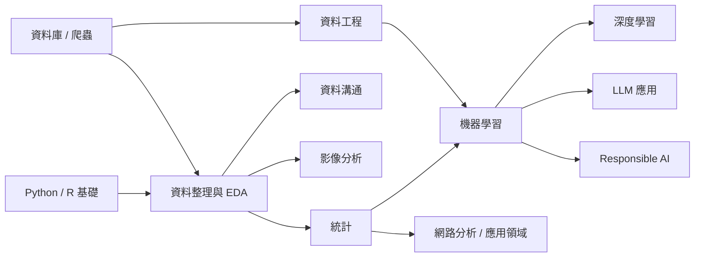

# 資料科學 (Data Science)

從 Python / R 基礎、資料整理與 EDA、統計推論，到機器學習、深度學習與 LLM 應用。主軸是**先理解資料，再建立模型，最後把結果說清楚**。

> 相同概念只在最適合的章節完整說明，其他地方以交叉連結為主。不知道從哪開始時，先讀 [認識資料科學](understanding-data-science.md)。

**找方法**：[統計方法速查](statistics/method-selection.md)、[模型選擇](machine-learning/model-selection.md)。

## 章節地圖

### 核心

| 章節 | 核心內容 | 回答的問題 |
| --- | --- | --- |
| [Python 基礎](python-foundations/README.md) | 語法、函式、腳本、[NumPy](python-foundations/numpy/README.md)、[pandas](python-foundations/pandas/README.md)、[效能與擴展](python-foundations/performance-and-scaling/README.md) | 如何有效率地讀取、整理與轉換資料？ |
| [R 基礎](r-foundations/README.md) | 資料結構、tidyverse、data.table、函數式程式設計、R Markdown | 如何在 R 裡整理資料、重用邏輯並產出可重現報告？ |
| [資料整理與 EDA](data-manipulation-and-eda/README.md) | EDA 流程、資料剖析、缺失值、[視覺化](data-manipulation-and-eda/visualization/README.md) | 資料可信嗎？分布、關係與問題欄位在哪？ |
| [統計](statistics/README.md) | 推論、迴歸、多重檢定、貝氏、時間序列、多變量、實驗設計、存活分析 | 這個差異或趨勢可靠嗎？不確定性多大？ |
| [機器學習](machine-learning/README.md) | 前處理、監督 / 非監督學習、評估、解釋、套件（scikit-learn、tidymodels）、部署 | 如何建立可泛化、可監控的預測模型？ |
| [深度學習](deep-learning/README.md) | 張量與反向傳播、訓練流程、CNN、序列與 Transformer | 如何用神經網路處理影像、序列等複雜資料？ |
| [LLM 應用](llm/README.md) | LLM 基礎、prompt、API 整合、fine-tuning、[RAG](llm/rag/README.md)、[agents](llm/agents/README.md)、LLMOps | 模型要接上知識庫、工具與流程時，系統怎麼設計？ |

### 方法與領域支線

| 章節 | 核心內容 | 回答的問題 |
| --- | --- | --- |
| [影像分析](image-analysis/README.md) | scikit-image、mask、物件量測、registration（古典方法，非 DL） | 不訓練模型時，如何從顯微鏡或醫學影像抽出可量測的結構？ |
| [網路分析](network-analysis/README.md) | graph、centrality、路徑、cliques、二分網路 | 資料核心是「誰和誰相連」時，如何找重要節點與群體結構？ |
| [Responsible AI](responsible-ai/README.md) | 倫理與治理、偏誤、隱私與法規（GDPR / EU AI Act）、匿名化、AI 資安 | 模型進入真實決策時，如何可控、可問責、合規？ |
| [應用領域](applied-domains/README.md) | finance、行銷反應模型、最佳化、process mining | 通用方法放進特定領域時要注意什麼？ |

### 資料取得與工程（選讀）

| 章節 | 核心內容 | 回答的問題 |
| --- | --- | --- |
| [資料庫](databases/README.md) | SQL 查詢、window functions、交易、效能、方言對照、SQLAlchemy / PyMongo | 如何在資料庫端先篩選、聚合再抽取？ |
| [網頁爬蟲](web-scraping/README.md) | Scrapy、BeautifulSoup / Selenium、rvest | 資料不在 API 或 CSV 時，如何合法抓取？ |
| [資料工程](data-engineering/README.md) | ingestion、pipelines、Spark、Databricks、雲端資料倉儲、串流、治理、資料品質 | 資料如何穩定流進分析與模型，而不是每次手動整理？ |
| [資料溝通](data-communication/README.md) | 問題定義、結果溝通、dashboard 設計、[BI 工具](data-communication/bi-tools/README.md)（Power BI / Tableau） | 如何把模糊需求翻成分析問題，並讓結果回到決策？ |

## 建議路線

| 讀者 | 路線 |
| --- | --- |
| 初學 | [認識資料科學](understanding-data-science.md) → [Python 基礎](python-foundations/README.md) → [資料整理與 EDA](data-manipulation-and-eda/README.md) → [統計](statistics/README.md) → [機器學習](machine-learning/README.md) |
| **生物資訊** | [pandas](python-foundations/pandas/README.md) / [R 基礎](r-foundations/README.md) → [EDA 與缺失值](data-manipulation-and-eda/README.md) → [統計（生資路線）](statistics/README.md#建議路線) → [機器學習](machine-learning/README.md) → [深度學習](deep-learning/README.md) → 依資料型態選 [影像分析](image-analysis/README.md) / [網路分析](network-analysis/README.md) |
| **機器學習** | [NumPy](python-foundations/numpy/README.md) / [pandas](python-foundations/pandas/README.md) → [EDA](data-manipulation-and-eda/README.md) → [統計（ML 路線）](statistics/README.md#建議路線) → [機器學習](machine-learning/README.md) → [深度學習](deep-learning/README.md) → [LLM 應用](llm/README.md) → [Responsible AI](responsible-ai/README.md) |
| 工程與 BI（選讀） | [資料庫](databases/README.md) → [資料工程](data-engineering/README.md) → [資料溝通](data-communication/README.md)；資料要自己抓時插入 [網頁爬蟲](web-scraping/README.md) |

## 一套一致的分析節奏

| 步驟 | 要做的事 | 對應章節 |
| --- | --- | --- |
| 1. 資料盤點 | 欄位型別、缺失值、重複值、異常值、時間範圍 | [EDA](data-manipulation-and-eda/eda-workflow.md) |
| 2. 看分布與關係 | 視覺化、描述統計、收集偏差 | [視覺化](data-manipulation-and-eda/visualization/README.md)、[敘述統計](statistics/descriptive-statistics/README.md) |
| 3. 選方法 | 檢定、迴歸、分類、分群、時間序列 | [統計方法速查](statistics/method-selection.md)、[模型選擇](machine-learning/model-selection.md) |
| 4. 回到決策 | 結果穩定嗎？可解釋、可重現、可部署嗎？ | [結果溝通](data-communication/communicating-results.md)、[部署](machine-learning/production/README.md) |

> 很多錯誤不是模型不夠複雜，而是前面的資料理解不夠。模型章節卡住時，先回頭補 EDA、視覺化與統計。
