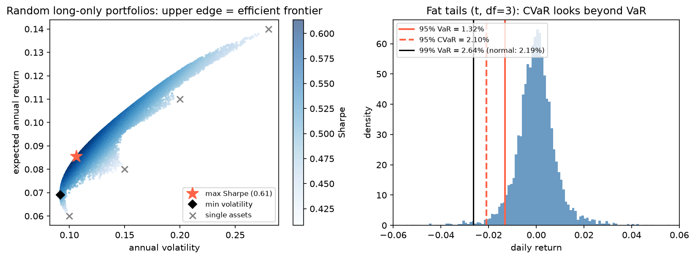

[Data Science](../../README.md) › [應用領域](../README.md) › [Finance](README.md) › 投資組合與風險

# 投資組合與風險 (Portfolio and Risk)

三部分：投資組合分析（報酬、波動、分散、相對基準、因子、最佳化）、量化風險管理（把不確定性轉成 VaR / CVaR 等可監控的量）、股價模擬（把波動度變成價格區間）。通用方法見 [蒙地卡羅模擬](../../statistics/probability-and-distributions/monte-carlo-simulation.md)、[時間序列](../../statistics/time-series-analysis/README.md)。

## 投資組合分析

投資組合分析問的不是單一資產好不好，而是一組資產放在一起後的風險、報酬與分散效果：同一批資產，權重不同，風險報酬輪廓就完全不同。

| 名詞 | 意義 |
| --- | --- |
| Portfolio | 實際持有或設計的一組部位 |
| Fund | 投資人共同出資、經理人管理的投資池 |
| Index | 代表市場或市場一部分的基準組合 |
| 被動 (passive) | 盡量貼近基準 → 在意 tracking error |
| 主動 (active) | 刻意偏離基準追求超額報酬 → 在意 active return、active weights、因子押注 |

分散的價值來自相關性結構，而不是持有數量：產業、國家、景氣循環暴露、風險水準、因子暴露都要有差異，風險來源才不會同時發作。

### 報酬

| 概念 | 計算 | 用途 |
| --- | --- | --- |
| 簡單報酬 | $P_t/P_{t-1} - 1$ | 跨資產加權（投組報酬 = Σ wᵢ rᵢ） |
| 對數報酬 | $\ln(P_t/P_{t-1})$ | 跨期加總 |
| 累積報酬 | $\prod(1 + r_t) - 1$ | 整段期間的財富變化 |
| 年化報酬 | $(1 + R_{cum})^{252/n} - 1$ | 比較不同長度的期間 |
| 算術平均 vs 幾何平均 | 單期平均 vs 多期複利成長 | 幾何平均較貼近實際財富路徑（包含波動造成的複利拖累） |

多期投組要說明權重邏輯：買進持有 (buy-and-hold) 的權重會隨表現漂移；定期再平衡 (rebalanced) 則拉回目標配置。兩者是不同策略。

```python
import numpy as np
import pandas as pd

rets = prices.pct_change().dropna()                     # 日報酬，每檔一欄
w = np.array([0.4, 0.3, 0.2, 0.1])
port = rets @ w                                         # 每日再平衡到 w 的投組報酬

ann_ret = (1 + port).prod() ** (252 / len(port)) - 1
ann_vol = port.std() * np.sqrt(252)                     # 假設日報酬近似獨立
cov = rets.cov() * 252
port_vol = np.sqrt(w @ cov @ w)                         # 投組波動：權重 + 共變異，不是個別波動的加權平均

rf = 0.02
sharpe = (ann_ret - rf) / ann_vol                       # 超額報酬 / 總波動
downside = port[port < 0].std() * np.sqrt(252)
sortino = (ann_ret - rf) / downside                     # 只用下檔波動

wealth = (1 + port).cumprod()
drawdown = wealth / wealth.cummax() - 1
max_dd = drawdown.min()                                 # 最大回撤
```

### 風險調整後報酬

| 指標 | 回答 | 限制 |
| --- | --- | --- |
| Sharpe ratio | 每單位總波動換到多少超額報酬（報酬 − 無風險利率） | 上下波動一視同仁；偏態報酬下不足 |
| Sortino ratio | 每單位下檔波動的超額報酬 | 下檔樣本少時不穩 |
| 最大回撤 (max drawdown) | 從高點到低點最大的累積跌幅 | 比日波動更貼近投資人的痛感；回復時間也是風險 |
| 偏態、峰度 | 分布形狀 | 左偏、厚尾時 Sharpe 低估真正的下檔風險 |

### 相對基準

| 指標 | 意義 |
| --- | --- |
| Active return | 投組報酬 − 基準報酬 |
| Tracking error | 主動報酬的波動 |
| Information ratio | active return / tracking error |
| Active weights | 投組權重 − 基準權重；揭露產業超配 / 低配、國家押注、風格傾斜 |
| 最大相對回撤 | 相對基準最難熬的落後區段 |

### 因子模型

CAPM（單因子）：$r_p - r_f = \alpha + \beta (r_m - r_f) + \varepsilon$

| 參數 | 意義 |
| --- | --- |
| β | 對市場超額報酬的敏感度：> 1 放大市場、< 1 稀釋 |
| α | 模型沒解釋的報酬 |
| R² | 多少波動被市場解釋；β 高但 R² 低代表「有市場暴露」不等於「大部分波動由市場解釋」 |

```python
import statsmodels.formula.api as smf

df = pd.DataFrame({"ex_p": port - rf / 252, "ex_m": mkt - rf / 252})
beta_cov = df.cov().loc["ex_p", "ex_m"] / df["ex_m"].var()        # 共變異法
capm = smf.ols("ex_p ~ ex_m", data=df).fit()                       # 迴歸法：同時得到 α、R²
ff3 = smf.ols("ex_p ~ mkt_rf + smb + hml", data=ff).fit()          # Fama-French 三因子
```

Fama-French 三因子再加入 SMB（小型股 − 大型股）與 HML（高淨值市價比 − 低）暴露，從「像不像市場」走到「偏向什麼風格」，把報酬拆成因子能解釋的部分與 α。

### 效率前緣與最佳化

Markowitz：給定風險最大化期望報酬，或給定期望報酬最小化風險；把各目標下的最優解連起來就是效率前緣 (efficient frontier)。



左：四檔模擬資產的 20,000 個隨機只做多組合，上緣是效率前緣；最大 Sharpe 組合（★）與最小波動組合（◆）都在前緣上，分別服務「最佳風險報酬比」與「先控制風險」的需求。右見[風險管理](#value-at-risk-與-cvar)。

```python
from scipy.optimize import minimize
from sklearn.covariance import LedoitWolf

mu = rets.mean() * 252
Sigma = LedoitWolf().fit(rets).covariance_ * 252       # 收縮估計：比樣本共變異穩
n = len(mu)
cons = [{"type": "eq", "fun": lambda w: w.sum() - 1}]  # 全額投資
bounds = [(0, 1)] * n                                  # 只做多

min_vol = minimize(lambda w: w @ Sigma @ w, np.ones(n) / n, bounds=bounds, constraints=cons).x
max_sr = minimize(lambda w: -(w @ mu - rf) / np.sqrt(w @ Sigma @ w),
                  np.ones(n) / n, bounds=bounds, constraints=cons).x
```

| 輸入的問題 | 改良 |
| --- | --- |
| 期望報酬估計誤差極大，最佳化器會放大它 | 收縮、Black-Litterman（結合市場均衡與主觀觀點）、或只做最小變異（不需要 μ） |
| 樣本共變異在資產多、樣本短時不穩 | Ledoit-Wolf 收縮、因子模型降維 |
| 舊資料不代表現在 | 指數加權平均與共變異 |
| 只在意下檔 | semicovariance |
| 離群值 | 穩健統計量 |

沒說清楚約束（全額投資、只做多、目標報酬）的最優組合只是數學解，不一定可投資。

### 滾動分析與風險貢獻

均值、波動、相關、Sharpe、因子暴露都會隨時間變化。滾動窗口在每個時間點只用最近一段資料估計；窗口太短估計雜訊大，太長混入舊的市場狀態 (regime)。滾動最佳化：用訓練窗估計 → 在再平衡日算新權重 → 套用到下一段持有期 → 重複並比較樣本外路徑。

| 風險貢獻 | 意義 |
| --- | --- |
| 邊際風險貢獻 | 權重增加一點，總風險怎麼變：$(\Sigma w)_i / \sigma_p$ |
| 成分風險貢獻 | $w_i (\Sigma w)_i / \sigma_p$，加總 = 投組波動 |
| 百分比貢獻 | 各資產占總風險的比例 |

名目權重平均不代表風險預算平均：高波動、高相關的資產會吃掉遠超過權重比例的風險（等權重股債組合中，股票常貢獻 90% 以上的風險）。

### 回測紀律

最佳化在樣本內很漂亮，放到樣本外常不穩，因為 μ 與 Σ 有估計誤差。要切開估計樣本與評估樣本、嚴格避免 look-ahead bias，並記錄再平衡頻率、訓練期長度、滾動窗口、solver：季度與月度再平衡就已經是兩個不同策略，見 [交易策略與回測](trading-strategies-and-backtesting.md)。R 中常用 `PerformanceAnalytics`（`Return.calculate()`、`Return.portfolio()`）與 `PortfolioAnalytics`（定義資產 / 約束 / 目標 → 求解 → 分析），把「想要什麼目標」「允許什麼約束」「用什麼估計與 solver」分開，結果才能追溯。

## 量化風險管理

風險管理不是消除不確定性，而是量化可能損失、辨識主要風險來源、控制暴露，在既定的風險胃納下做決策。它同時是量測問題與決策問題。

| 步驟 | 內容 |
| --- | --- |
| 風險因子 | 市場、利率、通膨、產業衝擊、發行人違約；分系統性與個別風險，找出壞時候一起發作的因子 |
| 因子報酬 | 模型通常用因子的變化量（簡單、相對或對數報酬），不是水準 |
| 時間尺度 | 日報酬聚合成週、月時，常態性、相依性、尾部行為都可能改變 |
| 損失分布 | 重點在尾部：少數極端事件決定生死 |

波動度是第一個風險指標，直觀、和共變異矩陣與現代投資組合理論接軌，但它對上下波動一視同仁、不告訴你尾部損失多嚴重。日波動乘 √T 年化假設報酬近似獨立且期間內沒有狀態轉換，是基準近似而非定律。

### Value at Risk 與 CVaR

| 指標 | 問題 | 說明 |
| --- | --- | --- |
| VaR（α 信心水準） | 在 α 的情況下，損失不超過多少？ | 只告訴你門檻位置，不管門檻之外有多慘 |
| CVaR / Expected Shortfall | 損失超過 VaR 時，平均損失多少？ | 描述尾部嚴重程度；厚尾或不對稱時一定要一起看 |

```python
from scipy import stats

alpha = 0.95
var_hist = -np.quantile(port, 1 - alpha)                       # 歷史法：直接取分位數
cvar_hist = -port[port <= -var_hist].mean()                    # 超過 VaR 的平均損失

mu_, sd_ = port.mean(), port.std()
var_norm = -(mu_ + stats.norm.ppf(1 - alpha) * sd_)            # 參數法（常態）
df_t, loc, scale = stats.t.fit(port)
var_t = -stats.t.ppf(1 - alpha, df_t, loc, scale)              # 參數法（t 分布，厚尾）

sims = rng.multivariate_normal(mu_vec, cov_daily, size=100_000) @ w   # 蒙地卡羅：模擬情境 → 投組損益
var_mc = -np.quantile(sims, 1 - alpha)
```

| 方法 | 假設 | 優點 | 缺點 |
| --- | --- | --- | --- |
| 歷史模擬 | 過去的情境對未來仍有代表性 | 直觀、自動保留偏態與厚尾 | 沒發生過的情境看不到；仍依賴平穩性 |
| 參數法（常態 / t） | 指定的分布 | 參數少、好算 | 常態低估極端尾部 |
| 蒙地卡羅 | 可抽樣的模型 | 能處理沒發生過但合理的情境、非線性部位 | 模型錯了，抽再多次也只是放大錯誤 |

圖右：t 分布（df = 3）模擬的日報酬。95% 歷史 VaR 1.32%、CVaR 2.10%；99% VaR 2.64%，而用相同平均與標準差的常態假設只得到 2.19%。厚尾分布在 95% 時常態 VaR 反而偏高（1.55%），到 99% 才明顯低估：常態假設的錯誤在越極端的尾部越嚴重。

風險暴露不只看損失大小，還要結合發生機率與決策者的風險胃納。

### 金融報酬的典型事實 (Stylized Facts)

| 現象 | 影響 |
| --- | --- |
| 尾部比常態厚 | 常態 VaR 低估極端損失 |
| 波動隨時間改變、波動聚集 | 平靜之後常平靜、劇烈之後常劇烈；用 GARCH 或滾動波動 |
| 原始報酬自相關弱，絕對值 / 平方報酬自相關強 | 只檢查報酬的自相關會漏掉波動聚集 |
| 極端值成群出現 | 危機期間相關性上升，分散效果下降 |
| 聚合到較長期間時較接近常態 | 不同期間的模型不能直接套用 |

檢查分布假設：直方圖與擬合密度、Q-Q plot、偏態與峰度、Jarque-Bera 檢定，見 [假設檢查](../../statistics/inferential-statistics/assumption-checks.md)。KDE 可以不假設參數分布地平滑損失密度，但依賴頻寬，尾部資料常不足。

### 平穩性、結構斷點與回測

幾乎所有風險估計都假設分布不隨時間改變，但危機、政策、制度變化會造成結構斷點，舊的波動、共變異、尾部估計瞬間失效。用視覺檢查、Chow test、滾動波動輔助辨認，必要時分段估計或用時變波動模型。

風險模型要回測：宣稱 95% VaR 時，實際超過 VaR 的天數應約 5%。超過太多 → 低估尾部；太少 → 過度保守或分布錯。用 √T 放大到多日期間，也要回頭檢查在真實資料上是否合理（Kupiec test 檢驗超過次數）。

### 極值理論 (EVT)

只關心尾部時，EVT 專注於極端損失而不是整體配適：block maxima（每段期間的最大損失 → GEV 分布）或 peaks over threshold（超過門檻的部分 → generalized Pareto，`scipy.stats.genpareto`）。擬合尾部後估計高信心水準的 VaR / CVaR，用於資本準備與壓力損失。

### 選擇權部位

選擇權的價值還受隱含波動度、到期時間、利率影響，損失與標的價格是非線性關係；隱含波動度本身就是風險因子，市場壓力時標的價格與隱含波動常一起劇烈變動，要同時看價格因子與波動因子。

也有人用神經網路直接學習「價格 → 投組權重」的映射，讓市場資料更新時能即時輸出新權重、省去每次完整最佳化；但這只是用另一種函數近似表達決策規則，沒有消除估計誤差與尾部風險的問題。

| 常見錯誤 | |
| --- | --- |
| 把波動度當成完整的風險定義 | 忽略尾部損失 |
| 直接套用常態分布 | 沒檢查厚尾 |
| 只檢查原始報酬的自相關 | 漏掉波動聚集 |
| 把平穩性當成市場保證 | 忽略結構斷點 |
| 沒回測就拿 VaR 控制部位 | 用 √T 放大卻沒檢查 |
| 以為一個漂亮的 VaR 數字代表理解了尾部風險 | 一起看 CVaR 與壓力情境 |

## 股價模擬與波動度

對股價建模的重點不是預測單一路徑，而是把波動、可能區間與機率分布表達清楚。

幾何布朗運動 (GBM)：對數報酬近似常態，價格呈對數常態，不會變成負數，與連續複利表示相容。

$$S_{t+\Delta t} = S_t \exp\left[\left(\mu - \tfrac{1}{2}\sigma^2\right)\Delta t + \sigma\sqrt{\Delta t}\,Z\right],\quad Z \sim N(0, 1)$$

```python
rng = np.random.default_rng(42)
S0, mu_a, sigma_a, days, n_paths = 100, 0.08, 0.25, 252, 10_000   # 年化參數
dt = 1 / 252
Z = rng.standard_normal((n_paths, days))
log_paths = np.cumsum((mu_a - 0.5 * sigma_a**2) * dt + sigma_a * np.sqrt(dt) * Z, axis=1)
paths = S0 * np.exp(log_paths)

np.percentile(paths[:, -1], [5, 50, 95])       # 一年後價格的 90% 區間與中位數
(paths[:, -1] < 90).mean()                     # 一年後跌破 90 的機率
```

| 觀念 | 說明 |
| --- | --- |
| 單位一致 | 平均、波動、時間步長要用同一尺度（年化或日化），不能混用 |
| 期望 vs 實現報酬 | 模擬輸入是估計的期望報酬；單一路徑只是眾多可能之一，不是預言 |
| 輸出區間而非點估計 | 中心區間、尾部風險、分布偏態 |
| 累積 vs 密度 | 累積機率回答「價格低於某門檻的機率」；密度回答「哪一段最可能出現」 |
| 「最可能價格」 | 連續分布中只是密度最高的附近，對數常態的眾數 < 中位數 < 平均數 |
| 模型限制 | 真實市場有厚尾、波動聚集、狀態轉換，GBM 只是簡化 |

不論用 Python 還是試算表，都要檢查平均、波動、時間步長是否同一尺度，log / exp 轉換前後定義一致，隨機函數的輸出是否真的對應假設的分布。模擬輸出看起來過度平滑時，先懷疑波動度或隨機項是否處理得太弱。
