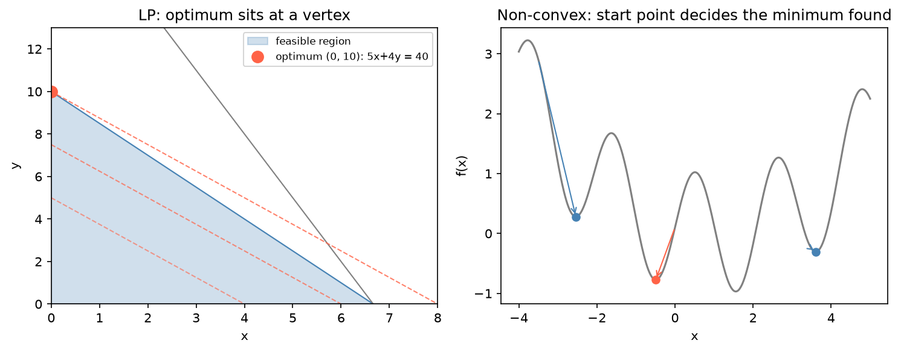

[Data Science](../README.md) › [應用領域](README.md) › 最佳化

# 最佳化 (Optimization)

最佳化是 prescriptive 的一側：問題不是「會發生什麼」，而是「在約束下應該怎麼做」。任何最佳化問題都要先拆成三塊，再交給 solver：

| 元件 | 問題 | 例子 |
| --- | --- | --- |
| 決策變數 (decision variables) | 可以調什麼？ | 生產量、出貨量、是否開廠、投資權重、模型參數 |
| 目標函數 (objective) | maximize 或 minimize 什麼？ | 成本、利潤、負對數概似、生物質產量 |
| 約束 (constraints) | 哪些條件不能違反？ | 容量、需求、預算、質量守恆、權重和為 1 |

三者沒分清楚，solver 只是把模糊的問題算得更快。solver 回傳 `optimal` 只代表「在你寫的模型裡最優」，不代表在真實世界最優。

| 問題型態 | 工具 |
| --- | --- |
| 連續變數、一般非線性函數 | `scipy.optimize.minimize` |
| 線性目標 + 線性約束（LP） | `scipy.optimize.linprog` |
| 部分變數為整數或 0/1（MILP） | `scipy.optimize.milp`、PuLP、OR-Tools |
| 索引多、約束有業務語意的大模型 | 代數建模工具：PuLP、Pyomo、CVXPY（凸問題） |

## 無約束最佳化

```python
import numpy as np
from scipy.optimize import minimize_scalar, minimize

# 單變數
res = minimize_scalar(lambda x: x**2 - 12*x + 4)
res.x, res.fun, res.success          # (6.0, -32.0, True)

# 求最大值：最小化 -f
revenue = lambda x: -(x - 4)**2 + 10
res = minimize_scalar(lambda x: -revenue(x))
res.x, revenue(res.x)                # (4.0, 10.0)

# 多變數：需要初始值
res = minimize(lambda q: (q[0] - 2)**2 + (q[1] - 3)**2, x0=np.zeros(2))
res.x                                 # [2., 3.]
```

| 結果欄位 | 意義 |
| --- | --- |
| `x`、`fun` | 最佳輸入、目標值 |
| `success`、`message` | 是否正常收斂；`False` 時數值不能直接相信 |
| `nit`、`nfev` | 迭代次數、函數評估次數 |

## 約束最佳化

```python
from scipy.optimize import Bounds, LinearConstraint, NonlinearConstraint

f = lambda q: (q[0] - 4)**2 + (q[1] - 4)**2

# 1. 上下界：每個變數各自的範圍
res = minimize(f, x0=[1, 1], method="L-BFGS-B", bounds=Bounds([0, 0], [3, 10]))
res.x                                                        # [3., 4.]

# 2. 線性約束：x + y <= 5
lin = LinearConstraint([[1, 1]], lb=-np.inf, ub=5)
res = minimize(f, x0=[1, 1], method="trust-constr", constraints=[lin])
res.x                                                        # [2.5, 2.5]

# 3. 非線性約束：x² + y² <= 4（可行域是半徑 2 的圓）
circle = NonlinearConstraint(lambda q: q[0]**2 + q[1]**2, lb=-np.inf, ub=4)
res = minimize(f, x0=[0.5, 0.5], method="trust-constr", constraints=[circle])
res.x                                                        # ≈ [1.414, 1.414]
```

約束是線性時優先用 `LinearConstraint`：語意清楚、數值較穩。目標與約束都是線性時不要用 `minimize`，改用 `linprog` / `milp`。

## 凸性

| | 凸問題 | 非凸問題 |
| --- | --- | --- |
| 局部最優 = 全域最優？ | 是 | 不一定 |
| 對初始值敏感？ | 否 | 是 |
| 例子 | LP、最小平方、Ridge / Lasso、Markowitz 最小變異 | 神經網路、混合模型的概似、多峰函數 |



左：LP 的最佳解一定在可行域的頂點（目標函數等高線往外推，最後碰到的角）。右：非凸函數從三個起點出發得到三個不同的局部最小值，而真正的全域最小值（x ≈ 1.55）一個都沒找到。非凸問題要用多個起點、全域方法（`scipy.optimize.differential_evolution`、`basinhopping`），或重新表述成凸問題。

## 線性與整數規劃

```python
from scipy.optimize import milp, linprog

# 最大化 5x + 4y，s.t. 6x + 4y <= 40、3x + y <= 20、0 <= x <= 20、0 <= y <= 12，x、y 為整數
res = milp(c=[-5, -4],                                   # milp 只做最小化，係數取負
           constraints=LinearConstraint([[6, 4], [3, 1]], ub=[40, 20]),
           bounds=Bounds([0, 0], [20, 12]),
           integrality=[1, 1])                           # 沒給 integrality 時就只是 LP
res.x, -res.fun                                          # ([0., 10.], 40.0)
```

| 適合 LP / MILP 的問題 | 0/1 變數表達的邏輯 |
| --- | --- |
| 產品組合、資源分配 | 開 / 不開某個設施 |
| 運輸與指派 | 若不開廠則出貨為 0（`flow <= capacity × open`） |
| 設施選址、網路設計 | 互斥選擇（`open_low + open_high <= 1`） |

有些非線性問題可以重新表述：變數替換、把非線性項線性化、或接受可解的近似。很多實務最佳化工作不是按下 solver，而是把原始問題改寫成 solver 能理解的形式。

## 生醫例子

### 參數估計 = 最佳化

統計模型的最大概似估計 (MLE) 就是最小化負對數概似；曲線擬合是最小化殘差平方和，見 [最大概似估計](../statistics/probability-and-distributions/maximum-likelihood.md)。

```python
from scipy.optimize import curve_fit

# 劑量反應：四參數 logistic（Hill）曲線
def hill(dose, bottom, top, ec50, n):
    return bottom + (top - bottom) / (1 + (ec50 / dose)**n)

params, cov = curve_fit(hill, dose, response, p0=[0, 100, 1.0, 1.0],
                        bounds=([-10, 50, 1e-4, 0.1], [20, 150, 100, 5]))
se = np.sqrt(np.diag(cov))                 # 參數標準誤
```

非線性擬合是非凸問題：合理的 `p0` 與 `bounds` 決定能否收斂到有意義的解。

### 通量平衡分析 (Flux Balance Analysis)

代謝網路的 FBA 是一個 LP：決策變數是反應通量 v，約束是穩態質量守恆 S·v = 0（S 是化學計量矩陣）與通量上下界，目標通常是最大化生物質反應。

```python
# 玩具網路：v1 吸收 → A；v2 A → B；v3 A → 副產物；v4 B → biomass
S = np.array([[1, -1, -1,  0],    # 代謝物 A
              [0,  1,  0, -1]])   # 代謝物 B
res = linprog(c=[0, 0, 0, -1], A_eq=S, b_eq=[0, 0],
              bounds=[(0, 10), (0, 6), (0, None), (0, None)])
res.x, -res.fun                    # 生物質通量 6：受 v2 上限 6 限制
```

這個解不唯一：v1 可以是 6 到 10 之間任何值（多出來的走 v3），目標值都一樣。FBA 常有多重最佳解，所以會再做 flux variability analysis 找每個通量的可行範圍。實際分析用 COBRApy。

## 供應鏈最佳化

供應鏈問題把網路決策寫成 LP / MILP：供應商、工廠、倉庫、市場之間該怎麼配置。

| 模型 | 決策 | 典型約束 |
| --- | --- | --- |
| 運輸問題 | 每個供給點送多少到每個需求點 | 滿足需求、不超過供給上限 |
| 設施選址 | 開哪些廠 / 倉（0/1）+ 流量 | 沒開就不能出貨、固定成本 |
| 容量設施選址 | 開哪些、開低或高產能版本、誰供應哪個市場 | 需求完全滿足、出貨不超過產能、高低產能互斥 |

設施選址的典型取捨：小型分散設施運輸成本低但失去規模經濟；少數大型設施固定成本與規模效率較好，但運輸、關稅或服務半徑變差。

```python
import pulp      # pip install pulp highspy；PuLP 4 不再內建 CBC solver

plants, markets = ["P1", "P2"], ["M1", "M2", "M3"]
cost = {("P1", "M1"): 4, ("P1", "M2"): 6, ("P1", "M3"): 9,
        ("P2", "M1"): 5, ("P2", "M2"): 3, ("P2", "M3"): 7}
supply, demand = {"P1": 250, "P2": 300}, {"M1": 150, "M2": 200, "M3": 180}
fixed = {"P1": 500, "P2": 600}

m = pulp.LpProblem("plant_location", pulp.LpMinimize)
x = m.add_variable_dict("ship", (plants, markets), lowBound=0)      # 索引化變數：x[(p, j)]
y = m.add_variable_dict("open", plants, cat="Binary")
m += pulp.lpSum(cost[k] * x[k] for k in cost) + pulp.lpSum(fixed[p] * y[p] for p in plants)
for j in markets:
    m += pulp.lpSum(x[(p, j)] for p in plants) == demand[j], f"demand_{j}"
for p in plants:
    m += pulp.lpSum(x[(p, j)] for j in markets) <= supply[p] * y[p], f"cap_{p}"   # 沒開就不能出貨
stats = m.solve(pulp.HiGHS(msg=False))
stats.status, pulp.value(m.objective)          # (LpSolveStatus.Optimal, 3720.0)：兩廠都開
{k: v.value() for k, v in x.items() if v.value()}
# {('P1','M1'): 150, ('P1','M3'): 80, ('P2','M2'): 200, ('P2','M3'): 100}
```

PuLP 3.x 的寫法是 `pulp.LpVariable.dicts(...)`、`m.solve(pulp.PULP_CBC_CMD(msg=False))`、`pulp.LpStatus[m.status]`、`m.constraints[name].pi`；4.0 改成由問題物件建立變數、solve 回傳統計物件、`m.constraints()` 變成方法，舊教材的程式要改寫。MILP 沒有對偶值（影子價格全為 0）：要固定 0/1 決策後對剩下的 LP 求解，才能讀影子價格。

### 約束是最常出錯的地方

| 錯誤 | 例子 |
| --- | --- |
| 方向寫反 | 「每單位 B 至少需要 3 單位 A」寫成 `B >= 3A`（應為 `A >= 3B`） |
| 用 `==` 寫死 `>=` / `<=` 的限制 | 「至少」不是「剛好」 |
| 多維索引加總漏一層 | 少加總或重複加總 |
| 0/1 變數沒和流量連動 | 關閉的廠仍在出貨 |
| 數學上可解但業務上不合理 | 同時開高產能與低產能版本 |

> 求解前先代入一組小數字手算：如果 B = 2，A 至少該是多少？某市場需求 100，模型是否真的要求總出貨 = 100？某廠關閉時，流量是否真的為 0？這比盯著公式更容易抓錯。

### 求解後：影子價格與敏感度

| 分析 | 回答 |
| --- | --- |
| Binding constraints / slack | 哪些約束真正卡住系統？哪些廠還有剩餘產能？ |
| 影子價格 (shadow price) | 某約束右側多一單位，目標值改善多少？哪個產能最值得投資擴充？哪個市場的額外需求最貴？ |
| 情境分析 | 需求、成本小幅變動時，開廠決策會不會翻轉？ |
| 模擬壓力測試 | 對需求或成本加隨機擾動、重複求解，看決策與成本的分布；單點最優對小擾動很敏感時，模型需要更多韌性考量 |

影子價格是局部的邊際資訊，只在目前解附近成立，不是全域真理。目標函數定義了「系統認為什麼叫好」：真正在意服務可靠度或韌性時只寫成本最小化，會得到數學漂亮、營運危險的解。

## 工作流程

1. 畫出網路與決策範圍
2. 定義索引、變數、目標與單位
3. 逐條寫約束，用小例子驗證語意
4. 求解後檢查可行性、流量、開關決策、`success` / status
5. 看 binding constraints、slack、影子價格
6. 做情境或模擬測試，而不是把單次結果當真理

| 相關筆記 | |
| --- | --- |
| [線性迴歸](../machine-learning/supervised-learning/regression/linear.md) | 迴歸最佳化的是模型配適；作業研究最佳化的是有明確約束的決策 |
| [投資組合與風險](finance/portfolio-and-risk.md) | Markowitz 最佳化是二次規劃 |
| [流程探勘](process-mining.md) | 找出瓶頸後，最佳化負責資源配置 |
