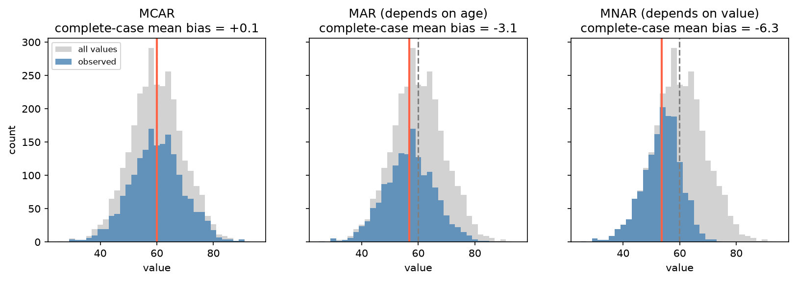

[Data Science](../README.md) › [資料處理與 EDA](README.md) › 缺失機制

# 缺失機制 (Missing Data Mechanisms)

缺值「為什麼缺」決定了刪除或插補是否會造成偏誤。本篇只講機制與刪除策略；工具用法見 [pandas 缺值](../python-foundations/pandas/missing-data.md) / [R naniar](../r-foundations/missing-data.md)，插補方法見 [Imputation](../machine-learning/preprocessing/imputation.md)。

## 三種機制

依缺失與「已觀測資料」、「缺失值本身」的關係分類（Rubin 1976）：

| 機制 | 缺失機率取決於 | 例子 | 直接刪除 | 可用方法 |
| --- | --- | --- | --- | --- |
| **MCAR**（完全隨機缺失，Missing Completely At Random） | 都無關 | 儀器偶發故障、樣本管意外破損 | 無偏，但損失 power | 刪除、任何插補 |
| **MAR**（隨機缺失，Missing At Random） | 只取決於**已觀測**變數 | 年長病人較少回報體重（年齡有記錄） | 通常有偏 | 在模型中納入相關變數；多重插補 (multiple imputation)、最大概似 |
| **MNAR**（非隨機缺失，Missing Not At Random） | 取決於**缺失值本身**（控制已觀測變數後仍如此） | 重度憂鬱者不填量表；高收入者不報收入；蛋白質濃度低於偵測極限 | 有偏 | 選擇模型 (selection model)、模式混合模型 (pattern-mixture)、敏感度分析、針對機制建模（如 left-censored） |



模擬：`value` 與年齡正相關，約 40–50% 缺失。MCAR 下觀測到的分布只是整體的縮小版（偏誤 ≈ 0）；MAR（年長者較常缺）與 MNAR（值越高越常缺）都讓 complete-case 平均偏低。差別在於 MAR 可以修正：以年齡迴歸 `value` 後再對全部樣本預測，平均就回到真值（60.0 vs 60.0）；MNAR 則無法只靠觀測資料修正。

> **重點**：無法單從資料證明是 MAR 還是 MNAR，因為判斷需要用到沒觀測到的值。Little's MCAR test 只能檢驗 MCAR，不顯著也不代表就是 MCAR（power 可能不足）。機制要靠對資料產生流程的了解來判斷，並對 MNAR 做敏感度分析。

## 刪除策略

| 方法 | 做法 | 優點 | 缺點 |
| --- | --- | --- | --- |
| 整列刪除 (listwise deletion / complete-case analysis) | 任一變數缺值就刪整列 | 簡單；MCAR 下無偏 | 樣本數驟減（每欄缺 5%、20 欄就可能少掉 ~64%）；非 MCAR 時有偏 |
| 成對刪除 (pairwise deletion / available-case analysis) | 每次計算只刪用到的變數有缺的列 | 保留較多資料 | 各統計量的 n 不同；相關矩陣可能不是半正定 (not positive semi-definite)，後續 PCA / 迴歸會出錯 |

```python
df.dropna()                          # listwise
df.dropna(subset=["age", "bmi"])     # 只看分析用到的欄位
df.corr(numeric_only=True)           # pandas 的 corr 預設就是 pairwise
```

> 「每欄缺 5%、20 欄」的估計假設缺失彼此獨立：$1 - 0.95^{20} \approx 0.64$。

## 生資常見的缺失型態

| 情境 | 機制 | 處理方向 |
| --- | --- | --- |
| 質譜蛋白質體學 (proteomics) 的缺值 | 多為 MNAR：低豐度 → 低於偵測極限 (left-censored)，混合部分 MCAR | 不要用平均數補；用最小值附近抽樣（如 MinProb）或考慮截尾的模型，並比較不同方法的結果 |
| 單細胞 RNA-seq 的 0 | 0 是「觀測到 0 個 UMI」，不是缺失；包含真實不表現與取樣不足 | 不當缺值插補；以計數模型處理，見 [計數模型](../statistics/regression-analysis/glm-count-models.md) |
| 基因型資料 (genotype) 缺 call | 定序深度不足、特定區域難定序 → 常與位置有關 | 依 call rate 過濾樣本 / 位點；以 reference panel 做 genotype imputation |
| 臨床資料 (EHR) 缺檢驗值 | 常為 MAR / MNAR：醫師只在懷疑時才開檢驗，「有沒有驗」本身帶資訊 | 加缺失指標 (missing indicator)；注意不要讓它成為洩漏 |
| 縱貫研究中途退出 (dropout) | 常為 MNAR：病情惡化或改善而退出 | 混合效應模型（MAR 下有效）+ 敏感度分析，見 [混合效應模型](../statistics/regression-analysis/mixed-effects-models.md) |

## 相關筆記

| 主題 | 筆記 |
| --- | --- |
| pandas 偵測、`missingno`、`fillna` / `interpolate` | [pandas 缺值](../python-foundations/pandas/missing-data.md) |
| R 的 `naniar`、shadow matrix | [R 缺值](../r-foundations/missing-data.md) |
| SimpleImputer、KNN、MICE、缺失指標 | [Imputation](../machine-learning/preprocessing/imputation.md) |
| 缺失之外的品質檢查 | [Statistics：資料品質](../statistics/descriptive-statistics/data-quality.md) |
