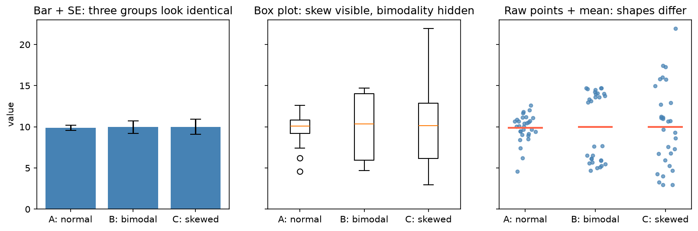

[資料處理與 EDA](../README.md) › [視覺化](README.md) › 圖表設計原則

# 圖表設計原則 (Chart Design Principles)

圖表的目標是讓讀者快速抓到重點，而且不被比例尺、顏色或摘要方式誤導。設計錯了，再正確的分析結果也會被誤讀。

## 先問三個問題

| 問題 | 影響 |
| --- | --- |
| 要回答比較、分布、關係，還是時間趨勢？ | 決定圖型（見 [選圖速查](README.md#選圖速查)） |
| 讀者要精確數值，還是整體模式？ | 精確數值 → 表格或直接標註；模式 → 圖 |
| 自己探索，還是對外溝通？ | 探索求快、可粗糙；溝通要標題寫結論、刪掉多餘元素 |

## 好圖的共同特徵

| 元素 | 做法 |
| --- | --- |
| 標題 | 直接寫結論或問題（"Treatment B lowers CRP"），不只是欄位名 |
| 軸 | 標籤與單位完整；倍數變化 (fold change)、濃度、count 等跨數量級的資料用 log 軸 |
| 顏色 | 有功能才用；同一份報告中同一顏色代表同一件事 |
| 排序 | 類別依數值排序，而不是字母順序 |
| 密度 | 不塞太多圖層、註記、圖例；能直接標註就移除圖例 |
| 分組 | 子群多時用 small multiples / facet，共用同一尺度 |

## 常見誤導

| 錯誤 | 問題 | 改法 |
| --- | --- | --- |
| 長條圖 y 軸不從 0 開始 | 長條長度與數值不成比例，差異被放大 | 長條圖從 0 開始；要看細微差異改用點圖或折線（可不從 0） |
| 只畫平均 ± SE 的長條圖（dynamite plot） | 看不到分布形狀、樣本數、離群值 | 畫原始點 + 平均 / 中位數，或 box + 點 |
| 誤差線沒說明是 SD、SE 還是 CI | 三者大小差很多，讀者無法判讀 | 圖說寫清楚；描述變異用 SD，描述估計精確度用 CI（見 [SD vs SE](../../statistics/descriptive-statistics/univariate-numerical.md#標準差-vs-標準誤-sd-vs-se)） |
| 類別多還用圓餅圖 | 角度難比較，超過 4–5 類就讀不出差異 | 排序長條圖 |
| 雙 y 軸 | 兩軸刻度可任意調整，相關看起來多強都可以 | 分成上下兩個子圖共用 x 軸，或標準化到同一尺度 |
| 過度平滑 | 掩蓋離群值、雙峰 | 搭配原始點或 histogram |
| 大量點互相覆蓋 (overplotting) | 密度看不出來 | 透明度、hexbin，見 [Scatter Plot](matplotlib/scatter-plot.md) |
| 所有子群疊在同一張圖 | 線條、顏色太多 | small multiples |

三組平均都約 10（n = 30）：A 為常態、B 為雙峰、C 為右偏。長條 + SE 完全看不出差別；箱型圖看得出 C 的偏態，但 B 的雙峰仍被藏起來；只有畫出原始點才看到三組形狀完全不同。生物實驗 n 通常不大，直接畫點幾乎總是更好的選擇。

## 顏色

| 資料型態 | 色盤 | 例子 |
| --- | --- | --- |
| 類別 (qualitative) | 彼此可區分、無順序 | `tab10`、Seaborn `colorblind`、Okabe–Ito |
| 連續、單向 (sequential) | 亮度單調變化 | `viridis`、`magma`、`Blues` |
| 有中心點 (diverging) | 兩端不同色、中心淺色 | `RdBu_r`、`vlag`、`coolwarm`；設 `center=0`（相關、log fold change、z-score） |

- 約 8% 男性有紅綠色覺異常：避免只靠紅 / 綠區分（heatmap 的紅綠配色尤其常見），改用藍 / 橘或加形狀。
- `jet` / `rainbow` 亮度不單調，會製造假邊界；連續資料改用 `viridis`。
- diverging 色盤的兩端要對稱（`vmin=-v, vmax=v`），否則 0 不在中間的白色。

## 出版與輸出

| 需求 | 做法 |
| --- | --- |
| 向量圖（論文、可再編輯） | `fig.savefig("fig.pdf")` 或 `.svg`；點數極多時用 `rasterized=True` 只把散點轉點陣，避免檔案爆大 |
| 點陣圖（投影片、網頁） | `.png`，`dpi=300` |
| 不切到標籤 | `bbox_inches="tight"` 或 `layout="constrained"` |
| 尺寸 | 直接用期刊欄寬設定 `figsize`（單欄約 3.5 in、雙欄約 7 in），不要事後縮放，字才不會變太小 |
| 中文字型 | 見 [Matplotlib 基礎](matplotlib/basics.md#中文字型) |

## 實務流程

1. 先畫草稿，確認這個問題適合哪種圖。
2. 調整排序、標籤、顏色、版面。
3. 最後才處理字體、主題與輸出尺寸；若要在手機或窄螢幕閱讀，確認標籤長度、字體大小、facet 排列。
