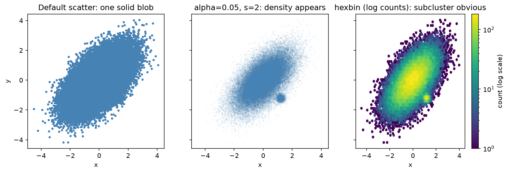

[視覺化](../README.md) › [Matplotlib](README.md) › 散布圖

# 散布圖 (Scatter Plot)

散布圖呈現兩個連續變數的關係：方向、強度、是否非線性、有無分群與離群值。相關係數只是一個數字，散布圖才看得到形狀（見 [雙變數分析](../../../statistics/descriptive-statistics/bivariate.md)）。

```python
import matplotlib.pyplot as plt
import numpy as np
import seaborn as sns

iris = sns.load_dataset("iris")
x, y = iris["sepal_length"], iris["petal_length"]

fig, axes = plt.subplots(1, 3, figsize=(14, 4), layout="constrained")

# 1. 依類別分組上色：每組各畫一次並給 label
for species, d in iris.groupby("species"):
    axes[0].scatter(d["sepal_length"], d["petal_length"], label=species, alpha=0.7)
axes[0].legend()

# 2. 用顏色 (c) 與大小 (s) 編碼第三、四個變數
sc = axes[1].scatter(x, y, c=iris["petal_width"], s=iris["sepal_width"] * 15,
                     cmap="viridis", alpha=0.7)
fig.colorbar(sc, ax=axes[1], label="Petal width (cm)")

# 3. 線性趨勢線 + 註解單一點
slope, intercept = np.polyfit(x, y, deg=1)
xs = np.linspace(x.min(), x.max(), 100)
axes[2].scatter(x, y, alpha=0.6)
axes[2].plot(xs, slope * xs + intercept, color="tomato", label=f"y = {slope:.2f}x {intercept:+.2f}")
i = y.idxmax()
axes[2].annotate("max petal length", xy=(x[i], y[i]), xytext=(5, 6.5),
                 arrowprops={"arrowstyle": "->", "color": "gray"})
axes[2].legend()

for ax in axes:
    ax.set(xlabel="Sepal length (cm)", ylabel="Petal length (cm)")
```

| 參數 | 用途 |
| --- | --- |
| `c=` | 顏色；給數值欄位時依 `cmap` 對應，需加 `colorbar` |
| `s=` | 點面積（單位 points²），可對應數值欄位 |
| `alpha=` | 透明度，處理點重疊 |
| `marker=`、`edgecolor=` | 點形狀與邊框 |
| `np.polyfit(x, y, deg)` | 多項式最小平方擬合；要 CI 或殘差用 Seaborn `regplot` / statsmodels |

> 趨勢線要畫在排序過的 x 上（如上面的 `xs`），直接用原始 x 畫 `plot` 會來回連線。

## 點太多：Overplotting

基因表現（數萬個基因）、單細胞（數十萬個細胞）、GWAS（數百萬個 SNP）的散布圖，預設設定會把點疊成一整塊：

```python
ax.scatter(x, y, s=2, alpha=0.05, rasterized=True)   # 小點 + 透明；rasterized 讓 PDF 不爆大
ax.hexbin(x, y, gridsize=60, bins="log", cmap="viridis")   # 六角格計數，log 色階
```



50,000 個點中藏了一個 1,500 點的密集小群。預設畫法只看到一整團；調小點與透明度後密度浮現；hexbin（log 計數）把小群標得最清楚。Seaborn 對應的是 `sns.histplot(x=, y=)`（2D 直方圖）與 `sns.kdeplot(x=, y=)`。

## 相關

| 主題 | 連結 |
| --- | --- |
| 依類別上色、facet、迴歸線的高階寫法 | [Seaborn 關係圖](../seaborn/relational.md)、[迴歸圖](../seaborn/regression.md) |
| 多變數兩兩散布 | [Seaborn 矩陣圖](../seaborn/matrix.md) |
