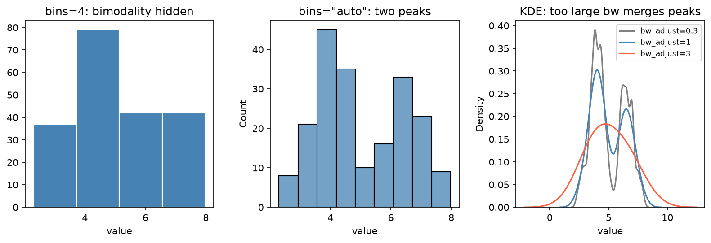

[視覺化](../README.md) › [Seaborn](README.md) › 分布圖

# 分布圖 (Distribution Plots)

看單一連續變數的形狀：中心、離散、偏態、峰的數量、尾巴。分布的統計描述見 [單變數：數值型](../../../statistics/descriptive-statistics/univariate-numerical.md)。

| 函式 | 畫什麼 | y 軸預設 | 優點 | 缺點 |
| --- | --- | --- | --- | --- |
| `histplot` | 直方圖 | count | 直觀、看得到原始次數 | 形狀受 bins 影響 |
| `kdeplot` | 核密度估計 (KDE) 平滑曲線 | density（面積 = 1） | 多組疊加清楚 | 受頻寬影響；會延伸到不可能的值（負濃度） |
| `ecdfplot` | 經驗累積分布 (ECDF) | proportion | 沒有參數可調、看得到每個點；百分位直接讀 | 形狀不如直方圖直覺 |
| `displot(kind=)` | 以上三者的 figure-level 版 | — | 可 `col=` / `row=` facet | 回傳 `FacetGrid` |

## 寫法

```python
import seaborn as sns
import matplotlib.pyplot as plt

iris = sns.load_dataset("iris")
fig, axes = plt.subplots(2, 2, figsize=(10, 7), layout="constrained")

# 1. 直方圖 + KDE
sns.histplot(data=iris, x="petal_width", bins=15, kde=True, ax=axes[0, 0])

# 2. 分組：multiple= "layer"（疊加，預設）、"stack"、"dodge"、"fill"
sns.histplot(data=iris, x="sepal_length", hue="species", multiple="stack", ax=axes[0, 1])

# 3. 分組 KDE：common_norm=False 讓每組各自面積 = 1
sns.kdeplot(data=iris, x="sepal_length", hue="species", common_norm=False, fill=True, ax=axes[1, 0])

# 4. ECDF：曲線越右代表數值越大
sns.ecdfplot(data=iris, x="sepal_length", hue="species", ax=axes[1, 1])

# figure-level：依物種分子圖
sns.displot(data=iris, x="petal_length", col="species", kind="hist", height=3)
```

| 參數 | 用途 |
| --- | --- |
| `bins` / `binwidth` | 區間數或寬度；Seaborn 預設 `"auto"` |
| `stat` | `"count"`、`"frequency"`、`"probability"`（總和 = 1）、`"percent"`、`"density"`（面積 = 1） |
| `common_norm` | `hue` 分組時是否**全部合起來**正規化（預設 `True`） |
| `bw_adjust` | KDE 頻寬倍數；< 1 較崎嶇、> 1 較平滑 |
| `cut=0` | KDE 不延伸到資料範圍外 |
| `log_scale=True` | x 軸取 log（表現量、濃度） |
| `element="step"` | 直方圖只畫外框，多組疊加較清楚 |

> **`common_norm` 陷阱**：`hue` 分組時預設 `common_norm=True`，所有組的面積**加總**為 1，樣本數大的組曲線較高。要比較各組的**形狀**，設 `common_norm=False`（`histplot` 同時設 `stat="density"`）。

## bins 與頻寬



同一組雙峰資料（n = 200）：只用 4 個 bins 時看起來像單峰右偏；`bins="auto"` 才看到兩個峰。KDE 的頻寬同理：`bw_adjust=0.3` 出現雜訊造成的小峰，`bw_adjust=3` 把兩峰合成一個。判斷「是否雙峰」前，至少換兩三種 bins / 頻寬確認，或改看 ECDF。

## 類別 vs 連續

| 變數 | 用 | 原因 |
| --- | --- | --- |
| 類別（物種、基因型） | `countplot` | 每個類別一根，見 [類別圖](categorical.md) |
| 離散整數、取值少（家庭人數、突變數 0–5） | `histplot(discrete=True)` | 每個整數一根，對齊在整數中心 |
| 連續（長度、表現量） | `histplot` / `kdeplot` / `ecdfplot` | 需要分區間或平滑 |

## 雙變數分布

```python
sns.histplot(data=iris, x="sepal_length", y="petal_length")            # 2D 直方圖
sns.kdeplot(data=iris, x="sepal_length", y="petal_length", hue="species", levels=5)
sns.jointplot(data=iris, x="sepal_length", y="petal_length", kind="hex")   # 中間散布 + 邊緣分布
```

點數很多時 2D 直方圖 / hexbin 比散布圖好讀，見 [Overplotting](../matplotlib/scatter-plot.md#點太多overplotting)。
