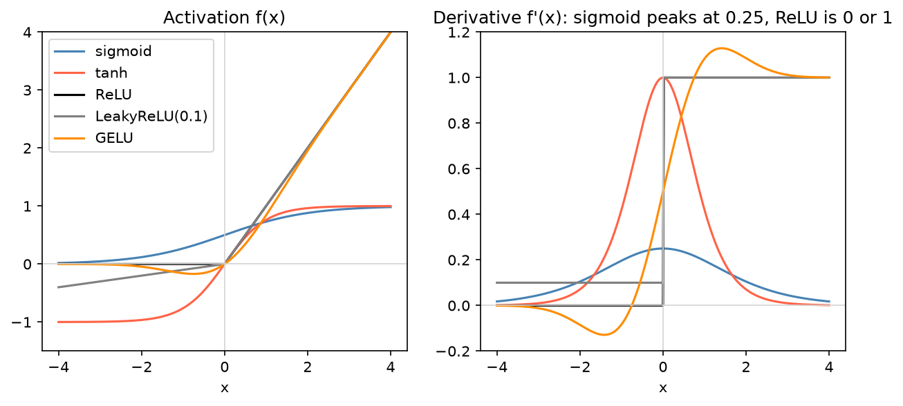

[Deep Learning](../README.md) › [基礎](README.md) › 激活函數

# 激活函數 (Activation Functions)

激活函數在層與層之間加入非線性。沒有它，再多層的網路都等於一個 [線性層](linear-layer.md)。它的**導數**決定梯度能否順利往回傳，因此直接影響能不能訓練起來。

## 常用函數

| 函數 | 公式 | 值域 | 導數特性 | 用在哪 |
| --- | --- | --- | --- | --- |
| Sigmoid | $\sigma(x) = \dfrac{1}{1+e^{-x}}$ | (0, 1) | $\sigma(1-\sigma)$，最大 0.25；兩端趨近 0 | 二元分類**輸出**、gate（LSTM） |
| Tanh | $\tanh(x)$ | (−1, 1) | $1-\tanh^2$，最大 1；兩端趨近 0 | RNN 隱藏狀態 |
| **ReLU** | $\max(0, x)$ | [0, ∞) | x > 0 為 1，否則 0 | CNN、MLP 隱藏層預設 |
| Leaky ReLU | $\max(\alpha x, x)$，α 約 0.01 | ℝ | 負區斜率 α | ReLU 出現大量死神經元時 |
| **GELU** | $x \cdot \Phi(x)$ | 約 [−0.17, ∞) | 平滑、負區有小梯度 | **Transformer**（BERT、GPT、ESM） |
| SiLU / Swish | $x \cdot \sigma(x)$ | 約 [−0.28, ∞) | 平滑 | EfficientNet、部分 LLM（SwiGLU） |
| Softmax | $\dfrac{e^{x_i}}{\sum_j e^{x_j}}$ | (0, 1)，總和 1 | — | 多類別輸出（通常交給 loss 處理） |



> 判讀：sigmoid 導數最大只有 0.25，連乘 10 層後梯度剩 $0.25^{10} \approx 10^{-6}$——這就是**梯度消失 (vanishing gradient)**。ReLU 在正區導數恆為 1，梯度不會被縮小，但負區導數為 0：若某個神經元對所有輸入都輸出負值，它永遠不會更新（**死神經元 dead ReLU**）。

## 為什麼導數重要

反向傳播時，每經過一層梯度就乘上該層激活函數的導數（[鏈鎖律](backpropagation.md#鏈鎖律)）：

| 導數 | 結果 | 對策 |
| --- | --- | --- |
| 長期 < 1（sigmoid、tanh 飽和區） | 梯度消失，前面的層學不動 | 隱藏層改 ReLU / GELU、[殘差連接](../computer-vision/convolutional-neural-networks.md#經典架構)、[normalization](regularization-and-normalization.md) |
| 長期 > 1（或權重太大） | 梯度爆炸，loss 變 NaN | [初始化](weight-initialization.md)、gradient clipping、降低學習率 |
| 恆為 0（死 ReLU） | 神經元停止學習 | Leaky ReLU / GELU、降低學習率 |

## PyTorch 用法

```python
import torch
from torch import nn
import torch.nn.functional as F

# 1. 當作層放進模型（隱藏層）
model = nn.Sequential(
    nn.Linear(6, 16), nn.ReLU(),
    nn.Linear(16, 16), nn.GELU(),
    nn.Linear(16, 1),                 # 輸出 logits，不接 Sigmoid → 用 BCEWithLogitsLoss
)

# 2. 函式寫法（自訂 forward 裡常用）
x = torch.tensor([-1.0, 0.0, 2.0])
F.relu(x)                             # tensor([0., 0., 2.])
F.leaky_relu(x, negative_slope=0.01)  # tensor([-0.0100, 0.0000, 2.0000])
torch.sigmoid(x)                      # tensor([0.2689, 0.5000, 0.8808])

# 3. softmax 一定要指定 dim（類別所在的維度）
logits = torch.tensor([[1.0, 2.0, 3.0, 4.0]])
F.softmax(logits, dim=-1)             # tensor([[0.0321, 0.0871, 0.2369, 0.6439]])
```

## 輸出層怎麼選

| 任務 | 輸出層 | 搭配 loss |
| --- | --- | --- |
| 二元分類 / 多標籤 (multi-label) | 1 或 K 個 logits（不接 sigmoid） | `BCEWithLogitsLoss` |
| 多類別單選 | K 個 logits（不接 softmax） | `CrossEntropyLoss` |
| 迴歸 | 無激活 | `MSELoss` / `L1Loss` |
| 非負輸出（計數、表現量） | `softplus` 或 `exp` | Poisson / NB 負對數似然 |

細節見 [損失函數](loss-functions.md)。2 類 softmax 等價於 sigmoid：$\text{softmax}(z_1, z_2)_1 = \sigma(z_1 - z_2)$。
