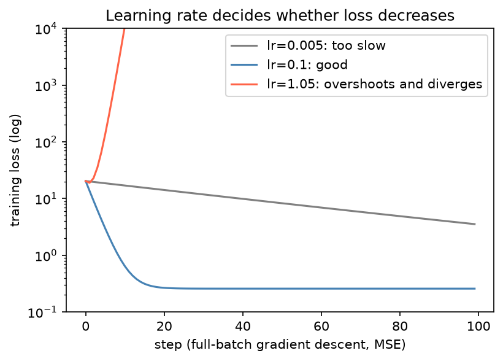

[Deep Learning](../README.md) › [基礎](README.md) › 反向傳播與 Optimizer

# 反向傳播與 Optimizer (Backpropagation and Optimizers)

訓練 = 反覆「前向算 loss → 反向算梯度 → optimizer 更新參數」。反向傳播 (backpropagation) 用鏈鎖律有效率地算出 loss 對每個參數的梯度；optimizer 決定拿這個梯度怎麼走一步。

## 一步訓練

```
forward：x → model → ŷ → loss(ŷ, y)
backward：loss.backward() → 每個參數的 .grad = ∂L/∂w
update：optimizer.step() → w ← w − η · ∂L/∂w（SGD 的情況）
清零：optimizer.zero_grad() → PyTorch 預設把梯度「累加」，每步要清掉
```

```python
import torch
from torch import nn

model = nn.Sequential(nn.Linear(16, 8), nn.ReLU(), nn.Linear(8, 2))   # 最後輸出 logits
criterion = nn.CrossEntropyLoss()                                       # 內含 softmax，不要再接 nn.Softmax
optimizer = torch.optim.SGD(model.parameters(), lr=0.01)

x, y = torch.randn(4, 16), torch.tensor([1, 0, 1, 1])
loss = criterion(model(x), y)        # 1. forward
optimizer.zero_grad()                # 2. 清除上一步的梯度
loss.backward()                      # 3. 算梯度
optimizer.step()                     # 4. 更新
model[0].weight.grad.shape           # torch.Size([8, 16])  梯度與參數同 shape
```

完整的 epoch / validation 迴圈見 [PyTorch 訓練迴圈](../training-workflows/pytorch-training-loop.md)。

## 鏈鎖律

對 $\hat y = f_2(f_1(x; w_1); w_2)$，

$$
\frac{\partial L}{\partial w_1} = \frac{\partial L}{\partial \hat y}\cdot\frac{\partial \hat y}{\partial h_1}\cdot\frac{\partial h_1}{\partial w_1}
$$

| 觀念 | 說明 |
| --- | --- |
| 從輸出往回算 | 後面層算好的梯度可重用，所以一次 backward 的成本約等於一次 forward |
| 每層乘上局部導數 | 激活函數導數長期 < 1 → 梯度消失；> 1 → 爆炸（見 [激活函數](activation-functions.md#為什麼導數重要)） |
| 需要存中間結果 | forward 的 activation 要留到 backward，所以**訓練比推論吃記憶體**；batch 越大越多 |
| autograd 自動完成 | 只要運算是 PyTorch 的 tensor 運算，就不必手寫導數 |

## 學習率 (Learning Rate)

$$
w \leftarrow w - \eta \cdot \frac{\partial L}{\partial w}
$$



| 學習率 | 現象 | 怎麼看出來 |
| --- | --- | --- |
| 太小 | loss 緩慢下降，訓練很久 | 曲線幾乎是直線 |
| 適中 | 快速下降後趨平 | — |
| 太大 | 越過最低點來回震盪，最後發散、loss 變 NaN | loss 上升或爆成 `inf` / `nan` |

> 學習率是 DL 中最該先調的超參數。常見起點：Adam / AdamW 用 `1e-3`（從頭訓練）或 `1e-5`～`5e-5`（fine-tune 預訓練 Transformer）；SGD + momentum 用 `0.1`～`0.01`。學習率在訓練中逐步調降（scheduler）見 [訓練迴圈](../training-workflows/pytorch-training-loop.md#學習率排程-scheduler)。

## Optimizer

| Optimizer | 更新規則（直覺） | 適合 |
| --- | --- | --- |
| SGD | 沿負梯度走固定步長 | 教學；搭配 momentum 後在 CNN 常有最好的泛化 |
| SGD + momentum | 累積過去梯度方向，像有慣性的球 | CNN 從頭訓練（`momentum=0.9`） |
| Adam | 每個參數有自己的步長（用梯度一階、二階動差估計） | 多數情況的預設，對學習率較不敏感 |
| **AdamW** | Adam + 正確實作的 weight decay | **Transformer、fine-tune 的預設** |
| RMSprop | 只用二階動差 | RNN（舊）|

```python
torch.optim.SGD(model.parameters(), lr=0.01, momentum=0.9)
torch.optim.Adam(model.parameters(), lr=1e-3)
torch.optim.AdamW(model.parameters(), lr=3e-4, weight_decay=0.01)

# 不同層用不同學習率（fine-tune：預訓練骨幹小、新的分類頭大）
torch.optim.AdamW([
    {"params": backbone.parameters(), "lr": 1e-5},
    {"params": head.parameters(),     "lr": 1e-3},
])
```

> Adam 的 `weight_decay` 等於加 L2 懲罰，但會被自適應步長縮放，效果不一致；要做 weight decay 就用 AdamW。兩者的關係見 [正則化](regularization-and-normalization.md#weight-decay)。

## 梯度問題排查

| 症狀 | 可能原因 | 處理 |
| --- | --- | --- |
| loss 一開始就 NaN | 學習率太大、輸入有 NaN / inf、log(0) | 降學習率、檢查資料、用 `BCEWithLogitsLoss` 而非手寫 log |
| 訓練中途 NaN | 梯度爆炸 | gradient clipping（下方）、降學習率、混合精度改 bf16 |
| loss 完全不動 | 忘了 `optimizer.step()`、參數被凍結、學習率太小、死 ReLU | 檢查 `requires_grad`、確認 optimizer 收到正確參數 |
| loss 降很慢且不穩 | 輸入沒標準化、初始化不當 | 標準化特徵、[初始化](weight-initialization.md)、加 [normalization](regularization-and-normalization.md) |

```python
loss.backward()
torch.nn.utils.clip_grad_norm_(model.parameters(), max_norm=1.0)   # 在 step 之前
optimizer.step()

# 檢查哪些層梯度異常
for name, p in model.named_parameters():
    if p.grad is not None:
        print(name, p.grad.norm().item())
```

> 除錯第一步：拿 1 個小 batch 反覆訓練，模型應該能把 loss 壓到接近 0（overfit 一個 batch）。做不到代表模型、loss 或資料管線有 bug，不是資料不夠。
