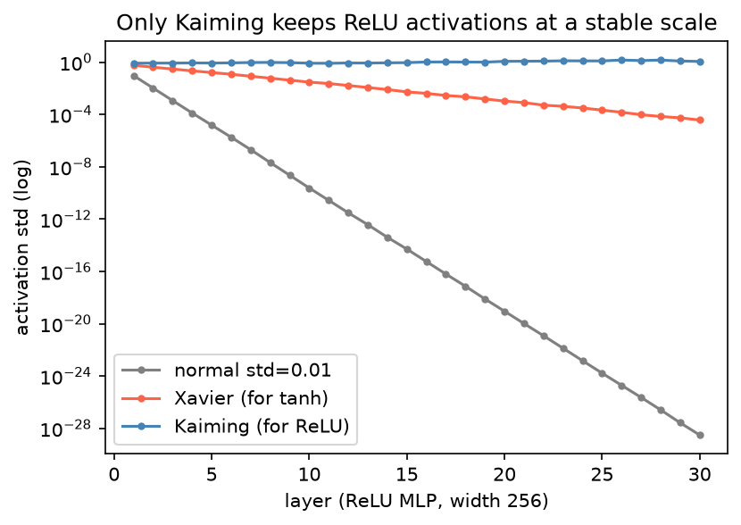

[Deep Learning](../README.md) › [基礎](README.md) › 權重初始化

# 權重初始化 (Weight Initialization)

初始化決定訓練的起點。權重太小，訊號一層層縮小到 0；太大則爆炸。好的初始化讓每一層輸出的變異數大致維持不變，深層網路才訓練得動。

## 為什麼重要



30 層 ReLU MLP，同一批輸入：`normal(std=0.01)` 的輸出在幾層內就縮到 $10^{-28}$（梯度同樣消失）；Xavier 是為 tanh 設計的，用在 ReLU 上每層縮小約一半；Kaiming 把 ReLU 砍掉一半訊號的效應補回來，變異數維持穩定。

## 方法比較

| 方法 | 權重變異數 | 適合的激活函數 | PyTorch |
| --- | --- | --- | --- |
| 常數 0 | — | **不要用在權重**：所有神經元對稱、學到一樣的東西 | `nn.init.zeros_`（bias 可用） |
| 小常態 / 均勻 | 自訂 | 淺層網路、embedding | `nn.init.normal_(w, 0, 0.02)` |
| Xavier / Glorot | $\frac{2}{n_{in}+n_{out}}$ | tanh、sigmoid | `nn.init.xavier_uniform_` / `xavier_normal_` |
| **Kaiming / He** | $\frac{2}{n_{in}}$ | ReLU、Leaky ReLU | `nn.init.kaiming_normal_(w, nonlinearity="relu")` |
| Orthogonal | 正交矩陣 | RNN 的 recurrent 權重 | `nn.init.orthogonal_` |

## PyTorch 預設

`nn.Linear`、`nn.Conv2d` 建立時已用 Kaiming uniform 的變體（`a=√5`，等效於 $U(-1/\sqrt{n_{in}}, 1/\sqrt{n_{in}})$）初始化，bias 也是小範圍均勻分布。多數情況**不必手動初始化**，搭配 [BatchNorm / LayerNorm](regularization-and-normalization.md) 後對初始化更不敏感。需要自訂時：

```python
import torch
from torch import nn

def init_weights(m):
    if isinstance(m, nn.Linear):
        nn.init.kaiming_normal_(m.weight, nonlinearity="relu")
        nn.init.zeros_(m.bias)

torch.manual_seed(42)                        # 初始化也是隨機的；要可重現先設 seed
model = nn.Sequential(nn.Linear(64, 128), nn.ReLU(), nn.Linear(128, 2))
model.apply(init_weights)                    # 遞迴套用到每個子模組

# 只重設某一層（例如 fine-tune 時換掉分類頭）
model[2].reset_parameters()                  # 回到該層的預設初始化
model[0].weight.min(), model[0].weight.max() # 檢查範圍
```

## 什麼時候會重設權重

| 情境 | 做法 |
| --- | --- |
| [遷移學習](../training-workflows/transfer-learning.md) 換新任務 | 只重建 / 重設最後的分類頭，骨幹保留預訓練權重 |
| 比較不同 seed 的穩定性 | 每次重建模型並換 seed，報告平均 ± 標準差 |
| 自己實作的深層架構訓練不動 | 檢查初始化是否與激活函數匹配 |
| Transformer 從頭訓練 | 常見 `normal(0, 0.02)`，殘差分支輸出層再縮小 |
