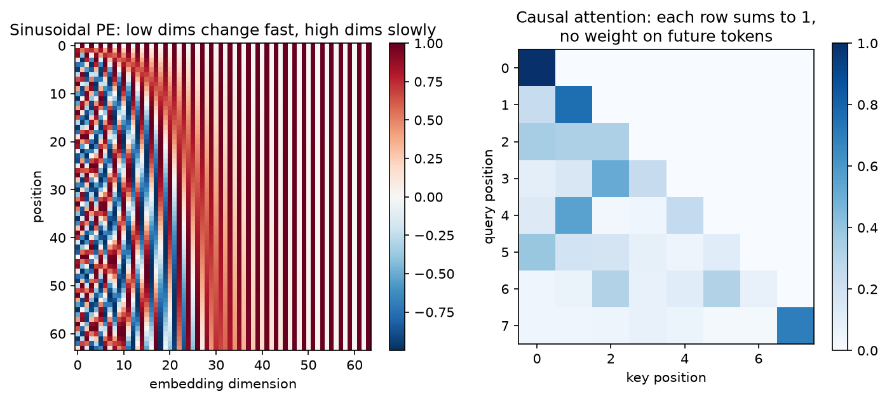

[Deep Learning](../README.md) › [NLP 與 Transformer](README.md) › Transformer 與 Attention

# Transformer 與 Attention (Transformers and Attention)

Transformer（Vaswani et al., 2017）拿掉了 RNN 的逐步狀態傳遞，改用 **attention**：每個 token 直接看整條序列，依相關程度加權彙整其他位置的資訊。這讓長距離依賴更容易學、訓練可完全平行，成為 LLM、BERT、蛋白質語言模型（ESM）與 ViT 的共同骨架。

## Scaled Dot-Product Attention

每個 token 的向量 $x$ 經三個線性層投影成：

| 向量 | 角色 | 比喻 |
| --- | --- | --- |
| Query $q = xW_Q$ | 我在找什麼 | 搜尋關鍵字 |
| Key $k = xW_K$ | 我能提供什麼 | 文件標題 |
| Value $v = xW_V$ | 實際被取走的內容 | 文件內容 |

$$
\text{Attention}(Q, K, V) = \text{softmax}\!\left(\frac{QK^\top}{\sqrt{d_k}}\right) V
$$

| 步驟 | shape（單一 head，序列長 L） | 意義 |
| --- | --- | --- |
| $QK^\top$ | `(L, L)` | 每對 (query, key) 的相似度 |
| $/\sqrt{d_k}$ | `(L, L)` | 縮放；否則維度大時內積過大，softmax 飽和、梯度消失 |
| mask | `(L, L)` | padding 或未來位置設成 $-\infty$ |
| softmax（沿 key 維） | `(L, L)` | 每列總和為 1 的注意力權重 |
| 乘 $V$ | `(L, d_v)` | 每個位置得到其他位置 value 的加權平均 |

```python
import torch
import torch.nn.functional as F

def attention(q, k, v, mask=None):                   # q, k, v: (batch, L, d)
    scores = q @ k.transpose(-2, -1) / q.size(-1) ** 0.5
    if mask is not None:
        scores = scores.masked_fill(mask, float("-inf"))   # mask 為 True 的位置不可看
    w = scores.softmax(dim=-1)
    return w @ v, w

q = k = v = torch.randn(2, 5, 16)
causal = torch.triu(torch.ones(5, 5, dtype=torch.bool), diagonal=1)   # 上三角 = 未來
out, w = attention(q, k, v, causal)
out.shape, w.sum(-1)[0]                              # torch.Size([2, 5, 16])，每列和為 1

# 實務用內建版本（自動選 FlashAttention 等高效實作）
F.scaled_dot_product_attention(q, k, v, is_causal=True)
```

## Multi-Head Attention

把 $d_{model}$ 切成 h 份，各自做一次 attention（不同的 $W_Q, W_K, W_V$），再串接投影回 $d_{model}$。不同 head 可以注意不同關係（相鄰位置、語法依存、蛋白質中的接觸殘基對）。

```python
from torch import nn

mha = nn.MultiheadAttention(embed_dim=64, num_heads=8, batch_first=True)   # 每個 head 64/8 = 8 維
x = torch.randn(2, 10, 64)
out, weights = mha(x, x, x)                          # self-attention：Q、K、V 都來自 x
out.shape, weights.shape                             # (2, 10, 64), (2, 10, 10)  權重預設對 head 平均
```

| 類型 | Q 來自 | K、V 來自 | 用在 |
| --- | --- | --- | --- |
| Self-attention | 自己 | 自己 | encoder、decoder |
| Causal (masked) self-attention | 自己 | 自己（只看過去） | GPT 類生成模型 |
| Cross-attention | decoder | encoder 輸出 | 翻譯、影像描述、條件生成 |

## 位置編碼 (Positional Encoding)

attention 本身不知道順序：把序列打亂，每個 token 得到的加權平均完全一樣（permutation equivariant）。所以要把位置資訊加進輸入。

| 方法 | 做法 | 用在 |
| --- | --- | --- |
| Sinusoidal | 不同頻率的 sin / cos，直接加到 embedding | 原始 Transformer |
| 可學習絕對位置 | `nn.Embedding(max_len, d)` | BERT、ViT；不能超過訓練時的最大長度 |
| 相對位置 / **RoPE** | 依兩 token 的距離旋轉 Q、K | 多數現代 LLM、ESM-2；較能外推到更長序列 |

$$
PE_{(pos, 2i)} = \sin\!\left(\frac{pos}{10000^{2i/d}}\right), \qquad PE_{(pos, 2i+1)} = \cos\!\left(\frac{pos}{10000^{2i/d}}\right)
$$



左圖：每個位置得到獨特的 sin / cos 組合，低維度變化快（分辨相鄰位置）、高維度變化慢（分辨遠距離）。右圖：causal mask 下的注意力權重，上三角全為 0，每列總和為 1。

## Transformer Block

```
x ─► LayerNorm ─► Multi-Head Attention ─► (+) ─► LayerNorm ─► FFN (Linear → GELU → Linear) ─► (+) ─► 輸出
│                                          ▲  │                                                ▲
└──────────────── residual ────────────────┘  └─────────────────── residual ───────────────────┘
```

| 元件 | 作用 |
| --- | --- |
| Residual connection | 梯度直接回傳，能疊很深（同 [ResNet](../computer-vision/convolutional-neural-networks.md#經典架構)） |
| [LayerNorm](../fundamentals/regularization-and-normalization.md#batchnorm-vs-layernorm) | 穩定訓練；現代模型多放在子層之前（pre-norm） |
| FFN | 每個位置各自通過的兩層 MLP，隱藏層通常是 $4 \times d_{model}$；參數量大半在這裡 |

```python
layer = nn.TransformerEncoderLayer(d_model=64, nhead=8, dim_feedforward=256,
                                   activation="gelu", batch_first=True, norm_first=True)
encoder = nn.TransformerEncoder(layer, num_layers=4)
pad_mask = torch.zeros(2, 10, dtype=torch.bool); pad_mask[1, 7:] = True   # True = padding
encoder(x, src_key_padding_mask=pad_mask).shape                           # torch.Size([2, 10, 64])
```

## 三種架構

| 架構 | 注意力 | 預訓練目標 | 代表模型 | 適合 |
| --- | --- | --- | --- | --- |
| Encoder-only | 雙向 | 遮蔽語言模型 (MLM)：猜被遮住的 token | BERT、**ESM-2**、DNABERT | 分類、序列標註、抽 embedding |
| Decoder-only | causal | 下一個 token 預測 | GPT、Llama、ProGen | 生成、LLM |
| Encoder-decoder | 雙向 + cross | 序列到序列 | T5、原始 Transformer | 翻譯、摘要 |

LLM 的訓練、對齊與使用見 [LLM 基礎](../../llm/llm-foundations.md)；fine-tune（LoRA / PEFT）見 [Fine-Tuning](../../llm/integration/fine-tuning.md)。

## 長序列的問題

attention 矩陣是 $L \times L$：序列長度加倍，記憶體與計算變 4 倍。對基因體（調控區域動輒數萬到數十萬 bp）尤其關鍵。

| 對策 | 例子 |
| --- | --- |
| 高效實作（不改數學） | FlashAttention（`F.scaled_dot_product_attention` 自動使用） |
| 先用 CNN / pooling 縮短序列再接 Transformer | Enformer |
| 稀疏 / 局部 attention | Longformer、BigBird |
| 非 attention 的長序列架構 | 狀態空間模型 (state space model)、Hyena 類（HyenaDNA、Caduceus） |

## 常見誤解

| 誤解 | 實際 |
| --- | --- |
| attention 權重 = 模型的解釋 | 權重高不等於因果上重要；多層、多 head 混合後更難解讀。需要解釋時用歸因方法並以實驗驗證 |
| Transformer 一定比較好 | 小資料、短序列時 CNN / LSTM / 樹模型常相當，且便宜得多 |
| 模型越大越好 | 標註品質、切分方式（同源序列洩漏）的影響常大於模型大小 |
| attention map 看起來像蛋白質接觸圖就代表學到結構 | ESM 的部分 head 確實與接觸圖相關，但仍需以結構資料驗證 |
