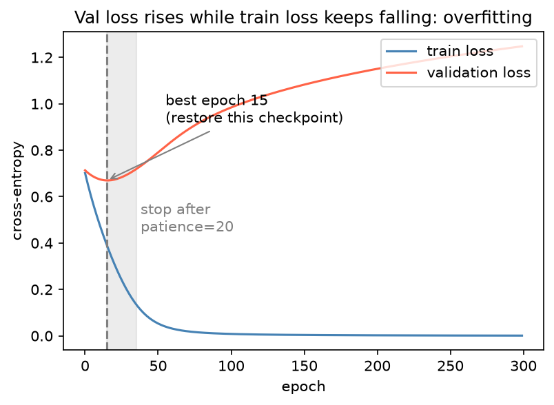

[Deep Learning](../README.md) › [訓練流程](README.md) › PyTorch 訓練迴圈

# PyTorch 訓練迴圈 (Training Loop)

PyTorch 沒有 `fit()`，訓練迴圈要自己寫。好處是每一步都看得見；壞處是很容易漏掉 `model.eval()`、`zero_grad()` 或在錯的地方算指標。這篇給一個可以直接套用的完整模板。

## 整體流程

```
資料切分（先切！以病人 / 個體 / 序列群為單位）
  ↓
Dataset（怎麼取第 i 筆）→ DataLoader（batch、shuffle、平行讀取）
  ↓
每個 epoch：
  ├─ train：model.train() → 每個 batch：forward → loss → zero_grad → backward → step
  ├─ eval ：model.eval() + no_grad → 算 validation loss / 指標
  ├─ scheduler.step()
  └─ 比較 val 指標：進步 → 存 checkpoint；連續 patience 次沒進步 → 停
  ↓
載回最佳 checkpoint → 在 test set 評估一次
```

## Dataset 與 DataLoader

| 元件 | 負責 | 要實作 |
| --- | --- | --- |
| `Dataset` | 給索引 i，回傳一筆 `(x, y)` | `__len__`、`__getitem__` |
| `DataLoader` | 組 batch、打亂、多程序讀取 | 設定參數即可 |
| `TensorDataset` | 資料已全在記憶體的 tensor 時的現成 Dataset | — |

```python
import torch
from torch.utils.data import Dataset, DataLoader, TensorDataset

# 1. 資料已在記憶體（表現量矩陣、特徵表）
train_ds = TensorDataset(torch.from_numpy(X_train).float(), torch.from_numpy(y_train).long())

# 2. 自訂 Dataset：檔案太大、需要逐筆讀取或做 augmentation
class SeqDataset(Dataset):
    def __init__(self, seqs, labels, augment=False):
        self.seqs, self.labels, self.augment = seqs, labels, augment
    def __len__(self):
        return len(self.seqs)
    def __getitem__(self, i):
        x = one_hot(self.seqs[i])                      # (4, L)
        if self.augment and torch.rand(1) < 0.5:
            x = x.flip(dims=[0, 1])                    # 反向互補（通道順序 ACGT 時）
        return x, torch.tensor(self.labels[i], dtype=torch.float32)

# 3. DataLoader
train_loader = DataLoader(train_ds, batch_size=64, shuffle=True,  num_workers=4, pin_memory=True)
val_loader   = DataLoader(val_ds,   batch_size=256, shuffle=False, num_workers=4)
```

| 參數 | 建議 |
| --- | --- |
| `shuffle` | train 為 `True`；val / test 為 `False` |
| `batch_size` | 先用 GPU 放得下的 32～256；eval 時可放大（不存梯度） |
| `num_workers` | 0 = 主程序讀取（最好除錯）；I/O 重時設 4～8。Windows / macOS 上要把主程式放在 `if __name__ == "__main__":` 內 |
| `pin_memory` | 用 GPU 時設 `True`，加快 CPU → GPU 傳輸 |
| `drop_last` | 最後一個 batch 很小且有 BatchNorm 時設 `True` |
| `sampler=WeightedRandomSampler(...)` | 類別不平衡時過採樣少數類（與 `shuffle` 互斥） |

## 完整模板

```python
import copy
import torch
from torch import nn
from torchmetrics.classification import MulticlassAccuracy   # pip install torchmetrics

device = "cuda" if torch.cuda.is_available() else "cpu"
model = nn.Sequential(nn.Linear(50, 128), nn.ReLU(), nn.Dropout(0.3), nn.Linear(128, 2)).to(device)
criterion = nn.CrossEntropyLoss()
optimizer = torch.optim.AdamW(model.parameters(), lr=1e-3, weight_decay=0.01)
scheduler = torch.optim.lr_scheduler.ReduceLROnPlateau(optimizer, mode="min", factor=0.5, patience=5)

def run_epoch(loader, train):
    model.train(train)                                 # True → train()；False → eval()
    metric = MulticlassAccuracy(num_classes=2).to(device)
    total_loss, n = 0.0, 0
    with torch.set_grad_enabled(train):                # eval 時不建運算圖
        for x, y in loader:
            x, y = x.to(device), y.to(device)
            logits = model(x)
            loss = criterion(logits, y)
            if train:
                optimizer.zero_grad()
                loss.backward()
                optimizer.step()
            total_loss += loss.item() * len(y)         # 依樣本數加權，最後一個 batch 較小也正確
            n += len(y)
            metric.update(logits, y)                   # 累積整個 epoch，最後一次算
    return total_loss / n, metric.compute().item()

best_loss, best_state, patience, bad = float("inf"), None, 20, 0
for epoch in range(200):
    tr_loss, tr_acc = run_epoch(train_loader, train=True)
    va_loss, va_acc = run_epoch(val_loader, train=False)
    scheduler.step(va_loss)                            # ReduceLROnPlateau 要傳監控值
    if va_loss < best_loss:
        best_loss, bad = va_loss, 0
        best_state = copy.deepcopy(model.state_dict())  # 或 torch.save 到硬碟
    else:
        bad += 1
        if bad >= patience:
            break
    print(f"{epoch:3d} train {tr_loss:.3f}/{tr_acc:.3f}  val {va_loss:.3f}/{va_acc:.3f}")

model.load_state_dict(best_state)                      # 用最佳 epoch 的權重，不是最後一個
```

| 容易漏掉的 | 後果 |
| --- | --- |
| `optimizer.zero_grad()` | 梯度跨 batch 累加，更新方向錯誤 |
| `model.eval()` | dropout 仍開、BatchNorm 用 batch 統計量 → validation 結果偏低且不穩定 |
| `torch.no_grad()` | 記憶體暴增（仍存運算圖） |
| `loss.item()` | 累加 tensor 會讓整個運算圖留在記憶體 |
| 每個 batch 算 accuracy 再平均 | 最後一個 batch 較小時加權錯誤；AUROC 等指標不能逐 batch 平均 → 用 torchmetrics 累積或收集所有預測再算 |

## Early Stopping



120 個樣本、50 個特徵、256 個隱藏單元：train loss 一路降到 0，validation loss 在第 15 個 epoch 後就上升。early stopping 在 val loss 連續 `patience` 個 epoch 沒有進步時停止，並**載回最佳 epoch 的權重**。

> 用 validation set 決定停在哪個 epoch，本身就是一種調參；最終效能必須在沒參與任何決策的 test set 上報告。樣本很少時，可用交叉驗證決定 epoch 數，再用全部訓練資料重訓固定 epoch 數。

## 學習率排程 (Scheduler)

| Scheduler | 行為 | 適合 |
| --- | --- | --- |
| `StepLR(step_size=30, gamma=0.1)` | 每 30 epoch 乘 0.1 | 經典 CNN 訓練 |
| `ReduceLROnPlateau` | val 指標停滯時降低 | 不確定要訓練多久時 |
| `CosineAnnealingLR(T_max=epochs)` | 餘弦曲線降到接近 0 | 固定 epoch 數的訓練 |
| `OneCycleLR(max_lr, total_steps)` | 先升後降 | 快速收斂；**每個 batch** 呼叫 `step()` |
| Linear warmup + decay | 前幾百步線性升高再下降 | Transformer 必備（`transformers.get_linear_schedule_with_warmup`） |

```python
optimizer.step()
scheduler.step()                          # 新版 PyTorch 要求在 optimizer.step() 之後
optimizer.param_groups[0]["lr"]           # 查目前學習率
```

## 資料切分（DL 特有的陷阱）

一般原則見 [資料洩漏](../../machine-learning/foundations/data-leakage.md) 與 [交叉驗證](../../machine-learning/workflow/cross-validation.md)。DL 資料常有隱藏的群組結構：

| 資料 | 切分單位 | 錯誤切法的後果 |
| --- | --- | --- |
| 病理切片的 patch、同一病人多張影像 | 病人 | 模型學到病人特徵（掃描儀、染色），分數虛高 |
| 蛋白質 / DNA 序列 | 序列相似度群（MMseqs2、CD-HIT 分群） | 同源序列跨 train / test，等於考古題 |
| 基因體區段 | 染色體（例如 chr8、chr9 留作 test） | 相鄰區段高度相關 |
| 單細胞 | 樣本 / 捐贈者 | 同一捐贈者的細胞跨 train / test |
| 時序（EHR） | 時間點 | 用未來預測過去 |

## 可重現性

```python
import random, numpy as np, torch

def set_seed(seed=42):
    random.seed(seed)
    np.random.seed(seed)                  # 第三方套件可能用全域 RNG；自己的程式碼仍建議 default_rng
    torch.manual_seed(seed)               # 也會設定所有 GPU
    torch.backends.cudnn.benchmark = False

set_seed(42)
torch.use_deterministic_algorithms(True)  # 遇到沒有確定性實作的運算會報錯；CUDA 上另需設環境變數 CUBLAS_WORKSPACE_CONFIG=:4096:8
g = torch.Generator().manual_seed(42)
DataLoader(train_ds, shuffle=True, generator=g)   # 固定 shuffle 順序
```

> 即使設好 seed，不同 GPU 型號、CUDA / PyTorch 版本仍可能有細微差異。比起追求逐位元相同，更重要的是**用多個 seed 重跑並回報平均 ± 標準差**——小資料集上 seed 造成的差異常大於方法之間的差異。

## 監控工具

| 工具 | 用途 |
| --- | --- |
| `torchmetrics` | 跨 batch 正確累積指標（AUROC、F1、Dice） |
| TensorBoard（`torch.utils.tensorboard.SummaryWriter`） | 本機畫 loss / 學習率曲線 |
| Weights & Biases、[MLflow](../../machine-learning/production/README.md) | 實驗追蹤、超參數比較 |
| PyTorch Lightning | 把上面的模板結構化（自動處理 train / eval 切換、checkpoint、多 GPU），見 [高效訓練](efficient-training-and-scaling.md) |
