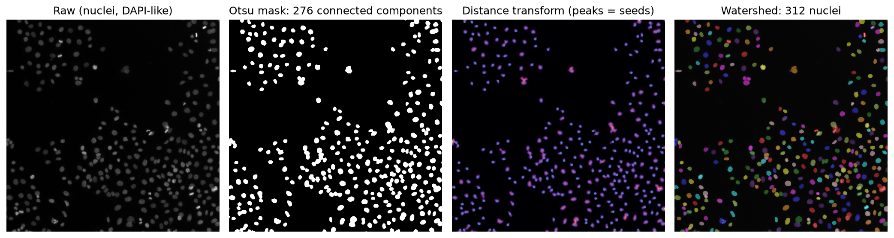

[Data Science](../README.md) › [Image Analysis](README.md) › scikit-image 影像處理

# scikit-image 影像處理 (Image Processing with scikit-image)

古典影像處理流程：不訓練模型，直接對影像做增強、修復、閾值、分割、邊緣偵測與量測。核心常是「先把訊號變乾淨，再把結構抽出來」。

```
載入 → 必要時轉灰階 → 濾波（去噪、平滑）→ 閾值 / 邊緣偵測 → 分割物件 → 量測（面積、強度、形狀）
```

## 影像就是 NumPy 陣列

| 影像 | shape | 說明 |
| --- | --- | --- |
| 灰階 | `(rows, cols)` | 一個通道 |
| RGB | `(rows, cols, 3)` | 最後一軸是通道 |
| 多通道螢光 | `(channels, rows, cols)` 或 `(rows, cols, channels)` | 依檔案而異，要確認 |
| 3D / 時間序列 | `(planes, rows, cols)`、`(t, ...)` | 見 [生醫影像分析](biomedical-image-analysis.md) |

| dtype | 範圍 | 注意 |
| --- | --- | --- |
| `uint8` | 0–255 | 一般照片 |
| `uint16` | 0–65535 | 顯微鏡常用（12 / 16-bit 相機） |
| `float` | 通常 0–1 | 多數 scikit-image 函式輸出 |

```python
import numpy as np
from skimage import io, color, img_as_float

img = io.imread("nuclei.tif")          # 顯微鏡 TIFF 也可用 tifffile.imread
img.shape, img.dtype, img.min(), img.max()
img = img_as_float(img)                # 轉成 0–1 float；不要自己除 255（16-bit 會錯）
gray = color.rgb2gray(rgb)             # RGB → 灰階（彩色影像才需要）
```

> 定量分析（比較螢光強度）要用原始資料，不要用存成 JPEG 或做過自動對比調整的影像；JPEG 有失真壓縮，自動對比會讓不同影像的強度不能比較。

## 濾波 (Filtering)

| 濾波 | 用途 | scikit-image | 注意 |
| --- | --- | --- | --- |
| Gaussian | 平滑、壓高頻雜訊、讓後續分割更穩 | `filters.gaussian(img, sigma=1)` | `sigma` 越大越模糊、細節一起抹掉；RGB 加 `channel_axis=-1` |
| Median | 去椒鹽雜訊、保留邊緣 | `filters.median(img, morphology.disk(2))` | 比 Gaussian 更能保留邊界 |
| Sobel | 強調邊緣（局部強度變化大處） | `filters.sobel(gray)` | 輸出是邊緣強度，不是二值圖 |
| 背景校正 | 移除不均勻照明 | `restoration.rolling_ball(img, radius=50)` | 半徑要大於物件 |

```python
from skimage import filters, restoration, morphology

smooth = filters.gaussian(gray, sigma=1)
denoised = restoration.denoise_tv_chambolle(gray, weight=0.1)    # 去噪但保留邊緣
background = restoration.rolling_ball(gray, radius=50)
corrected = gray - background
```

去噪不是越強越好：過度去噪會把想保留的細節一起消掉。可以先人為加雜訊（`util.random_noise`）測試流程是否穩定。

## 對比增強 (Contrast Enhancement)

| 方法 | 函式 | 適合 |
| --- | --- | --- |
| 線性拉伸 | `exposure.rescale_intensity(img, in_range=(p2, p98))` | 只為了看清楚；保留相對強度 |
| 直方圖等化 | `exposure.equalize_hist(gray)` | 重新分配亮度分布 |
| CLAHE（自適應直方圖等化） | `exposure.equalize_adapthist(gray, clip_limit=0.03)` | 光照不均、局部細節不明顯 |

```python
from skimage import exposure
p2, p98 = np.percentile(gray, (2, 98))
display = exposure.rescale_intensity(gray, in_range=(p2, p98))
```

> 對比增強會放大雜訊，而且改變強度的相對關係：用來**顯示**或幫助分割可以，量測強度時要回到原始影像。

## 修復 (Inpainting)

影像有刮痕、文字或局部缺損時，先用 mask 標出要修的區域，再用周圍未受損的區域估計內容：

```python
from skimage.restoration import inpaint

mask = np.zeros(img.shape[:2], dtype=bool)
mask[101:106, 0:240] = True
restored = inpaint.inpaint_biharmonic(img, mask, channel_axis=-1)   # RGB；灰階省略 channel_axis
```

## 閾值 (Thresholding)

把灰階影像轉成二值 mask，是很多分割流程的第一步，也是「把連續訊號變成結構假設」的一步：錯了會影響後面所有量測。

| 方法 | 函式 | 適合 |
| --- | --- | --- |
| Otsu | `filters.threshold_otsu` | 前景與背景強度呈雙峰 |
| Li、Triangle | `threshold_li`、`threshold_triangle` | 前景比例很小（稀疏螢光訊號） |
| 局部 (local) | `filters.threshold_local(img, block_size=51)` | 照明不均 |
| 多類別 | `filters.threshold_multiotsu(img, classes=3)` | 背景、弱訊號、強訊號 |

```python
from skimage import filters
filters.try_all_threshold(gray)                  # 一次比較多種全域方法
binary = smooth > filters.threshold_otsu(smooth)
```

同一批實驗的影像要用同一種閾值方法（或固定閾值），並報告用了哪一種。

## 分割細胞核：watershed

互相接觸的細胞核在閾值 mask 中會黏成一塊，connected components 會少算。標準做法：distance transform 的峰值當種子，再用 watershed 沿著「谷」切開。

```python
import pandas as pd
from scipy import ndimage as ndi
from skimage import measure, segmentation, feature

smooth = filters.gaussian(img, sigma=1)
mask = ndi.binary_fill_holes(smooth > filters.threshold_otsu(smooth))

dist = ndi.distance_transform_edt(mask)                          # 每個前景像素到背景的距離
coords = feature.peak_local_max(dist, min_distance=5, labels=measure.label(mask))
markers = np.zeros(mask.shape, dtype=int)
markers[tuple(coords.T)] = np.arange(1, len(coords) + 1)
labels = segmentation.watershed(-dist, markers, mask=mask)       # 每個細胞核一個整數標籤

props = pd.DataFrame(measure.regionprops_table(
    labels, intensity_image=img,
    properties=("label", "area", "eccentricity", "solidity", "intensity_mean", "centroid")))
props = props[props["area"] >= 20]                               # 去掉碎片（門檻依倍率決定）
```



scikit-image 的 `human_mitosis` 螢光影像：Otsu mask 得到 276 個連通區塊，watershed 把黏在一起的細胞核切開後得到 312 個。`min_distance` 太小會把一個細胞核切成多塊（過度分割），太大則漏切。

| 量測 (`regionprops`) | 意義 |
| --- | --- |
| `area`、`perimeter` | 像素數、周長（乘上像素大小換成 µm²） |
| `eccentricity`、`solidity` | 形狀：拉長程度、凸性（分裂中或破碎的細胞核） |
| `intensity_mean`、`intensity_max` | 強度（需要 `intensity_image`；舊名 `mean_intensity` 已改名） |
| `centroid`、`bbox` | 位置 |

| 注意 | 說明 |
| --- | --- |
| 像素大小 | 面積要乘上像素實際大小（從顯微鏡 metadata 讀），不同倍率不能直接比像素數 |
| 邊緣物件 | 被影像邊界切到的細胞核量測不完整，用 `segmentation.clear_border(labels)` 移除 |
| 驗證 | 抽幾張影像與人工計數比較；擁擠或形狀不規則時，改用 Cellpose / StarDist 等[深度學習分割](../deep-learning/computer-vision/u-net-segmentation.md) |
| 統計單位 | 同一張影像的細胞不是獨立樣本，比較組別時以生物重複（每隻動物、每個病人）為單位，見 [假重複](../statistics/experimental-design/core-concepts.md) |

## 輪廓、邊緣與角點

| 任務 | 函式 | 輸出 | 用途 |
| --- | --- | --- | --- |
| 輪廓 | `measure.find_contours(binary, 0.5)` | 每個輪廓是 (row, col) 座標陣列 | 形狀擷取、邊界視覺化 |
| Canny 邊緣 | `feature.canny(gray, sigma=1.0)` | 細的二值邊緣圖 | 比 Sobel 乾淨；`sigma` 小較敏感、大則漏小結構 |
| Harris 角點 | `feature.corner_harris(gray)` → `feature.corner_peaks(resp, min_distance=5)` | 角點座標 | 特徵配對、registration、追蹤 |

```python
from skimage import measure, feature

contours = measure.find_contours(binary.astype(float), 0.5)   # 二值圖的邊界在 0 與 1 之間
edges = feature.canny(gray, sigma=1.0)
corners = feature.corner_peaks(feature.corner_harris(gray), min_distance=5)
```

## 先找區域，再局部處理

很多實用任務不是整張圖套同一個變換，而是先偵測區域（人臉、組織區塊、ROI），再只對 ROI 處理，例如對偵測到的人臉做 Gaussian 模糊以去識別化，或只在組織區域內計數細胞。

## 選方法

| 想做的事 | 方法 |
| --- | --- |
| 改善可見性 | 對比增強（只用於顯示） |
| 去雜訊 | Gaussian、median、TV denoise |
| 前景 / 背景分離 | 閾值（Otsu、local） |
| 分開接觸的物件 | distance transform + watershed |
| 量測物件 | `label` + `regionprops_table` |
| 幾何特徵 | 輪廓、邊緣、角點 |
