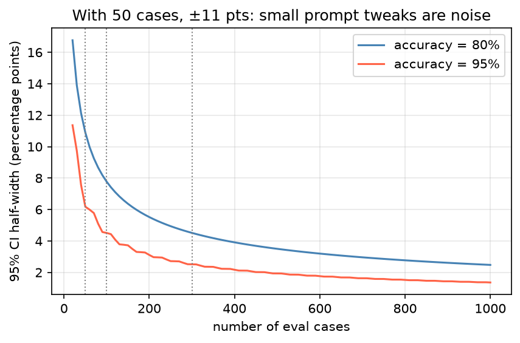

[Data Science](../README.md) › [LLM](README.md) › 評估與幻覺

# 評估與幻覺 (Evaluation and Hallucination)

改了 prompt、換了模型，怎麼知道是真的變好，而不是剛好在那幾個例子上看起來比較好？LLM 評估的原則和 [ML 評估](../machine-learning/evaluation/README.md) 相同：先定義任務與指標、建立固定的評估集、考慮統計不確定性。差別在於輸出是開放式文字，而且最大的風險是**流暢但錯誤**的幻覺。

## 評估流程

```
定義任務與「好答案」的標準（rubric）
        ↓
建立評估集：代表性案例 + 困難案例 + 應拒答案例 + 對抗案例
        ↓
選指標：可自動比對 → 程式；開放式 → LLM-as-judge + 人工校正
        ↓
跑 baseline（目前版本）與候選版本，同一批題目配對比較
        ↓
看信賴區間與失敗案例，不只看平均分數
```

## 建立評估集

| 原則 | 說明 |
| --- | --- |
| 來自真實使用情境 | 從實際問題、log、使用者回饋抽樣；不要只用自己想到的例子 |
| 涵蓋困難與邊界案例 | 罕見基因名、同名異義（`MARCH1` / `SEPT7` 這類曾被 Excel 轉成日期的基因符號）、多重條件、否定句 |
| 包含應該拒答的題目 | 文件中沒有答案的問題；測試模型是否會編造 |
| 與開發用例子分開 | 調 prompt 時看到的例子不能再拿來當最終評估，否則就是 [資料洩漏](../machine-learning/foundations/data-leakage.md) |
| 標準答案由領域專家確認 | 至少抽樣讓兩人獨立標註，檢查一致性 |
| 隨時間擴充 | 每個上線後發現的失敗案例都加入評估集 |

### 要多少題？

評估集準確率本身是二項比例的估計值，題數少時信賴區間很寬（計算方式見 [評估指標的不確定性](../machine-learning/evaluation/metric-uncertainty.md)）。



| 題數 | 準確率 80% 時的 95% CI（Wilson） | 能分辨的差異 |
| --- | --- | --- |
| 50 | 約 ±11 個百分點 | 只能看出很大的差異 |
| 100 | 約 ±8 個百分點 | 中等差異 |
| 300 | 約 ±4.5 個百分點 | 較細的差異 |

比較兩個版本時用**同一批題目做配對比較**（McNemar 檢定或配對 bootstrap），比各自算信賴區間更有檢定力。不同 prompt 在 50 題上差 3 分，通常只是雜訊。

## 指標選擇

| 任務 | 指標 | 注意 |
| --- | --- | --- |
| 分類、篩選（如文獻納入 / 排除） | precision、recall、F1、[混淆矩陣](../machine-learning/evaluation/confusion-metrics.md) | 篩選任務通常重視 recall（漏掉一篇比多看一篇嚴重） |
| 實體擷取（NER） | 實體層級 precision / recall / F1（完全比對或部分比對） | 先標準化（大小寫、同義詞、ID）再比對 |
| 結構化輸出 | schema 通過率、各欄位準確率 | 解析失敗也要算進錯誤 |
| 有標準答案的問答 | exact match、token F1 | 同義表達會被判錯 |
| 摘要、翻譯 | ROUGE、BLEU、BERTScore | 與人類判斷相關性有限；可能高分但內容錯誤 |
| 開放式回答 | rubric 評分（人工或 LLM-as-judge）、成對比較勝率 | 要校正評審者偏誤 |
| RAG | 檢索 recall@k、答案忠實度 (faithfulness)、答案相關性 | 見 [RAG 評估](rag/rag-pipeline.md#評估-rag) |
| 系統層面 | 延遲、成本、拒答率、任務完成率 | 見 [LLMOps](llmops.md#監控) |

## LLM-as-Judge

用另一個（通常較強的）模型依 rubric 評分或比較兩個答案。可大量執行，但本身有偏誤。

| 偏誤 | 現象 | 緩解 |
| --- | --- | --- |
| 位置偏誤 (position bias) | 成對比較時偏好第一個（或第二個）答案 | 兩種順序各評一次，不一致就算平手 |
| 冗長偏誤 (verbosity bias) | 偏好較長的答案 | rubric 明確說明長度不加分 |
| 自我偏好 (self-preference) | 偏好同一家族模型的輸出 | 用不同供應商的模型當評審 |
| 不擅長查核事實 | 會被流暢但錯誤的答案說服 | 提供標準答案或來源文件讓評審比對 |
| 分數尺度不穩 | 1–10 分的意義飄移 | 用二元判斷或少數等級，每級附定義與範例 |

```text
<rubric>
依下列標準判斷「答案」是否完全由「來源」支持：
- supported：每個事實陳述都能在來源中找到依據
- partially_supported：部分陳述沒有依據
- unsupported：主要結論沒有依據或與來源矛盾
</rubric>
<source>{context}</source>
<answer>{answer}</answer>
先逐句列出陳述與對應的來源句子，再輸出 JSON：{"label": "...", "unsupported_claims": [...]}
```

> 用 LLM 評審之前，先拿 50–100 題人工標註計算評審與人的一致性（Cohen's kappa 或簡單的一致率）。一致性不夠高，自動分數就沒有意義。

## 幻覺 (Hallucination)

模型產生與事實或提供的來源不符、卻表達得很有把握的內容。

| 類型 | 例子 |
| --- | --- |
| 內在幻覺 (intrinsic) | 摘要中把「降低」寫成「增加」，與來源矛盾 |
| 外在幻覺 (extrinsic) | 加入來源中沒有的細節（樣本數、p 值） |
| 編造引用 | 不存在的 PMID、DOI、論文標題，或真實論文配上錯誤的結論 |
| 實體錯誤 | 基因符號、變異命名、藥物劑量錯誤；把 `TP53` 的功能套到 `TP63` |
| 過時知識 | 引用已更新的指引、已改名的基因或已撤稿的論文 |

| 降低幻覺 | 做法 |
| --- | --- |
| 提供來源 | [RAG](rag/README.md)，並要求「只根據來源回答」 |
| 允許拒答 | 明確定義資訊不足時的輸出 |
| 先引用再回答 | 要求先列出來源原句，再根據引用作答 |
| 降低 temperature | 減少低機率 token 被取樣（不能消除幻覺） |
| 交給確定性工具 | ID 查詢、計算、資料庫查詢用 [tool calling](integration/llm-api-patterns.md#tool-calling) |

| 偵測幻覺 | 做法 | 限制 |
| --- | --- | --- |
| 引用驗證 | 用程式檢查 PMID / DOI 是否存在（NCBI E-utilities、Crossref），再比對標題 | 只能確認存在，不能確認內容被正確引用 |
| 實體驗證 | 基因符號對 HGNC、疾病對 MONDO / HPO 查詢 | 需要先擷取實體 |
| 自我一致性 (self-consistency) | 同一問題取樣多次，答案不一致代表模型不確定 | 一致但錯誤的情況偵測不到；成本倍增 |
| 蘊含檢查 (NLI) | 逐句檢查答案是否被來源蘊含 | NLI 模型本身有錯誤率 |
| LLM-as-judge 忠實度評分 | 見上方 rubric | 評審也會被說服 |
| 人工抽查 | 高風險輸出一定要做 | 成本高 |

```python
import requests

def pmid_exists(pmid: str) -> bool:
    """用 NCBI E-utilities 確認 PMID 存在（大量查詢請加 api_key 並控制頻率）。"""
    r = requests.get("https://eutils.ncbi.nlm.nih.gov/entrez/eutils/esummary.fcgi",
                     params={"db": "pubmed", "id": pmid, "retmode": "json"}, timeout=10)
    r.raise_for_status()
    doc = r.json()["result"].get(pmid, {})
    return "error" not in doc and bool(doc.get("title"))
```

## 檢查清單

| 問題 | 沒做到的後果 |
| --- | --- |
| 評估集是否與調 prompt 時看的例子分開？ | 高估效果 |
| 題數是否足以分辨想看的差異？ | 把雜訊當進步 |
| 是否包含應拒答的題目？ | 看不出模型會不會編造 |
| LLM 評審是否與人工標註校正過？ | 自動分數無意義 |
| 引用、ID 是否用程式驗證？ | 編造的引用流入報告 |
| 是否看失敗案例，而不只看平均分數？ | 漏掉系統性錯誤 |
