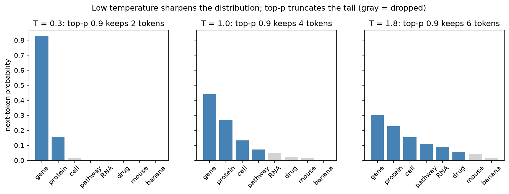

[Data Science](../README.md) › [LLM](README.md) › LLM 基礎

# LLM 基礎 (LLM Foundations)

LLM 在變成工具或 agent 之前的核心觀念：它把文字切成 token，一次預測一個 token；能力來自預訓練，行為來自後續的指令微調與對齊。理解這點，就能預期它在哪裡可靠、在哪裡會一本正經地編造。Attention、位置編碼等內部機制見 [Transformer 與 Attention](../deep-learning/nlp-and-transformers/transformers-and-attention.md)。

## LLM 在做什麼

```
文字 → tokenizer → token IDs → embedding → Transformer（decoder-only）→ 下一個 token 的機率分布
                                                                     ↓ 取樣
                                                     接到序列尾端，重複直到結束
```

| 概念 | 意義 | 實務影響 |
| --- | --- | --- |
| Token | 模型處理的基本單位，通常是子字 (subword)；英文約 0.75 字 / token，中文常 1–2 字 / token | 計費、長度上限都以 token 計；罕見基因名、序列會被切成很多 token |
| Embedding | 把 token 對應成向量，語意相近者向量相近 | 也是 [語意搜尋](rag/embeddings-and-semantic-search.md) 的基礎 |
| Context window | 單次請求可放入的 token 上限（輸入 + 輸出） | 超過就要截斷、摘要或改用 [RAG](rag/README.md) |
| 自迴歸生成 (autoregressive) | 一次產生一個 token，每步都以前面所有 token 為條件 | 輸出越長越慢；前面寫錯會一路錯下去 |
| 參數知識 (parametric knowledge) | 預訓練資料中的規律被壓縮進權重 | 有知識截止日；冷門事實記得模糊 → 幻覺 |

> LLM 學的是「在這個上下文中，下一個 token 最可能是什麼」。流暢不等於正確：沒有機制保證輸出對應到真實世界的事實。

### Tokenization 的陷阱

```python
from transformers import AutoTokenizer

tok = AutoTokenizer.from_pretrained("gpt2")
tok.tokenize("The patient carries a BRCA1 c.68_69delAG variant")
# ['The', 'Ġpatient', 'Ġcarries', 'Ġa', 'ĠB', 'RC', 'A', '1', 'Ġc', '.', '68', '_', '69', 'del', 'AG', 'Ġvariant']
tok.tokenize("ATGCGTACGTTAGC")   # ['AT', 'GC', 'GT', 'AC', 'G', 'TT', 'AG', 'C']：DNA 被切成不規則片段
```

| 現象 | 後果 |
| --- | --- |
| 基因名、HGVS 變異寫法被切碎 | 拼字、大小寫、數字容易出錯（`BRCA1` ↔ `BRCA2`） |
| 數字被切成不規則片段 | 算術不可靠 → 計算交給程式或 [tool calling](integration/llm-api-patterns.md#tool-calling) |
| 中文、非英文較耗 token | 同樣內容成本較高、context 較快用完 |
| 不同模型 tokenizer 不同 | 不能用 A 模型的 tokenizer 估算 B 模型的 token 數 |

DNA / 蛋白質序列請用專門的序列模型（[序列與蛋白模型](../deep-learning/bio-applications/sequence-and-protein-models.md)），不要把序列丟給通用 LLM 期待它「讀懂」。

### 取樣參數 (Decoding)

模型輸出的是機率分布，取樣策略決定實際挑哪個 token。

| 參數 | 作用 | 建議 |
| --- | --- | --- |
| `temperature` | logits 除以 T 後再 softmax；T 小 → 分布更尖、輸出更穩定 | 擷取、分類、程式碼：0–0.3；草稿、發想：0.7–1 |
| `top_p` (nucleus) | 只從累積機率達 p 的最小 token 集合中取樣 | 與 temperature 擇一調整即可 |
| `top_k` | 只從機率最高的 k 個 token 取樣 | 部分 API 才提供 |
| `max_tokens` | 輸出長度上限 | 控制成本與延遲；太小會被截斷 |
| `seed` | 部分 API 支援，讓取樣可重現 | 即使 T = 0 也不保證完全一致（批次、硬體非決定性） |



T = 0.3 時幾乎只會選 "gene"；T = 1.8 時連 "drug"、"RNA" 都有可觀機率。top-p 0.9 在分布尖時只留 2 個候選、分布平時留 6 個，所以它是**自適應**的截斷。

## 訓練階段

| 階段 | 資料 | 得到什麼 |
| --- | --- | --- |
| 預訓練 (pretraining) | 數兆 token 的網頁、書籍、程式碼、論文 | 語言能力與廣泛的世界知識；只會「接續文字」 |
| 指令微調 (instruction tuning / SFT) | 人工撰寫的「指令 → 理想回答」配對 | 會遵循指令、以對話形式回答 |
| 偏好對齊 (RLHF、DPO 等) | 人類（或 AI）對多個回答的偏好排序 | 更有幫助、更會拒絕有害請求；也可能變得過度迎合使用者 |
| 推理強化（reasoning models） | 可驗證答案的任務（數學、程式）上做強化學習 | 回答前先產生較長的推理過程，複雜問題較準，但較慢較貴 |

> 預訓練給能力，後續階段塑造行為。要改「知識」用 [RAG](rag/README.md)；要改「行為 / 格式」才考慮 [fine-tuning](integration/fine-tuning.md)。

| 規模面向 | 意義 |
| --- | --- |
| 參數量 | 容量上限；但小模型 + 好資料常勝過大模型 + 差資料 |
| 訓練資料量 | 決定知識廣度；資料品質比數量更關鍵 |
| 算力 | 訓練與推論成本、能源消耗 |
| Context 長度 | 能放多少輸入；但長 context 中段的資訊常被忽略 ("lost in the middle") |

## 能做什麼、不能信什麼

| 擅長 | 例子 |
| --- | --- |
| 改寫、摘要、翻譯 | 把方法段落改寫成給臨床醫師看的說明 |
| 從文字擷取結構 | 從摘要抽出基因、疾病、藥物與關係 → JSON |
| 分類、路由 | 依摘要判斷是否符合 systematic review 的納入條件 |
| 寫程式、解釋程式 | 產生 pandas / R / Snakemake 草稿、解釋錯誤訊息 |
| 依提供的文件回答 | 給定說明文件或論文，回答具體問題 |

| 限制 | 原因 | 對策 |
| --- | --- | --- |
| 幻覺 (hallucination) | 生成目標是「像真的」而非「是真的」 | [RAG](rag/README.md) + 要求引用 + [驗證](evaluation-and-hallucination.md#幻覺-hallucination) |
| 知識截止、知識過時 | 參數在訓練後凍結 | 檢索最新資料庫 / 文獻 |
| 對措辭敏感 | 小幅改寫 prompt 可能改變答案 | 固定模板、建評估集比較 |
| 算術與計數不可靠 | tokenization + 沒有內建計算器 | 交給程式（tool calling、code execution） |
| 迎合使用者 (sycophancy) | 偏好對齊獎勵「讓人滿意」的回答 | 不要在 prompt 暗示想要的答案 |
| 偏誤 | 訓練資料的偏誤被學進去 | 見 [資料偏誤](../responsible-ai/data-bias-and-representativeness.md) |
| 無法保證一致性與安全 | 取樣本身有隨機性 | guardrail、人工審查、[評估](evaluation-and-hallucination.md) |

## 生成式 AI 的模型家族

LLM 是生成式 AI (generative AI) 的一支；生成式模型產生新內容，而非只輸出標籤或分數。

| 家族 | 核心想法 | 典型用途 | 生資例子 |
| --- | --- | --- | --- |
| 自迴歸 Transformer | 逐 token 預測下一個 | 文字、程式碼、多模態對話 | 蛋白質語言模型生成序列 |
| GAN | 生成器與判別器對抗訓練 | 早期高品質影像生成；訓練不穩定 | 合成病理影像（資料擴增） |
| Diffusion | 學習從雜訊逐步去噪 | 影像、影片、分子結構生成 | 蛋白質骨架設計（RFdiffusion 類方法） |
| VAE | 編碼到潛在分布再解碼 | 表示學習、生成 | [scVI](../deep-learning/bio-applications/single-cell-deep-learning.md) |

基礎模型 (foundation model)：在大量資料上預訓練一次，再用 prompt、embedding、微調轉到許多下游任務。VAE 與 GAN 的原理見 [Autoencoder 與 VAE](../deep-learning/representation-learning/autoencoders-and-vae.md)。

## 聊天介面 (ChatGPT 類) 的定位

ChatGPT、Claude、Gemini 等聊天產品 = LLM + 對話介面 + 系統 prompt + 產品規則（工具、記憶、安全政策）。所以同一模型在聊天介面與 API 上的行為可能不同。

| 與傳統 chatbot 比較 | 傳統（規則 / intent） | LLM 聊天 |
| --- | --- | --- |
| 回答來源 | 預先寫好的回覆 | 即時生成 |
| 涵蓋範圍 | 窄，超出 intent 就失敗 | 廣，但超出能力時仍會「回答」 |
| 可預測性 | 高 | 低，需要評估與 guardrail |

| 使用習慣 | 理由 |
| --- | --- |
| 一個對話一個主題 | 混雜的長對話會讓 context 互相干擾；換主題就開新對話 |
| 「AI 先做，人再審」 | 草稿、摘要、程式碼都要人工檢查後才使用 |
| 不貼病人資料、未發表資料、憑證 | 依服務條款，輸入可能被保留或用於訓練；見 [生醫 LLM 的隱私](bio-and-medical-llm.md#隱私與合規) |
| 要求附來源並自行查證 | 引用的 PMID、DOI 可能是編造的 |
