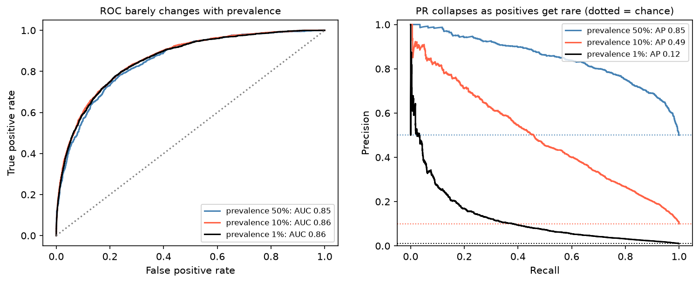

[Machine Learning](../README.md) › [模型評估](README.md) › 類別不平衡

# 類別不平衡 (Class Imbalance)

某一類遠比另一類少見：詐欺、罕見疾病篩檢、設備故障、致病變異、流失。問題主要出在**評估**（accuracy 失真、ROC 太樂觀），其次才是訓練。

## 為什麼 accuracy 失真

模擬資料，正類 3.5%（測試集 1,500 筆）：

| 模型 | Accuracy | Recall | Precision | ROC-AUC | PR-AUC (AP) |
| --- | --- | --- | --- | --- | --- |
| 永遠猜陰性（`DummyClassifier`） | **0.965** | 0 | — | 0.5 | 0.035 |
| 邏輯斯迴歸（閾值 0.5） | 0.966 | 0.019 | 1.0 | 0.774 | 0.178 |
| 邏輯斯迴歸 `class_weight="balanced"` | 0.725 | 0.769 | 0.091 | 0.768 | 0.159 |

- 什麼都沒學的模型 accuracy 0.965；邏輯斯迴歸 accuracy 一樣高，卻幾乎沒抓到任何陽性。
- `class_weight="balanced"` 讓 recall 從 0.02 升到 0.77，但 **AUC 與 AP 沒有變好**：它主要是移動了等效閾值，而不是學到更好的排序。

## 評估：看 PR 曲線



同樣的分數分布（陽性 ~ N(1.5, 1)、陰性 ~ N(0, 1)），只改變盛行率：ROC 曲線幾乎不動（AUC 都約 0.86），PR 曲線卻從 AP 0.85 掉到 0.12。原因是 FPR 的分母是大量的陰性，幾百個偽陽性在 FPR 上看不出來，在 precision 上卻很明顯。

| 指標 | 隨機基準 | 適合 |
| --- | --- | --- |
| ROC-AUC | 0.5 | 比較排序能力；盛行率會變的情境 |
| **PR-AUC / average precision** | **= 盛行率** | 正類稀少、在乎「預測為陽性的有多少是真的」 |
| Recall、precision、F1（特定閾值下） | — | 實際決策 |
| Balanced accuracy、MCC | 0.5 / 0 | 單一數字摘要 |
| Recall @ 固定 precision（或反之） | — | 有明確作業要求時 |

> PR-AUC 要和盛行率比較：盛行率 1% 時 AP 0.12 已是隨機的 12 倍。

```python
from sklearn.metrics import average_precision_score, PrecisionRecallDisplay, balanced_accuracy_score

average_precision_score(y_test, y_prob)               # PR-AUC
PrecisionRecallDisplay.from_predictions(y_test, y_prob)
balanced_accuracy_score(y_test, y_pred)
# CV 時：scoring="average_precision"，切分用 StratifiedKFold
```

## 訓練端的對策

| 方法 | 做法 | 效果 | 注意 |
| --- | --- | --- | --- |
| **調閾值** | 在驗證資料上選閾值 | 直接控制 recall / precision 取捨 | 通常是**最簡單有效**的做法，見 [閾值與校準](classification-thresholds-and-calibration.md) |
| Class weight | `class_weight="balanced"`、XGBoost `scale_pos_weight` | 加重少數類別的損失 | 機率被系統性放大，需要時重新校準 |
| 隨機過採樣 / 欠採樣 | 複製少數類 / 丟棄多數類 | 類似 class weight | 欠採樣丟資訊；過採樣易過擬合 |
| SMOTE 等合成樣本 | 在少數類鄰居間內插 | 文獻結果不一；對強模型常無幫助 | 高維資料（基因表現）中內插出的樣本可能不合理 |
| 收集更多少數類資料 | — | 最有效 | 成本高 |
| 換問題框架 | 改用 [異常偵測](../unsupervised-learning/anomaly-detection/README.md) | 陽性極少（< 0.1%）或型態多變時 | — |

上例中，SMOTE 的 CV average precision 0.173，不做任何處理 0.212：重抽樣不一定比直接調閾值好。

```python
from sklearn.linear_model import LogisticRegression

# class weight
LogisticRegression(class_weight="balanced", max_iter=1000)

# 重抽樣必須放在 imbalanced-learn 的 Pipeline 內，只對訓練 fold 做
from imblearn.pipeline import make_pipeline as make_imb_pipeline
from imblearn.over_sampling import SMOTE
from sklearn.model_selection import StratifiedKFold, cross_val_score

pipe = make_imb_pipeline(SMOTE(random_state=0), LogisticRegression(max_iter=1000))
cross_val_score(pipe, X_train, y_train, scoring="average_precision",
                cv=StratifiedKFold(5, shuffle=True, random_state=0))
```

## 常見錯誤

| 錯誤 | 後果 |
| --- | --- |
| 用 accuracy 當主要指標 | 高分但沒抓到任何陽性 |
| 先對全部資料 SMOTE / 過採樣，再切分 | 合成樣本跨 train / test → 嚴重洩漏 |
| 驗證 / 測試集也做重抽樣 | 評估的不再是真實盛行率下的表現 |
| 不用分層切分 | 某些 fold 幾乎沒有正類 |
| 用 class weight 訓練後直接把機率當風險 | 機率被放大，見 [校準](classification-thresholds-and-calibration.md#校準-calibration) |
| 測試集正類太少 | 正類只有 10 個時 recall 只能是 0.1 的倍數，信賴區間極寬，見 [指標的不確定性](metric-uncertainty.md) |
