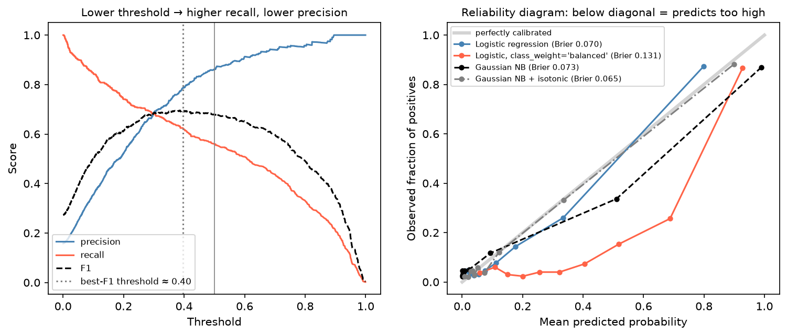

[Machine Learning](../README.md) › [模型評估](README.md) › 閾值與校準

# 分類閾值與機率校準 (Classification Thresholds and Calibration)

多數分類器先輸出機率或分數，再用閾值變成類別。這篇處理兩個獨立的問題：**閾值**（分數怎麼變成決策）與**校準**（預測的機率可不可信）。排序能力好（AUC 高）不代表兩者都沒問題。

| 問題 | 評估 | 調整 |
| --- | --- | --- |
| 排序 (discrimination) | [ROC-AUC](roc-auc.md)、PR-AUC | 換模型、改特徵 |
| 閾值 (threshold) | 該閾值下的 [混淆矩陣指標](confusion-metrics.md)、成本 | 調閾值 |
| 校準 (calibration) | 校準曲線、Brier score、log loss | Platt / isotonic / temperature scaling |

## 調整閾值

0.5 只是預設值。

| 情境 | 閾值 |
| --- | --- |
| 偽陰性代價高（漏診、漏抓詐欺） | **降低** → recall ↑、precision ↓ |
| 偽陽性代價高（昂貴的後續檢查、打擾客戶） | **提高** → precision ↑、recall ↓ |
| 處理容量有限（每天只能審 100 件） | 取分數前 100 名，等於固定 precision@k |
| 要求最低 recall（如篩檢 ≥ 98%） | 在驗證資料上找達到該 recall 的最高閾值 |
| 正類稀少 | 最佳閾值通常遠低於 0.5 |



左：閾值越低，recall 越高、precision 越低；這份資料（正類 16%）的 F1 最佳閾值約 0.40，不是 0.5。

```python
from sklearn.model_selection import TunedThresholdClassifierCV, FixedThresholdClassifier
from sklearn.metrics import precision_recall_curve

# 承乳癌範例（1 = 惡性）
base = make_pipeline(StandardScaler(), LogisticRegression(max_iter=1000))

# 1. 用 CV 自動找最佳化某指標的閾值（sklearn ≥ 1.5）
tuned = TunedThresholdClassifierCV(base, scoring="f1", cv=5).fit(X_train, y_train)
tuned.best_threshold_                     # 0.39

# 2. 指定閾值（例如依臨床需求）
fixed = FixedThresholdClassifier(base, threshold=0.2).fit(X_train, y_train)
# 測試集：recall 0.984、precision 0.955（閾值 0.5 時為 0.938 / 0.984）

# 3. 手動：在驗證資料上找「recall ≥ 0.98 的最高閾值」
prec, rec, thr = precision_recall_curve(y_val, model.predict_proba(X_val)[:, 1])
thr[(rec[:-1] >= 0.98)].max()
```

> 閾值要在**驗證資料或 CV** 上決定，不能在測試集上調，否則測試分數偏樂觀。

### 依成本決定閾值

已知每種錯誤的成本時，最小化預期成本：

| | 預測陰性 | 預測陽性 |
| --- | --- | --- |
| 實際陰性 | 0 | $C_{FP}$ |
| 實際陽性 | $C_{FN}$ | 0 |

若機率**已校準**，理論最佳閾值為 $t^* = \frac{C_{FP}}{C_{FP} + C_{FN}}$。例如漏診成本是誤診的 9 倍 → $t^* = 1/10 = 0.1$。機率沒有校準時這個公式不成立，要改用驗證資料直接計算各閾值的總成本。

## 校準 (Calibration)

校準良好的模型預測 0.8 的那群案例中，約 80% 真的是陽性。當下游決策**直接使用機率**（風險分層、預期成本、臨床風險分數、定價）時，校準和排序一樣重要。

| 模型 | 典型校準狀況 |
| --- | --- |
| 邏輯斯迴歸 | 通常不錯（直接最佳化 log loss） |
| Naive Bayes | 常把機率推向 0 或 1（特徵獨立假設不成立時） |
| 隨機森林 | 常把機率拉向中間 |
| SVM | 輸出不是機率；`probability=True` 內部用 Platt scaling |
| Boosting、深度網路 | 視設定而定，常過度自信 |
| **用 class weight / 重抽樣訓練的模型** | **系統性高估陽性機率**（見 [類別不平衡](class-imbalance.md)） |

右圖的校準曲線（reliability diagram）：把預測機率分箱，比較每箱的平均預測值與實際陽性比例。

| 曲線位置 | 意義 |
| --- | --- |
| 貼近對角線 | 校準良好 |
| 在對角線**下方** | 預測機率**太高** |
| 在對角線上方 | 預測機率太低 |

圖中 `class_weight="balanced"` 的邏輯斯迴歸明顯在對角線下方（Brier 0.131 vs 0.070）：它的 AUC 和一般邏輯斯迴歸幾乎一樣，但機率被系統性放大。Naive Bayes 經 isotonic 校準後 Brier 從 0.073 降到 0.065。

```python
from sklearn.calibration import CalibratedClassifierCV, CalibrationDisplay
from sklearn.metrics import brier_score_loss, log_loss
from sklearn.naive_bayes import GaussianNB

# 校準指標：越小越好
brier_score_loss(y_test, y_prob)      # 預測機率與 0/1 結果的 MSE
log_loss(y_test, y_prob)

# 校準曲線
CalibrationDisplay.from_predictions(y_test, y_prob, n_bins=10, strategy="quantile")

# 事後校準：在 CV 中用未參與訓練的 fold 擬合校準器
calibrated = CalibratedClassifierCV(GaussianNB(), method="isotonic", cv=5).fit(X_train, y_train)
```

| 校準方法 | 做法 | 適合 |
| --- | --- | --- |
| `method="sigmoid"`（Platt scaling） | 在分數上套一條邏輯斯曲線 | 樣本少；扭曲呈 S 形 |
| `method="isotonic"` | 非參數、單調的分段函數 | 樣本多（約 > 1,000）；樣本少時易過擬合 |
| `method="temperature"`（新版 sklearn） | 用單一溫度參數縮放 logits | 多類別、神經網路 |

## 實務建議

| 建議 | 原因 |
| --- | --- |
| 把排序品質與機率品質分開看 | AUC 高 ≠ 機率可信 |
| 閾值在驗證資料上調 | 測試集只用一次 |
| 機率要被直接使用時，明確檢查校準 | 臨床風險、成本計算 |
| 換族群（盛行率改變）後重新校準 | 盛行率改變會讓機率整體偏移，排序可能仍然正確 |
| 報告閾值與選擇理由 | 不同閾值下的 sensitivity / specificity 差很多 |
