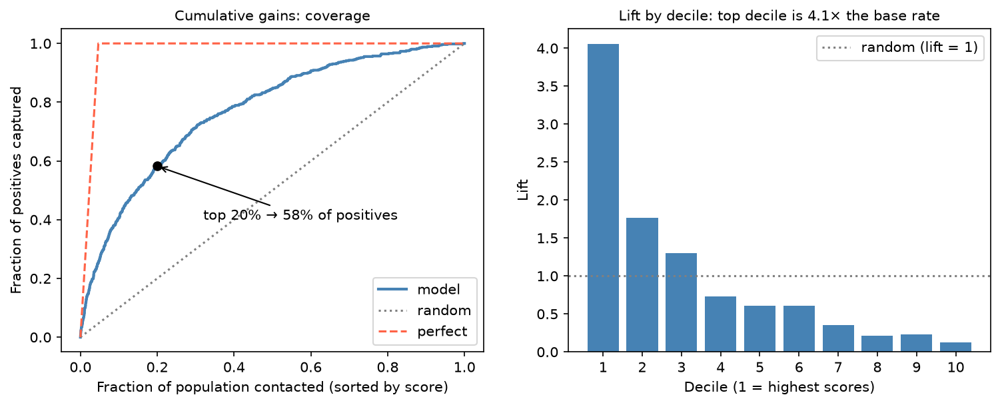

[Machine Learning](../README.md) › [模型評估](README.md) › Gains 與 Lift

# 累積增益與提升度曲線 (Cumulative Gains and Lift Curves)

[ROC-AUC](roc-auc.md) 回答「整體排序好不好」，但很多決策其實只能處理名單的一部分：只能聯絡前 10% 的人、每天只能審 100 件、只能送 5% 的樣本做驗證實驗。Gains 與 lift 把排序能力翻成「**只處理前 x% 時能得到多少**」的語言。

| 適用情境 | 共同點 |
| --- | --- |
| 行銷名單、募款、催收優先序、銷售線索評分 | 模型輸出分數用來**排序** |
| 詐欺審查佇列、人工複核配額 | 資源只能覆蓋母體的一部分 |
| 候選基因 / 化合物的實驗驗證優先序 | 同上 |

## 兩條曲線

| | 累積增益 (cumulative gains) | 提升度 (lift) |
| --- | --- | --- |
| x 軸 | 依分數由高到低，取前 x% 的母體 | 同左（或分成十等分 decile） |
| y 軸 | 累積抓到全部陽性的比例 | 該段的陽性率 ÷ 整體陽性率 |
| 回答 | 處理前 x% 能**涵蓋**多少陽性？（coverage） | 這段名單的**命中效率**是平均的幾倍？（efficiency） |
| 隨機基準 | 對角線 | lift = 1 |

$$
\text{lift} = \frac{\text{該段的陽性率}}{\text{整體陽性率}}
$$

例：整體陽性率 5%、分數前 10% 的陽性率 12.5% → lift = 12.5 / 5 = 2.5。



模擬資料（陽性率約 4.7%）：只聯絡分數前 20% 就涵蓋 58% 的陽性；第一個 decile 的命中率是平均的 4.1 倍，之後快速下降，第 4 個 decile 起已低於隨機。模型的價值集中在名單最前段。

| 判讀 | 意義 |
| --- | --- |
| Gains 曲線越早往上衝越好 | 高分群集中了更多陽性 |
| 前幾個 decile lift 很高、之後掉到 1 附近 | 模型只對名單前段有用 → 資源有限時很有價值 |
| Lift 不隨 decile 單調下降 | 排序不穩定，或樣本太少 |

## 計算

`scikit-plot`（`plot_cumulative_gain`、`plot_lift_curve`）已停止維護，在新版 SciPy 會因 `scipy.interp` 被移除而 import 失敗。自己算只要幾行：

```python
import numpy as np
import pandas as pd

def gains_table(y_true, score, n_bins=10):
    d = (pd.DataFrame({"y": np.asarray(y_true), "s": np.asarray(score)})
           .sort_values("s", ascending=False))
    d["bin"] = np.arange(len(d)) * n_bins // len(d) + 1              # 1 = 分數最高的 10%
    t = d.groupby("bin")["y"].agg(n="size", positives="sum")
    t["pct_pop"] = t["n"].cumsum() / t["n"].sum()                    # 累積母體比例
    t["gain"] = t["positives"].cumsum() / t["positives"].sum()       # 累積增益
    t["lift"] = (t["positives"] / t["n"]) / d["y"].mean()            # 各 decile 的 lift
    t["cum_lift"] = t["gain"] / t["pct_pop"]                         # 累積 lift
    return t

gains_table(y_test, y_prob)
```

## 接到利潤 / 成本

Gains 與 lift 很容易接到資源配置：

$$
\text{利潤}(x\%) = \text{抓到的陽性數} \times \text{每個陽性的收益} - \text{處理人數} \times \text{每人成本}
$$

比較「只處理前 x%」、「全部處理」、「完全不處理」三者，選利潤最高的 x。這也是行銷、募款、風險作業偏好 lift 勝過 AUC 的原因。

## 常見誤解

| 誤解 | 事實 |
| --- | --- |
| AUC 高 → 前 10% 名單一定最好用 | AUC 是整條曲線的平均；兩個模型的前段表現可以相反 |
| Lift 高 → 機率準 | Gains / lift 只看排序，不看機率值；機率要看 [校準](classification-thresholds-and-calibration.md) |
| Gains 好看 → 選定的切點符合成本 | 切點仍要依成本與容量決定 |
| 驗證集上的 lift = 上線的 lift | 驗證切分不像真實部署時一樣會過度樂觀 |

開始前先問：作業一次能處理多少比例？偽陽性與偽陰性的成本差多少？在乎的是涵蓋率還是命中率？
