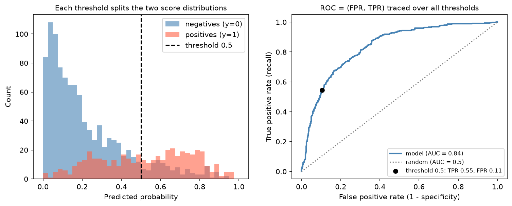

[Machine Learning](../README.md) › [模型評估](README.md) › ROC 與 AUC

# ROC 曲線與 AUC (ROC Curve and AUC)

ROC (Receiver Operating Characteristic) 曲線看二元 [分類](../supervised-learning/classification/README.md) 模型在**所有閾值**下，真陽性率與偽陽性率如何一起變化；AUC (Area Under the Curve) 把整條曲線濃縮成一個數字，衡量模型**把陽性排在陰性前面**的能力。

## 曲線怎麼來

| 軸 | 定義 |
| --- | --- |
| x：偽陽性率 FPR | $\frac{FP}{FP+TN}$ = 1 − specificity |
| y：真陽性率 TPR | $\frac{TP}{TP+FN}$ = recall = sensitivity |

把閾值從 1 掃到 0，每個閾值產生一個 (FPR, TPR) 點，連起來就是 ROC 曲線。



左：陽性與陰性的預測機率分布；閾值 0.5 右邊的陽性是 TP、陰性是 FP。右：閾值 0.5 對應 ROC 上的黑點（TPR 0.55、FPR 0.11）；降低閾值會沿曲線往右上移動。兩個分布重疊越少，曲線越靠左上角。

## AUC 的意義

> **AUC = 隨機挑一個陽性與一個陰性，模型給陽性的分數比較高的機率。** 它只看排序，不看機率值本身。

| AUC | 意義 |
| --- | --- |
| 1.0 | 完美排序 |
| 0.9 以上 | 很好（但先懷疑一下 [洩漏](../foundations/data-leakage.md)） |
| 0.7–0.8 | 可用，依領域而定 |
| 0.5 | 等於隨機（對角線） |
| < 0.5 | 比隨機差 → 通常是標籤或分數方向反了 |

AUC 等價於 Mann-Whitney U 統計量除以 $n_{pos} \cdot n_{neg}$，見 [Mann-Whitney U](../../statistics/nonparametric-methods/two-independent-samples.md)。

## 程式

```python
import numpy as np
from sklearn.metrics import roc_auc_score, roc_curve, RocCurveDisplay

# 承「混淆矩陣指標」的乳癌範例：model、X_test、y_test（1 = 惡性）
y_prob = model.predict_proba(X_test)[:, 1]        # 要用機率 / 分數，不是 predict() 的 0/1

roc_auc_score(y_test, y_prob)                     # 0.9975
fpr, tpr, thresholds = roc_curve(y_test, y_prob)
RocCurveDisplay.from_predictions(y_test, y_prob)

# Youden index：最大化 TPR − FPR 的閾值（= sensitivity + specificity − 1 最大）
j = np.argmax(tpr - fpr)
thresholds[j], tpr[j], fpr[j]                     # 0.243, 0.984, 0.019

# 多類別：one-vs-rest 平均
roc_auc_score(y_multi, proba_multi, multi_class="ovr", average="macro")
```

> 用 `predict()` 的 0/1 結果算 AUC 只會得到單一閾值的點，AUC 會被嚴重低估；一定要傳機率或 `decision_function` 的分數。

## 何時用、何時不夠

| 適合 | 不夠的地方 |
| --- | --- |
| 比較模型的整體排序能力 | 不告訴你該用哪個閾值 |
| 還沒決定閾值時 | **不反映校準**：機率全部乘 0.5，AUC 不變，見 [校準](classification-thresholds-and-calibration.md) |
| 類別比例會改變時（ROC 不受盛行率影響） | 正類很稀少時太樂觀：大量 TN 讓 FPR 看起來很小 → 改看 [PR 曲線](class-imbalance.md) |
| — | 兩條 ROC 交叉時，AUC 高的不一定在你在乎的區間比較好 → 看部分 AUC 或特定 FPR 下的 TPR |
| — | 只能處理前 k% 時，看 [Gains / Lift](gains-and-lift-curves.md) |

> Youden index 是方便的啟發式閾值，但它假設偽陽性與偽陰性代價相同；實務上應依錯誤成本決定閾值。
>
> 測試集小時 AUC 的不確定性很大，記得報告信賴區間，見 [指標的不確定性](metric-uncertainty.md)。
