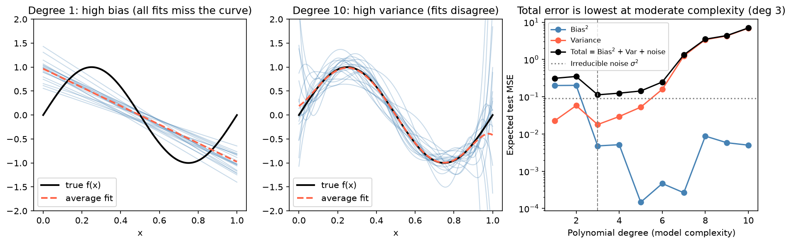

[Machine Learning](../README.md) › [基礎概念](README.md) › Bias-Variance 權衡

# Bias-Variance 權衡 (Bias–Variance Tradeoff)

模型的預測誤差可以拆成三塊：模型太簡單造成的偏誤、模型對訓練資料太敏感造成的變異、以及資料本身無法消除的雜訊。調整模型複雜度就是在前兩者之間取捨。

## 誤差分解

對平方誤差，在某個 x 上的期望測試誤差：

$$
E\big[(y - \hat{f}(x))^2\big] = \underbrace{\big(E[\hat{f}(x)] - f(x)\big)^2}_{\text{Bias}^2} + \underbrace{\text{Var}\big(\hat{f}(x)\big)}_{\text{Variance}} + \underbrace{\sigma^2}_{\text{不可約誤差}}
$$

期望是對「換一批訓練資料重新訓練」取的。

| 成分 | 意義 | 太高時 | 典型原因 |
| --- | --- | --- | --- |
| 偏誤 (bias) | 平均預測與真值的系統性差距 | [欠擬合](overfitting-underfitting.md) | 模型太簡單（線性模型配非線性關係）、正則化太強 |
| 變異 (variance) | 換一批訓練資料，預測會變多少 | [過擬合](overfitting-underfitting.md) | 模型太複雜、樣本太少、特徵太多 |
| 不可約誤差 (irreducible error) | 資料本身的雜訊 σ² | — | 量測誤差、沒觀測到的因素；任何模型都無法消除 |

統計上這就是估計量的 MSE = 偏誤² + 變異，見 [估計量的好壞](../../statistics/inferential-statistics/sampling-estimation.md#估計量的好壞偏誤與變異)。

## 圖解

以 $f(x) = \sin(2\pi x)$ 加上 σ = 0.3 的雜訊，每次抽 30 點、重複 300 次配適多項式迴歸：

| 圖 | 看到什麼 |
| --- | --- |
| 左（1 次多項式） | 每次的擬合線都差不多（低變異），但平均線（虛線）完全抓不到曲線（高偏誤） |
| 中（10 次多項式） | 平均線幾乎貼合真值（低偏誤），但單次擬合彼此差很多，邊緣尤其亂飄（高變異） |
| 右 | 複雜度增加 → 偏誤²下降、變異上升；總誤差在 3 次附近最低，且永遠不會低於雜訊 σ² |

## 管理權衡的方法

| 方法 | 主要降低 | 例子 |
| --- | --- | --- |
| [正則化](regularization.md) | 變異 | Ridge、Lasso、dropout |
| 調整模型複雜度 | 視方向而定 | 樹深度 `max_depth`、多項式次數、`n_neighbors` |
| [Bagging](../supervised-learning/ensemble/bagging.md) / [隨機森林](../supervised-learning/ensemble/random-forest.md) | 變異 | 平均多棵高變異的樹 |
| Boosting（[Gradient Boosting](../supervised-learning/ensemble/gradient-boosting.md)、[AdaBoost](../supervised-learning/ensemble/adaboost.md)） | 偏誤 | 逐步修正弱學習器的錯誤 |
| 更多訓練資料 | 變異 | 偏誤不會因資料變多而下降 |
| 更好的特徵 | 偏誤 | 加入非線性項、交互作用 |

用 [交叉驗證](../workflow/cross-validation.md) 估計不同複雜度下的泛化誤差，挑總誤差最低的那個。

> **深度學習的例外**：非常大的神經網路常出現「雙重下降 (double descent)」，參數多到遠超過樣本數後測試誤差反而再下降。經典的 U 形曲線仍適用於大多數表格資料模型。
