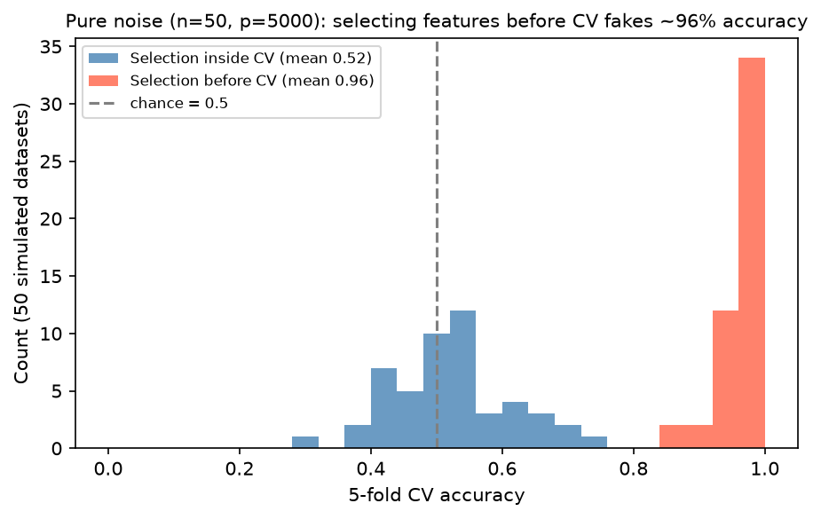

[Machine Learning](../README.md) › [基礎概念](README.md) › 資料洩漏

# 資料洩漏 (Data Leakage)

資料洩漏是指**預測當下拿不到的資訊**影響了模型訓練或評估，讓驗證分數過度樂觀，上線後才崩潰。它可能發生在前處理、切分、[特徵工程](feature-engineering-principles.md)，或反覆用測試集調參。

## 常見洩漏型態

| 型態 | 例子 | 對策 |
| --- | --- | --- |
| 前處理洩漏 | 在全資料上 fit scaler、[imputer](../preprocessing/imputation.md)、PCA 後才切分 | 放進 [Pipeline](../workflow/pipeline-basic.md) |
| 特徵選擇洩漏 | 用全部樣本挑出「與標籤最相關」的基因，再做 CV | 特徵選擇放在 CV 迴圈內 |
| 目標洩漏 (target leakage) | 特徵是結果發生後才產生的（「是否開了抗生素」預測感染） | 逐欄確認預測時點是否可得 |
| 時間洩漏 | 用未來的資料算特徵；時間序列隨機切分 | 依時間切分、[Basetable](basetable-and-time-aware-feature-engineering.md) |
| 實體重複 | 同一病人 / 使用者的多筆資料同時出現在 train 與 test | `GroupKFold`，見 [交叉驗證](../workflow/cross-validation.md) |
| Target encoding 洩漏 | 用全資料的類別平均目標值當特徵 | 在 fold 內計算，見 [類別編碼](../preprocessing/categorical-encoding.md) |
| 測試集過度使用 | 反覆看測試分數調參 | 測試集只用一次；調參用 CV / nested CV |
| 最新狀態回填 | join 只保留最新狀態的維度表，而不是 reference date 當下的狀態 | 建立時間點正確的快照 |

### 生資常見的洩漏

| 情境 | 洩漏方式 |
| --- | --- |
| 單細胞 / 多切片 | 同一病人的細胞同時在 train 與 test → 模型學到「病人」而不是「疾病」 |
| 批次效應 | 病例全在批次 A、對照全在批次 B → 模型學到批次。見 [批次效應](../../statistics/experimental-design/confounding-bias.md#生資最常見的干擾批次效應-batch-effect) |
| 技術重複 | 同一樣本的技術重複被當成獨立樣本切開。見 [生物實驗中的重複](../../statistics/experimental-design/core-concepts.md#生物實驗中的重複) |
| 序列相似性 | 蛋白質 / 序列模型中，test 序列與 train 序列高度同源 → 需依相似度分群後再切 |
| 正規化 | 用全部樣本做 normalization、批次校正（ComBat 等）後才切分 |

## 範例：特徵選擇放錯位置

純雜訊資料（50 個樣本、5,000 個隨機特徵、隨機標籤），真正的準確率應該是 50%：

```python
import numpy as np
from sklearn.feature_selection import SelectKBest, f_classif
from sklearn.linear_model import LogisticRegression
from sklearn.model_selection import cross_val_score
from sklearn.pipeline import make_pipeline

rng = np.random.default_rng(0)
X = rng.normal(size=(50, 5000))
y = rng.integers(0, 2, 50)

# 錯：先在全資料挑特徵，再 CV
X_sel = SelectKBest(f_classif, k=20).fit_transform(X, y)
cross_val_score(LogisticRegression(max_iter=1000), X_sel, y, cv=5).mean()        # 0.96

# 對：特徵選擇放進 pipeline，每個 fold 只用訓練部分挑
pipe = make_pipeline(SelectKBest(f_classif, k=20), LogisticRegression(max_iter=1000))
cross_val_score(pipe, X, y, cv=5).mean()                                         # 0.52
```



重複 50 次模擬：錯誤流程平均「準確率」0.96，正確流程 0.52（就是猜）。p 越大、n 越小，洩漏造成的假訊號越強，見 [高維小樣本](high-dimensional-data.md)。

## 檢查清單

對每個特徵與每個步驟問：

1. 這個值在**預測當下**真的拿得到嗎？
2. 這個轉換只用訓練資料（或訓練 fold）fit 嗎？
3. 驗證設計是否阻止資訊跨越 fold、時間邊界或同一實體？
4. 特徵是從時間點正確的快照算的，還是從整段歷史？
5. 分數是否好得不合理？（單一特徵就有 AUC 0.99 → 先懷疑洩漏）

> 表格資料的洩漏常不是出在模型，而是 basetable 的建法：用目標期間內的交易算「最近一年總金額」、join 最新狀態表、用全歷史算類別頻率或違約率。細節見 [Basetable 與時間感知特徵](basetable-and-time-aware-feature-engineering.md)；實作見 [資料切分與洩漏](../workflow/data-splitting-and-leakage.md)。
