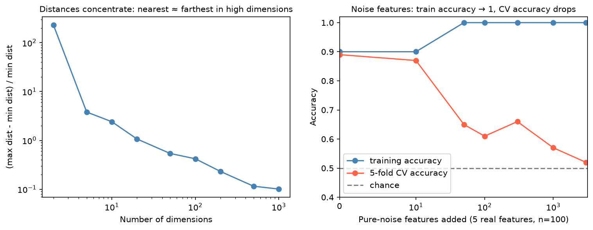

[Machine Learning](../README.md) › [基礎概念](README.md) › 高維小樣本

# 高維小樣本 (High-Dimensional Data, p ≫ n)

特徵數 p 遠大於樣本數 n 是生資的常態：RNA-seq 約 2 萬個基因配上幾十到幾百個樣本、甲基化晶片幾十萬個位點、蛋白質體上千個蛋白。這種資料下，模型幾乎一定能完美擬合訓練資料，所以**驗證設計比模型選擇更重要**。

## 會出什麼問題

| 問題 | 原因 | 後果 |
| --- | --- | --- |
| 必然過擬合 | p ≥ n 時，線性模型可以完美分開任何標籤 | 訓練準確率 100% 沒有任何意義 |
| OLS 無唯一解 | $X^\top X$ 不可逆（rank < p） | 必須用 Ridge / Lasso / Elastic Net 等正則化 |
| 偽相關 | 上萬個特徵中，純靠機率就會有幾十個與標籤高度相關 | 「找到的生物標記」無法再現；推論時要 [多重檢定校正](../../statistics/inferential-statistics/multiple-testing.md) |
| 特徵選擇洩漏 | 在全資料上挑特徵再做 CV | 純雜訊也能得到 90% 以上準確率，見 [資料洩漏](data-leakage.md#範例特徵選擇放錯位置) |
| 維度詛咒 (curse of dimensionality) | 高維空間中最近鄰與最遠鄰的距離差不多 | KNN、距離型分群、核方法變差 |
| 共線性 | 基因共表現、同一 pathway 的特徵高度相關 | 係數與特徵重要性不穩定；換個子樣本選出的基因就不同 |
| 效能估計不穩 | 測試集只有十幾個樣本 | 單次切分的分數可差 ±15% |



左：200 個均勻隨機點，維度從 2 升到 1,000 時，最遠距離與最近距離的相對差從約 230 倍降到 0.1 倍，「最近鄰」失去意義。右：5 個真實特徵、n = 100，加入越多純雜訊特徵，訓練準確率越快到 1，CV 準確率卻一路掉向 0.5。

## 對策

| 對策 | 做法 | 注意 |
| --- | --- | --- |
| 強正則化 | Lasso / Elastic Net / Ridge、樹模型限制深度 | Elastic Net 適合相關的基因群，見 [正則化](regularization.md) |
| 降維 | PCA 後再建模 | PCA 也要放在 pipeline 內 fit，見 [PCA](../unsupervised-learning/dimensionality-reduction/pca.md) |
| 特徵選擇放在 CV 內 | `SelectKBest`、`SelectFromModel` 放進 pipeline | 不使用標籤的過濾（低表現量、低變異）風險較低，但仍建議放進 pipeline |
| 使用先驗知識 | 用 pathway / gene set 分數取代單一基因、事先指定候選基因 | 降低有效維度，結果也較好解釋 |
| 偏好簡單模型 | 正則化的線性模型常與複雜模型打平 | 小樣本時複雜模型的變異大 |
| Nested CV | 內層調參、外層估計效能 | 避免「調參 + 報告」用同一批分數 |
| 重複 CV | `RepeatedStratifiedKFold`，報告平均 ± 標準差 | 小樣本下單次 CV 也不穩 |
| 置換檢定 | 打亂標籤重跑，看真實分數是否明顯高於隨機 | 見 [置換檢定](../../statistics/probability-and-distributions/monte-carlo-simulation.md#置換檢定-permutation-test) |
| 外部驗證 | 另一個 cohort / 批次 | 內部 CV 再好也不能取代 |

## Nested CV 與置換檢定

```python
from sklearn.datasets import make_classification
from sklearn.pipeline import make_pipeline
from sklearn.preprocessing import StandardScaler
from sklearn.feature_selection import SelectKBest, f_classif
from sklearn.linear_model import LogisticRegression
from sklearn.model_selection import (GridSearchCV, StratifiedKFold, RepeatedStratifiedKFold,
                                     cross_val_score, permutation_test_score)

# 模擬：80 個樣本、2,000 個特徵，其中 10 個有訊號
X, y = make_classification(n_samples=80, n_features=2000, n_informative=10, random_state=0)

pipe = make_pipeline(StandardScaler(), SelectKBest(f_classif), LogisticRegression(max_iter=5000))
grid = {"selectkbest__k": [10, 50, 200], "logisticregression__C": [0.01, 0.1, 1]}

# 1. Nested CV：內層挑參數，外層估計「整個流程（含調參）」的效能
inner = StratifiedKFold(5, shuffle=True, random_state=0)
outer = RepeatedStratifiedKFold(n_splits=5, n_repeats=5, random_state=1)
search = GridSearchCV(pipe, grid, cv=inner, scoring="roc_auc")
scores = cross_val_score(search, X, y, cv=outer, scoring="roc_auc")
scores.mean(), scores.std()          # 0.64 ± 0.10   ← 誠實的估計
search.fit(X, y).best_score_         # 0.76          ← 調參時看到的最佳分數，偏樂觀

# 2. 置換檢定：分數是否明顯高於隨機標籤
fixed = make_pipeline(StandardScaler(), SelectKBest(f_classif, k=50),
                      LogisticRegression(C=0.1, max_iter=5000))
score, perm_scores, p = permutation_test_score(fixed, X, y, cv=inner, scoring="roc_auc",
                                               n_permutations=200, random_state=0)
score, perm_scores.mean(), p         # 0.74, 0.51, p ≈ 0.01
```

> 同一份資料上，調參時的最佳 CV 分數 (0.76) 比 nested CV (0.64) 高了 0.12，這就是「挑選」本身造成的樂觀偏誤。小樣本論文報告的若是前者，效能多半被高估。

## 解讀特徵時的提醒

| 提醒 | 原因 |
| --- | --- |
| 選出的特徵清單不穩定是常態 | 相關特徵之間可互相替代；用 bootstrap 看每個特徵被選中的頻率（stability selection） |
| 「預測得好」≠「生物學上重要」 | 模型可能抓到批次、細胞比例或其他干擾，見 [批次效應](../../statistics/experimental-design/confounding-bias.md#生資最常見的干擾批次效應-batch-effect) |
| 單變量篩選要校正多重檢定 | 若要報告「哪些基因有差異」，那是推論問題，用 [多重檢定校正](../../statistics/inferential-statistics/multiple-testing.md) 而不是預測模型 |
| 樣本單位要正確 | 單細胞資料的獨立單位常是**病人**，不是細胞；切分要以病人分組 |
