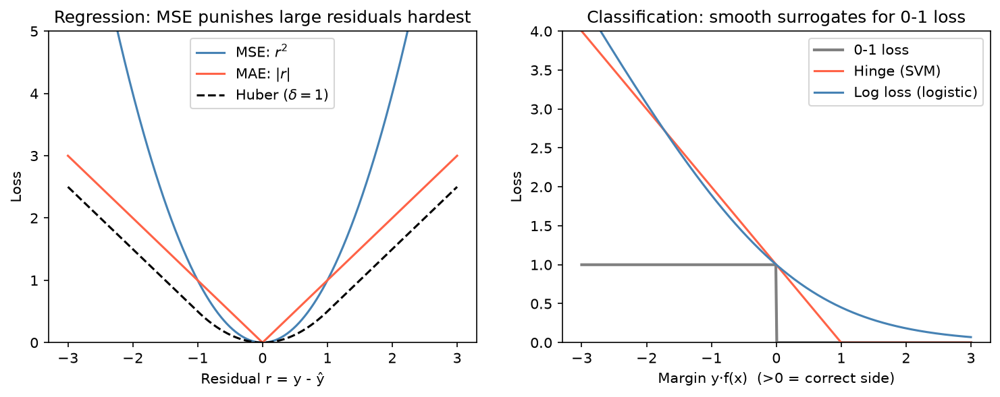

[Machine Learning](../README.md) › [基礎概念](README.md) › 損失函數

# 損失函數 (Loss Functions)

損失函數衡量預測錯得多嚴重；「訓練」就是找讓損失最小的參數。這篇談**依任務選損失**，以及訓練損失與評估指標的差別；PyTorch 實作與反向傳播見 [Deep Learning: Loss Functions](../../deep-learning/fundamentals/loss-functions.md)。

## 常見損失

| 任務 | 損失 | 公式（單筆） | 特性 |
| --- | --- | --- | --- |
| 迴歸 | 均方誤差 (MSE) | $(y-\hat{y})^2$ | 大誤差懲罰最重；對離群值敏感；預測的是**條件平均** |
| 迴歸 | 平均絕對誤差 (MAE) | $\lvert y-\hat{y} \rvert$ | 對離群值穩健；預測的是**條件中位數** |
| 迴歸 | Huber | 誤差小時像 MSE、大時像 MAE | 兩者折衷，`δ` 決定切換點 |
| 迴歸 | Quantile (pinball) | 依分位數 τ 不對稱懲罰 | 預測區間、上下界 |
| 計數迴歸 | Poisson deviance | 對應 Poisson 概似 | 非負計數（read count、事件數） |
| 分類 | 對數損失 / 交叉熵 (log loss, cross-entropy) | $-[y\log p + (1-y)\log(1-p)]$ | 懲罰「很有信心卻錯」；要好的**機率**時用 |
| 分類 | Hinge | $\max(0,\ 1 - y \cdot f(x))$，$y \in \{-1, 1\}$ | [SVM](../supervised-learning/classification/svm.md)；只在乎是否超過邊界 (margin) |
| 分類 | 0-1 loss | 錯 = 1、對 = 0 | 就是 1 − accuracy；不可微，無法直接最佳化 |



左：殘差越大，MSE 的懲罰成平方成長，所以少數離群值就能把模型拉走。右：hinge 與 log loss 都是 0-1 loss 的平滑上界 (surrogate)；log loss 即使分類正確也還會繼續推高信心，hinge 超過 margin 後就不再在乎。

```python
from sklearn.metrics import mean_squared_error, mean_absolute_error, log_loss

mean_squared_error([3, -0.5, 2, 7], [2.5, 0, 2, 8])     # 0.375
mean_absolute_error([3, -0.5, 2, 7], [2.5, 0, 2, 8])    # 0.5
log_loss([0, 1, 1, 0], [0.1, 0.9, 0.8, 0.35])           # 0.216

# 在模型中指定損失
from sklearn.linear_model import SGDClassifier, HuberRegressor
from sklearn.ensemble import HistGradientBoostingRegressor

SGDClassifier(loss="hinge")                       # 線性 SVM
SGDClassifier(loss="log_loss")                    # 邏輯斯迴歸
HuberRegressor(epsilon=1.35)                      # 穩健迴歸
HistGradientBoostingRegressor(loss="poisson")     # 計數目標
```

## 損失 ↔ 最大概似 (MLE)

大多數常見損失就是某個分配假設下的**負 log-likelihood**，這也是統計與 ML 的交會點：

| 損失 | 等價的機率模型 |
| --- | --- |
| MSE | y 服從常態分配（等變異）→ 最小平方法 |
| MAE | y 服從 Laplace 分配 |
| Log loss | y 服從 Bernoulli → 邏輯斯迴歸 |
| Poisson deviance | y 服從 Poisson → Poisson GLM |
| 損失 + L2 / L1 懲罰 | 再加上常態 / Laplace 先驗的 MAP 估計，見 [正則化](regularization.md) |

推導見 [最大概似估計](../../statistics/probability-and-distributions/maximum-likelihood.md#mle-與-ml-損失函數的對應)。

## 怎麼選

| 需求 | 選擇 |
| --- | --- |
| 大誤差代價特別高 | MSE |
| 資料有離群值或重尾 | MAE、Huber |
| 要預測區間或風險上界 | Quantile loss |
| 目標是計數或非負且右偏 | Poisson / Gamma deviance |
| 需要校準良好的機率 | Log loss |
| 只需要分類邊界 | Hinge |

## 訓練損失 ≠ 評估指標

| | 訓練損失 (training loss) | 評估指標 (evaluation metric) |
| --- | --- | --- |
| 用途 | 配適時被最佳化 | 判斷模型是否有用、比較模型 |
| 要求 | 通常要可微、好最佳化 | 要貼近真實目標 |
| 例子 | Log loss | [ROC-AUC](../evaluation/roc-auc.md)、[F1](../evaluation/confusion-metrics.md)、成本、臨床效益 |

> 除非確認過，不要假設模型在最佳化你在乎的那個指標。一個模型可能用 log loss 訓練、用 AUC 挑選，最後卻以業務或臨床影響來判斷好壞；三者不一致時，常靠 [調閾值](../evaluation/classification-thresholds-and-calibration.md) 銜接。
