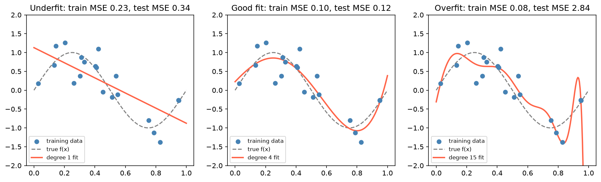
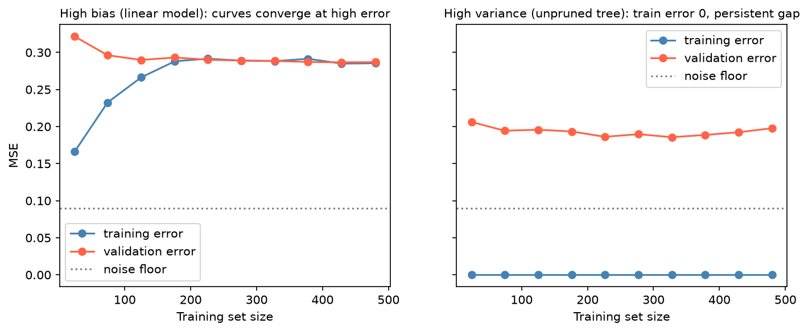

[Machine Learning](../README.md) › [基礎概念](README.md) › 過擬合與欠擬合

# 過擬合與欠擬合 (Overfitting and Underfitting)

[泛化](generalization.md) 失敗的兩種方向：模型把雜訊當成訊號（過擬合），或連主要結構都沒學到（欠擬合）。

| | 過擬合 (overfitting) | 欠擬合 (underfitting) |
| --- | --- | --- |
| 訓練誤差 | 很低 | 高 |
| 驗證 / 測試誤差 | 明顯高於訓練誤差 | 高，且與訓練誤差接近 |
| 原因 | 模型太複雜、樣本太少、特徵太多 | 模型太簡單、特徵不足、正則化太強 |
| [Bias-Variance](bias-variance-tradeoff.md) | 低偏誤、高變異 | 高偏誤、低變異 |



20 個訓練點配適不同次數的多項式：1 次抓不到曲線；4 次接近真值；15 次穿過幾乎每個點，訓練 MSE 最低，但測試 MSE 暴增到 2.84（邊緣亂飄）。

## 診斷

```python
from sklearn.model_selection import cross_validate, LearningCurveDisplay, ValidationCurveDisplay

# 1. 同時看訓練與驗證分數：差距大 → 過擬合；兩者都差 → 欠擬合
cv = cross_validate(model, X_train, y_train, cv=5,
                    scoring="neg_root_mean_squared_error", return_train_score=True)
-cv["train_score"].mean(), -cv["test_score"].mean()

# 2. 學習曲線：誤差 vs 訓練樣本數
LearningCurveDisplay.from_estimator(model, X_train, y_train, cv=5,
                                    scoring="neg_mean_squared_error")

# 3. 驗證曲線：誤差 vs 某個複雜度超參數
ValidationCurveDisplay.from_estimator(model, X_train, y_train, cv=5,
                                      param_name="max_depth", param_range=range(1, 15))
```

> 健康的模型通常訓練分數略好於驗證分數；兩者完全相同反而可能是欠擬合。判斷的重點是**差距大小**與**絕對水準**。

### 學習曲線判讀



| 型態 | 診斷 | 加資料有用嗎？ |
| --- | --- | --- |
| 兩條線很快收斂，但都停在高誤差（左） | 高偏誤 / 欠擬合 | **沒用**，要換更有彈性的模型或更好的特徵 |
| 訓練誤差極低、驗證誤差高、中間有明顯差距（右） | 高變異 / 過擬合 | 驗證曲線仍在下降時有用；平坦時要加強正則化或限制模型（如剪枝） |
| 兩條線收斂且接近雜訊下限 | 健康 | 邊際效益低 |

## 對策

| 過擬合 | 欠擬合 |
| --- | --- |
| 簡化模型（較淺的樹、較少參數 / 層數） | 增加模型複雜度（更深的樹、非線性模型） |
| 加強 [正則化](regularization.md)（L1、L2、dropout） | 減弱正則化 |
| 收集更多訓練資料、資料擴增 | 加入更有資訊量的特徵、交互作用 |
| 特徵選擇（放在 CV 內），見 [高維小樣本](high-dimensional-data.md) | 訓練更久（迭代模型沒收斂時） |
| Early stopping（boosting、神經網路） | — |
| 集成方法（[Bagging](../supervised-learning/ensemble/bagging.md)、[隨機森林](../supervised-learning/ensemble/random-forest.md)） | Boosting |

> 驗證分數很好、上線很差，不一定是過擬合，更常是 [資料洩漏](data-leakage.md) 或分布偏移。
