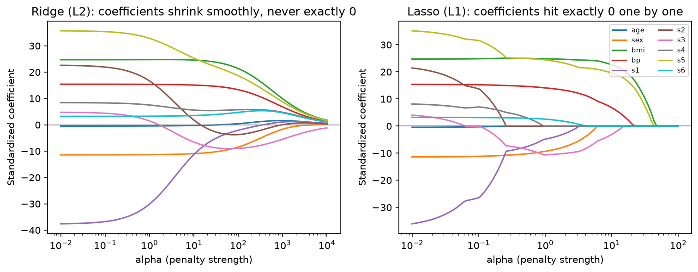

[Machine Learning](../README.md) › [基礎概念](README.md) › 正則化

# 正則化 (Regularization)

正則化是限制模型複雜度、改善 [泛化](generalization.md) 的一系列方法：故意多加一點偏誤，換取變異大幅下降（見 [Bias-Variance](bias-variance-tradeoff.md)）。

## 懲罰項 (Penalty)

在損失函數後面加上係數大小的懲罰，λ（sklearn 叫 `alpha`）控制強度：

$$
\min_\beta \ \text{Loss}(\beta) + \lambda \cdot \text{Penalty}(\beta)
$$

| 方法 | 懲罰 | 效果 | 何時用 | 筆記 |
| --- | --- | --- | --- | --- |
| L2 / Ridge | $\sum \beta_j^2$ | 係數平滑縮小，**不會變成 0** | 特徵多且彼此相關、只想穩定預測 | [Ridge](../supervised-learning/regression/ridge.md) |
| L1 / Lasso | $\sum \lvert\beta_j\rvert$ | 部分係數**剛好為 0** → 自動特徵選擇 | 預期只有少數特徵重要 | [Lasso](../supervised-learning/regression/lasso.md) |
| Elastic Net | L1 與 L2 的加權組合 | 稀疏，且相關特徵會一起被選 | 特徵高度相關又想稀疏（基因共表現） | [Elastic Net](../supervised-learning/regression/elastic-net.md) |



diabetes 資料（10 個標準化特徵）的係數路徑：Ridge 隨 `alpha` 增大全部一起縮向 0；Lasso 則讓係數一個個歸零（`alpha=1` 剩 7 個、`alpha=10` 剩 4 個非零），最後留下的 `bmi`、`s5` 就是最重要的特徵。

```python
import numpy as np
from sklearn.pipeline import make_pipeline
from sklearn.preprocessing import StandardScaler
from sklearn.linear_model import RidgeCV, LassoCV, ElasticNetCV, LogisticRegression

# 懲罰對量尺敏感 → 一定先標準化；alpha 用 CV 選
ridge = make_pipeline(StandardScaler(), RidgeCV(alphas=np.logspace(-3, 3, 50)))
lasso = make_pipeline(StandardScaler(), LassoCV(cv=5))
enet  = make_pipeline(StandardScaler(), ElasticNetCV(l1_ratio=[0.1, 0.5, 0.9], cv=5))

# 分類：sklearn 的 C = 1/λ，C 越小正則化越強
LogisticRegression(C=0.1)                                  # 預設 L2
LogisticRegression(C=0.1, l1_ratio=1, solver="saga")       # L1（sklearn ≥ 1.8 寫法）
```

> sklearn 1.8 起 `LogisticRegression(penalty=...)` 已 deprecated，改用 `l1_ratio`（0 = L2、1 = L1、介於中間 = Elastic Net）；舊版寫 `penalty="l1"`。

## 正則化 ↔ 貝氏先驗

| 懲罰 | 等價的先驗 |
| --- | --- |
| L2 (Ridge) | 係數 ~ Normal(0, τ²) |
| L1 (Lasso) | 係數 ~ Laplace(0, b) |

懲罰後的解就是 MAP 估計；λ 越大 = 先驗越窄 = 越相信係數接近 0。見 [先驗分配](../../statistics/bayesian-statistics/prior-distributions.md)、[最大概似估計](../../statistics/probability-and-distributions/maximum-likelihood.md#mle-與-ml-損失函數的對應)。

## 其他限制複雜度的方法

| 方法 | 適用模型 |
| --- | --- |
| 限制樹深度、最小葉節點樣本數、剪枝 | 決策樹、樹集成 |
| Early stopping | Boosting、神經網路 |
| Dropout、weight decay（= L2） | 神經網路 |
| [特徵選擇](../preprocessing/feature-selection.md) | 所有模型 |
| 降維（PCA 後再建模） | 所有模型 |
| 更多訓練資料、資料擴增 | 所有模型（不是懲罰，但效果相同：降低變異） |

| 正則化太弱 | 正則化太強 |
| --- | --- |
| [過擬合](overfitting-underfitting.md) | [欠擬合](overfitting-underfitting.md) |

> 正則化後的係數是**有偏的**，不能直接拿來做一般的顯著性推論（p 值、信賴區間）。要推論請用未懲罰的模型或專門的方法（如 post-selection inference）。
