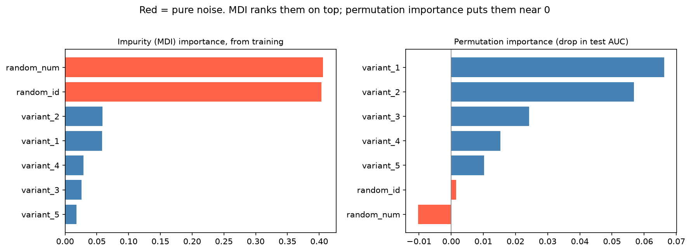

[Machine Learning](../README.md) › [可解釋性與診斷](README.md) › 模型可解釋性

# 模型可解釋性 (Model Interpretability)

回答「模型根據什麼做判斷」：建立信任、協助除錯，並檢查模型抓到的是合理訊號，還是可疑的代理變數（批次、醫院、掃描儀型號）。

## 全域 vs 局部

| | 全域解釋 (global) | 局部解釋 (local) |
| --- | --- | --- |
| 問題 | 模型整體最依賴哪些特徵？方向與形狀如何？ | 為什麼**這一筆**被預測成這樣？ |
| 方法 | 係數、permutation importance、PDP、SHAP 摘要圖 | SHAP 單筆、ICE、LIME |
| 用途 | 特徵審查、和領域知識對照 | 個案審查、對使用者解釋 |

## 方法比較

| 方法 | 適用模型 | 說明 | 注意 |
| --- | --- | --- | --- |
| 係數 | 線性 / 邏輯斯 | 特徵變動一單位的效果（logistic 取 exp 為 odds ratio） | 依賴縮放、編碼方式；共線性時不穩定；正則化後有偏 |
| 不純度重要性 (MDI) | 樹模型 `feature_importances_` | 訓練時每個特徵降低多少不純度 | **偏好連續 / 高基數特徵**；在訓練資料上算，會反映過擬合 |
| **Permutation importance** | 任何模型 | 打亂某特徵後，**驗證 / 測試**分數掉多少 | 較好的預設；相關特徵會互相掩護 |
| PDP / ICE | 任何模型 | 特徵值改變時預測如何變（平均 / 每筆） | 特徵相關時會外推到不存在的組合 |
| SHAP | 任何模型（樹模型有快速精確解） | 每筆預測拆成各特徵的貢獻，加總 = 預測 − 基準 | 計算量大；仍是相關不是因果 |

## MDI 的偏誤



模擬：5 個二元特徵（如是否帶某變異）有真實效果，另外加入兩個純雜訊：連續的 `random_num` 與每列不同值的 `random_id`。隨機森林在訓練資料上完美擬合（accuracy 1.0），MDI 把兩個雜訊特徵排在最前面（各約 0.40），因為它們提供最多切分點，樹用它們來記住雜訊。Permutation importance 在測試資料上算，雜訊特徵約為 0、真實特徵依效果大小排序。

## 用法

```python
import pandas as pd
from sklearn.inspection import permutation_importance, PartialDependenceDisplay
from sklearn.ensemble import RandomForestClassifier

rf = RandomForestClassifier(n_estimators=300, random_state=0).fit(X_train, y_train)

# 1. Permutation importance：在測試 / 驗證資料上算，重複多次看變異
pi = permutation_importance(rf, X_test, y_test, scoring="roc_auc", n_repeats=20, random_state=0)
(pd.DataFrame({"mean": pi.importances_mean, "sd": pi.importances_std}, index=X_test.columns)
   .sort_values("mean", ascending=False))

# 2. PDP + ICE：特徵效果的方向與形狀
PartialDependenceDisplay.from_estimator(rf, X_test, features=["worst radius", "mean texture"],
                                        kind="both")          # both = 平均 PDP + 每筆 ICE

# 3. SHAP（pip install shap）
import shap
sv = shap.TreeExplainer(rf)(X_test)        # 二元分類的隨機森林：shape = (n, 特徵數, 2 類)
shap.plots.beeswarm(sv[:, :, 1])           # 全域：各特徵對「陽性」的貢獻分布
shap.plots.waterfall(sv[0, :, 1])          # 局部：第 0 筆的預測拆解

# 4. 線性模型：標準化後的係數才能比較大小
coef = pd.Series(pipe[-1].coef_[0], index=X_train.columns).sort_values()
```

> 乳癌資料上，隨機森林的 permutation importance 都很小（最大約 0.005 AUC）：半徑、周長、面積高度相關，打亂其中一個，其他的還能補上。**低重要性 ≠ 沒用**；可以把相關特徵分群後一起打亂。

## 怎麼選

| 情境 | 優先方法 |
| --- | --- |
| 線性 / 邏輯斯模型 | 係數（標準化後）+ 領域審查；要推論用 [statsmodels](../packages/statsmodels/README.md) |
| 樹模型整體重要性 | Permutation importance（不要只看 `feature_importances_`） |
| 特徵如何影響預測（非線性、閾值） | PDP / ICE |
| 解釋單筆預測、個案審查 | SHAP |
| 高度相關的特徵群 | 分群後打亂整群、或先降維 |

## 注意事項

| 注意 | 原因 |
| --- | --- |
| 重要 ≠ 因果 | 模型只學相關；介入某特徵不一定改變結果 |
| 相關特徵會扭曲重要性 | 重要性被分攤或互相掩護 |
| 解釋與領域知識衝突時，先查資料 | 常是 [洩漏](../foundations/data-leakage.md) 或代理變數（醫院 ID、批次、檢驗時間） |
| 單筆解釋不能代表整個模型 | 局部與全域要分開看 |
| 解釋的是**模型**，不是資料 | 模型很差時，解釋也沒有意義；先確認效能 |

> **生資常見陷阱**：模型最重要的「基因」其實反映的是細胞組成比例、批次或樣本品質。看到意外的重要特徵，先檢查它和批次、QC 指標的相關性。
