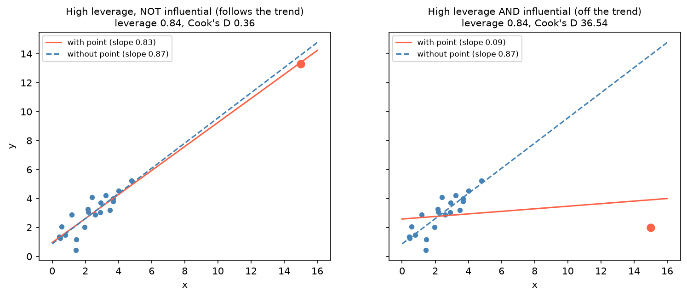

[Machine Learning](../../README.md) › [套件](../README.md) › [statsmodels](README.md) › 診斷

# statsmodels：迴歸診斷 (Regression Diagnostics)

檢查迴歸假設是否成立、結果是否被少數觀測驅動。[指標](metrics.md) 摘要整體配適；診斷看的是**個別觀測**與**假設**。殘差圖的判讀型態見 [模型假設與診斷](../../../statistics/multivariate-analysis/assumptions-diagnostics.md)；Cox 模型的診斷見 [存活分析：模型診斷](../../../statistics/survival-analysis/diagnostics.md)。

## 指標速查

| 診斷 | 衡量 | 經驗門檻 | statsmodels |
| --- | --- | --- | --- |
| 殘差 vs 配適值 | 線性、等變異 | 無結構、等寬 | `model.resid`、`model.fittedvalues` |
| 標準化殘差 | 離群的 y | \|r\| > 2 或 3 | `summary_frame()["standard_resid"]` |
| Leverage（hat 值） | x 離中心多遠 | > 2p/n 或 3p/n | `["hat_diag"]` |
| Cook's distance | 刪掉該點，所有配適值改變多少 | > 4/n（或 > 1 很嚴重） | `["cooks_d"]` |
| DFFITS | 刪掉該點，自己的配適值改變多少 | \|DFFITS\| > 2√(p/n) | `influence.dffits` |
| DFBETAS | 刪掉該點，每個係數改變多少 | \|DFBETAS\| > 2/√n | `influence.dfbetas` |
| VIF | 共線性 | > 5–10 | `variance_inflation_factor` |
| Breusch-Pagan | 異質變異 | p < 0.05 | `het_breuschpagan` |

（p = 參數數，含截距；n = 樣本數）

## Leverage ≠ 影響力



兩張圖的紅點 leverage 都是 0.84（x 遠離其他點）。左邊的點落在趨勢線上，刪掉它斜率只從 0.83 變成 0.87；右邊的點偏離趨勢，單獨把斜率從 0.87 拉到 0.09（Cook's D 36.5）。**影響力 = leverage × 殘差大小**，兩者都大才危險。

> 左邊那個「沒影響力」的點 Cook's D 仍有 0.36，超過 4/n = 0.19 的經驗門檻。門檻只用來**挑出值得看的點**，是否真的有影響要比較刪除前後的結果。

## 用法

```python
import numpy as np
import pandas as pd
import matplotlib.pyplot as plt
import statsmodels.formula.api as smf
from statsmodels.graphics.regressionplots import influence_plot
from statsmodels.stats.diagnostic import het_breuschpagan
from statsmodels.stats.outliers_influence import variance_inflation_factor

df = pd.DataFrame({"x": [1, 2, 3, 4, 5, 20],          # x = 20 是高 leverage 點
                   "y": [1, 2, 1.3, 3.75, 2.25, 7]})
model = smf.ols("y ~ x", data=df).fit()

# 1. 殘差圖
plt.scatter(model.fittedvalues, model.resid); plt.axhline(0, ls="--")

# 2. 影響力指標一次取得
infl = model.get_influence()
infl.summary_frame()[["hat_diag", "cooks_d", "dffits", "standard_resid"]]
# 第 6 筆（x=20）：hat_diag 0.967、cooks_d 3.41、dffits −2.33 → 高 leverage 且有影響力
# 第 4 筆：standard_resid 1.81 但 hat_diag 只有 0.18 → y 偏離，但影響不大
dffits, threshold = infl.dffits        # 回傳 (值, 門檻)；門檻 = 2√(p/n) = 1.15
infl.dfbetas                           # n × p

# 3. 綜合圖：x = leverage、y = 學生化殘差、泡泡大小 = Cook's D
influence_plot(model)

# 4. 異質變異與共線性
lm_stat, lm_p, f_stat, f_p = het_breuschpagan(model.resid, model.model.exog)
X = model.model.exog                   # 含截距欄
[variance_inflation_factor(X, i) for i in range(1, X.shape[1])]   # 跳過截距
```

## 發現問題後

| 問題 | 對策 |
| --- | --- |
| 高影響點是輸入錯誤 | 修正或移除，並記錄 |
| 高影響點是真實資料 | 報告有 / 無該點的結果；考慮穩健迴歸（`smf.rlm`） |
| 殘差有曲線 | 加非線性項、轉換變數 |
| 異質變異 | 轉換 y（log），或用穩健標準誤 `cov_type="HC3"`，見 [線性迴歸](linear-regression.md#穩健標準誤) |
| 高 VIF | 刪除或合併相關變數、用 [Ridge](../../supervised-learning/regression/ridge.md) |
| 殘差自相關（時間資料） | 時間序列模型或 HAC 標準誤 |

> 不要只因為某點「影響很大」就刪掉它；先確認它是錯誤還是真實現象，見 [離群值處理](../../preprocessing/outlier-handling.md)。
