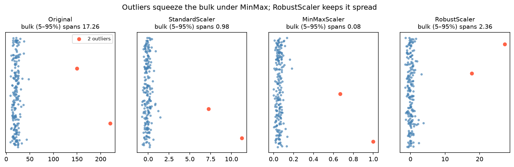

[Machine Learning](../README.md) › [前處理](README.md) › 特徵縮放

# 特徵縮放 (Feature Scaling)

把特徵轉到可比較的尺度，避免數值範圍大的變數主導距離計算或正則化懲罰。縮放參數（平均、SD、最小、最大）**只能用訓練資料估計**，再套用到測試資料。

## 哪些模型需要

| 需要縮放 | 原因 | 不需要縮放 |
| --- | --- | --- |
| [KNN](../supervised-learning/classification/knn.md)、K-Means、階層式分群 | 以距離為基礎 | 決策樹、[隨機森林](../supervised-learning/ensemble/random-forest.md) |
| [SVM](../supervised-learning/classification/svm.md)（尤其 RBF kernel） | 距離 / 內積 | [Gradient Boosting](../supervised-learning/ensemble/gradient-boosting.md)、XGBoost |
| 有正則化的線性 / [邏輯斯迴歸](../supervised-learning/classification/logistic-regression.md)（Ridge、Lasso） | 懲罰對係數大小敏感 | 未正則化的線性迴歸（預測不變，只影響係數解讀） |
| [PCA](../unsupervised-learning/dimensionality-reduction/pca.md) | 變異大的變數主導主成分 | Naive Bayes |
| 神經網路、梯度下降類模型 | 收斂速度與穩定性 | — |

## 方法

| Scaler | 公式 / 做法 | 結果 | 適用 |
| --- | --- | --- | --- |
| `StandardScaler` | $(x - \bar{x}) / s$ | 平均 0、SD 1 | **大多數情況的預設** |
| `MinMaxScaler` | $(x - \min) / (\max - \min)$ | [0, 1] | 需要固定範圍（影像像素、部分神經網路）；**對離群值很敏感** |
| `RobustScaler` | $(x - \text{median}) / IQR$ | 中位數 0 | 有離群值 |
| `MaxAbsScaler` | $x / \max\lvert x\rvert$ | [−1, 1] | 稀疏資料（不破壞 0 值） |
| `Normalizer` | 每一**列**縮放到單位長度 | 每列 L2 範數 = 1 | 文字向量、cosine 相似度 |
| `QuantileTransformer`、`PowerTransformer` | 非線性轉換成均勻 / 近似常態 | 改變分布形狀 | 嚴重偏態 |
| log（`FunctionTransformer(np.log1p)`） | 壓縮右尾 | 改變分布形狀 | 金額、計數、表現量 |

```python
import numpy as np
from sklearn.preprocessing import (StandardScaler, MinMaxScaler, RobustScaler,
                                   Normalizer, FunctionTransformer)

x = np.array([[1.], [2.], [3.], [4.], [100.]])            # 一個離群值
StandardScaler().fit_transform(x).ravel()   # [-0.54, -0.51, -0.49, -0.46, 2.0]
MinMaxScaler().fit_transform(x).ravel()     # [0.00, 0.01, 0.02, 0.03, 1.0]  ← 正常值全擠在 0 附近
RobustScaler().fit_transform(x).ravel()     # [-1.0, -0.5, 0.0, 0.5, 48.5]   ← 正常值保持分開
Normalizer().fit_transform([[3, 4]])        # [[0.6, 0.8]]  逐列

# 實務：放進 pipeline，自動只在訓練 fold 上 fit
from sklearn.pipeline import make_pipeline
from sklearn.neighbors import KNeighborsClassifier
from sklearn.model_selection import GridSearchCV

pipe = make_pipeline(StandardScaler(), KNeighborsClassifier())
search = GridSearchCV(pipe, {"kneighborsclassifier__n_neighbors": range(1, 50, 2)}, cv=5)
search.fit(X_train, y_train)

# log 轉換 + 標準化
make_pipeline(FunctionTransformer(np.log1p), StandardScaler())
```



右偏資料加兩個離群值：MinMax 把主體壓縮到 0.08 的寬度內；StandardScaler 的平均與 SD 也被拉動；RobustScaler 用中位數與 IQR，主體仍分得開。

> 縮放（標準化、MinMax）只是平移與伸縮，**不改變分布形狀**；偏態資料標準化後仍然偏態。要改變形狀得用 log、Box-Cox 等非線性轉換，見 [資料轉換](../../statistics/descriptive-statistics/univariate-numerical.md#資料轉換-transformation)。

## 生資：逐樣本正規化 vs 逐特徵縮放

| | 逐樣本（列）正規化 | 逐特徵（欄）縮放 |
| --- | --- | --- |
| 目的 | 消除樣本間的技術差異（定序深度、上機量） | 讓特徵在模型中可比較 |
| 例子 | CPM / TPM、DESeq2 size factor、`log1p(CPM)` | `StandardScaler`（基因 z-score） |
| 順序 | 先做 | 後做（在 pipeline 內） |

> 逐樣本正規化只用該樣本自己的資料，不會跨樣本洩漏；但 DESeq2 size factor、quantile normalization、ComBat 批次校正這類**用到所有樣本**的方法，嚴格來說也要只在訓練資料上估計。

## 常見錯誤

| 錯誤 | 改正 |
| --- | --- |
| 在全資料上 `fit_transform` 後才切分 | 先切分，或放進 [Pipeline](../workflow/pipeline-basic.md) |
| 測試資料另外 `fit_transform` | 測試資料只能 `transform` |
| 對 one-hot 欄位也標準化後解讀係數 | 可以做，但係數意義改變；通常只縮放數值欄 |
| 以為樹模型需要縮放 | 樹只看排序，縮放不影響結果 |
