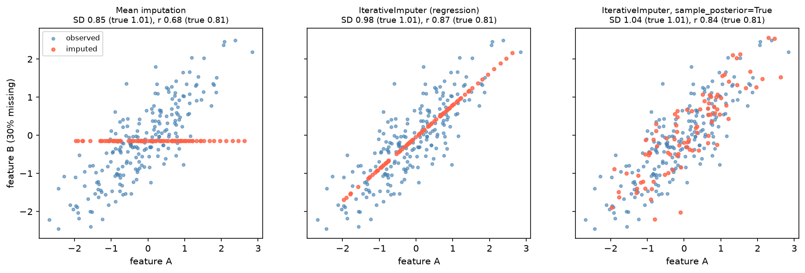

[Machine Learning](../README.md) › [前處理](README.md) › 補值

# 補值 (Imputation)

補值是用估計值填入缺失值。重點不是「把空格補滿」，而是補值方式**符合資料生成機制**、**不扭曲分布與關係**，且**只在訓練資料上 fit**。pandas 端的缺失偵測與 `missingno` 視覺化見 [pandas: Handling Missing Data](../../python-foundations/pandas/missing-data.md)；缺失機制的判斷與 EDA 見 [Missing Data](../../data-manipulation-and-eda/missing-data.md)。

## 決策順序

```
1. 缺多少？集中在哪些欄位？ ──► 缺太多（如 > 50%）→ 考慮刪欄位或只留缺失指標
2. 為什麼缺？ ──► 缺失本身有意義（沒做檢查 = 醫師判斷不需要）→ 加缺失指標
3. 缺失其實代表某個值？ ──► 「去年購買次數」缺失 = 0 → 固定值
4. 其餘 ──► 統計量 / 模型補值，放進 pipeline
```

## 方法

| 方法 | sklearn | 適用 | 缺點 |
| --- | --- | --- | --- |
| 平均數 | `SimpleImputer(strategy="mean")` | 近似對稱的數值 | 對離群值敏感；**壓縮變異、削弱相關** |
| 中位數 | `strategy="median"` | 偏態數值（金額、表現量） | 同上 |
| 眾數 | `strategy="most_frequent"` | 類別 | 放大多數類別 |
| 固定值 | `strategy="constant", fill_value=0` | 缺失有明確意義（0、`"unknown"`） | 選錯值會引入偏誤 |
| 缺失指標 | `add_indicator=True`、`MissingIndicator` | 缺失本身可能有訊號 | 增加欄位 |
| KNN | `KNNImputer(n_neighbors=5)` | 樣本間相似度有意義 | 需先縮放；大資料慢 |
| 迭代 / MICE 式 | `IterativeImputer`（實驗性 API） | 特徵之間有關聯 | 較慢；預設補的是條件平均 |
| 不補，交給模型 | `HistGradientBoosting*`、XGBoost、LightGBM、新版決策樹 / 隨機森林 | 樹模型 | 只適用支援 NaN 的模型 |

```python
import numpy as np
from sklearn.impute import SimpleImputer, KNNImputer
from sklearn.experimental import enable_iterative_imputer   # noqa: 必須先 import 才能用
from sklearn.impute import IterativeImputer
from sklearn.compose import ColumnTransformer
from sklearn.pipeline import make_pipeline

X = np.array([[1, 2], [np.nan, 3], [7, np.nan], [4, 5]], dtype=float)

SimpleImputer(strategy="median", add_indicator=True).fit_transform(X)
# [[1, 2, 0, 0],
#  [4, 3, 1, 0],    ← 補中位數 4，並多出「第 0 欄是否缺失」指標
#  [7, 3, 0, 1],
#  [4, 5, 0, 0]]
KNNImputer(n_neighbors=2).fit_transform(X)            # 用最近的 2 個樣本平均
IterativeImputer(random_state=0).fit_transform(X)     # 用其他欄位迴歸預測

# 不同欄位不同策略：放進 ColumnTransformer / Pipeline
preprocess = ColumnTransformer([
    ("num", SimpleImputer(strategy="median", add_indicator=True), ["age", "income"]),
    ("cat", SimpleImputer(strategy="constant", fill_value="unknown"), ["gender"]),
])

# 規則型：缺失代表 0、或手動做缺失指標
df["n_purchases_last_year"] = df["n_purchases_last_year"].fillna(0)
df["no_email"] = df["email"].isna().astype(int)
```

## 補值會扭曲資料



兩個相關特徵（真實 r = 0.81），B 有 30% 缺失：

| 方法 | 結果 | 影響 |
| --- | --- | --- |
| 平均數補值（左） | 補值全落在一條水平線上 | SD 從 1.01 降到 0.85、r 降到 0.68：**低估變異、削弱關係** |
| 迴歸補值（中） | 補值全落在迴歸線上 | r 升到 0.87：**誇大關係**（補的值沒有雜訊） |
| 加入隨機性（右，`sample_posterior=True`） | 補值帶有合理雜訊 | SD 與 r 都接近真值 |

> 對**預測**而言，單一補值通常夠用（模型評估看的是驗證分數）。對**統計推論**（係數、p 值、CI），單一補值會讓標準誤過小，應使用**多重補值 (multiple imputation)**：產生 m 份補值資料、分別分析、再用 Rubin's rules 合併（R `mice`、`statsmodels.imputation.mice`）。

## 單一補值 vs 多重補值

| | 單一補值 (single) | 多重補值 (multiple) |
| --- | --- | --- |
| 做法 | 每個缺失值補一個值 | 補 m 次（含隨機性），分析後合併 |
| 不確定性 | 忽略 → 標準誤偏小 | 納入補值的不確定性 |
| 用途 | ML 預測 | 統計推論 |
| 工具 | `SimpleImputer`、`KNNImputer`、`IterativeImputer` | `mice`（R）、`statsmodels` MICE、`IterativeImputer(sample_posterior=True)` 跑多次 |

## 常見錯誤

| 錯誤 | 後果 / 改正 |
| --- | --- |
| 在全資料上補值再切分 | 洩漏 → 放進 [Pipeline](../workflow/pipeline-basic.md) |
| 高缺失率欄位硬補平均 | 製造一大群相同值；改成缺失指標或刪欄位 |
| 類別欄位用平均數 | 語意錯誤；用眾數或 `"unknown"` |
| 偏態欄位用平均數 | 被極端值拉走；用中位數（如 `max_donation`） |
| 把補值和插值 (interpolation) 混為一談 | 插值用於**有順序**的資料（時間序列、空間），利用前後點；見 [pandas Interpolation](../../python-foundations/pandas/missing-data.md#6-插值-interpolation) |
| 時間感知資料用未來資訊估補值 | 補值規則必須在未來的快照上也能重現，見 [Basetable](../foundations/basetable-and-time-aware-feature-engineering.md) |

> **生資提醒**：蛋白質體 / 代謝體的缺失常是**低於偵測極限 (MNAR)**，補平均數會嚴重高估；常用最小值的一部分或從左截尾分配抽樣。單細胞 RNA-seq 的大量 0（dropout）多半不該當成缺失值補。
