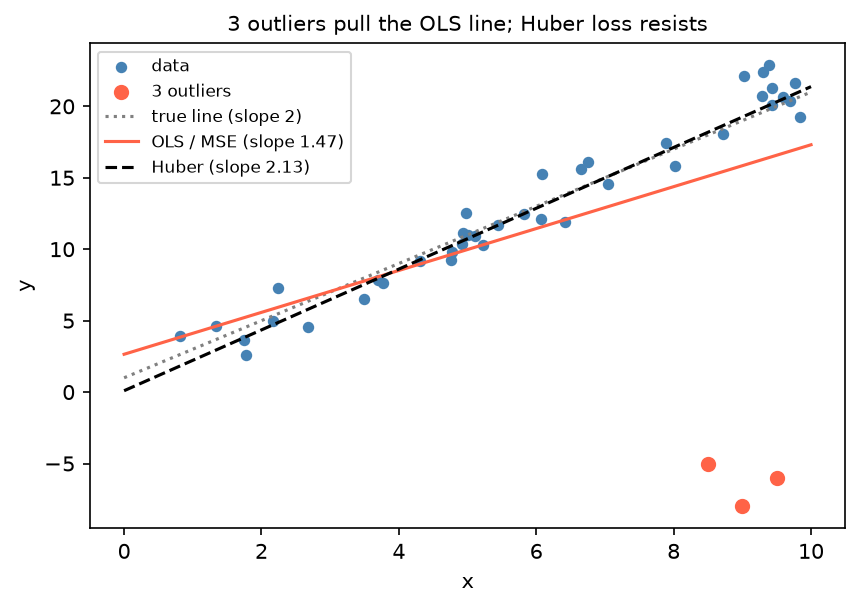

[Machine Learning](../README.md) › [前處理](README.md) › 離群值處理

# 離群值處理 (Outlier Handling)

離群值可能來自輸入錯誤、量測問題，或是真實但罕見的現象。處理的關鍵不是「看起來很大就刪」，而是先分辨**它是錯誤還是訊號**。描述統計面的偵測與判讀見 [單變數：數值型](../../statistics/descriptive-statistics/univariate-numerical.md#四分位距與離群值-iqr--outliers)、[資料品質](../../statistics/descriptive-statistics/data-quality.md)。

## 先判斷來源

| 來源 | 例子 | 處理 |
| --- | --- | --- |
| 輸入 / 單位錯誤 | 年齡 150、身高用公尺填成公分 | 修正；無法修正就設為缺失再 [補值](imputation.md) |
| 量測 / 技術問題 | 儀器飽和、定序深度異常低的樣本 | QC 階段排除，並記錄規則 |
| 真實極端值 | 罕見疾病、詐欺、超級大客戶 | **保留**；用穩健方法降低影響 |
| 不屬於目標母體 | 測試帳號、員工交易 | 依母體定義排除 |

> 離群值可能正是你要找的東西（詐欺、罕見亞型）。這類問題請看 [異常偵測](../unsupervised-learning/anomaly-detection/README.md)，而不是把它們刪掉。

## 偵測規則

| 規則 | 定義 | 適合 | 注意 |
| --- | --- | --- | --- |
| IQR (Tukey fence) | 超出 $[Q_1 - 1.5\,IQR,\ Q_3 + 1.5\,IQR]$ | 一般用途、偏態資料 | 大樣本下仍會標出不少點 |
| z-score | $\lvert x - \bar{x}\rvert / s > 3$ | 近似常態 | 平均與 SD 本身會被離群值拉走（遮蔽效應） |
| 穩健 z-score | 以中位數與 MAD 取代，$\lvert z \rvert > 3.5$ | 有離群值時 | — |
| 領域規則 | 年齡 < 0 或 > 120 | 有明確合理範圍 | 最可靠 |
| 多變量 | Isolation Forest、LOF、Mahalanobis 距離 | 單看每欄都正常，組合起來不正常 | 見 [異常偵測](../unsupervised-learning/anomaly-detection/README.md) |

```python
import pandas as pd
from scipy.stats import zscore, median_abs_deviation

s = pd.Series([25, 28, 30, 150, 27, 31, 29, 26])

# 1. IQR
q1, q3 = s.quantile([0.25, 0.75]); iqr = q3 - q1
s[(s < q1 - 1.5 * iqr) | (s > q3 + 1.5 * iqr)]            # [150]

# 2. z-score：小樣本時離群值會把 SD 撐大，自己躲過門檻
zscore(s).round(2)                                         # 150 的 z 只有 2.64 < 3 → 漏抓

# 3. 穩健 z-score
(s - s.median()) / median_abs_deviation(s, scale="normal")  # 150 的穩健 z ≈ 41
```

## 處理方法

| 方法 | 做法 | 何時用 |
| --- | --- | --- |
| 刪除 | 移除該列 | 確定是錯誤，且無法修正 |
| 截尾 (winsorize / clip) | 把超出分位數的值壓回分位數 | 真實但不該主導模型 |
| 轉換 | log、平方根 | 右偏的正值資料（金額、表現量、計數） |
| 穩健縮放 | `RobustScaler` | 距離型模型，見 [特徵縮放](feature-scaling.md) |
| 穩健模型 / 損失 | 樹模型、Huber、MAE | 不想改資料本身 |
| 設為缺失 | 換成 NaN 再補值 | 錯誤值但列的其他資訊仍有用 |

```python
import numpy as np

# 截尾：分位數要用「訓練資料」計算，再套到測試資料
lo, hi = X_train["amount"].quantile([0.01, 0.99])
X_train["amount"] = X_train["amount"].clip(lo, hi)
X_test["amount"] = X_test["amount"].clip(lo, hi)

# 平均 ± 3 SD 截尾（近似常態時才合理）
m, sd = X_train["age"].mean(), X_train["age"].std()
X_train["age"] = X_train["age"].clip(m - 3 * sd, m + 3 * sd)

# log 轉換（含 0 用 log1p）
df["log_income"] = np.log1p(df["income"])
```

> `scipy.stats.mstats.winsorize(x, limits=[0.05, 0.01])` 也能截尾（壓下方 5%、上方 1%），但回傳 masked array，且分位數是對傳入的資料本身計算；在 train / test 分開的流程中，用上面 `clip` 搭配訓練集分位數較安全。

## 穩健損失：不改資料也能降低影響



3 個離群點就把最小平方法的斜率從真值 2 拉到 1.47；Huber 損失對大殘差改用線性懲罰，斜率 2.13 幾乎不受影響。損失函數的比較見 [損失函數](../foundations/loss-functions.md)。

```python
from sklearn.linear_model import HuberRegressor
HuberRegressor(epsilon=1.35).fit(X, y)      # epsilon 越小越穩健
```

## 注意事項

| 注意 | 原因 |
| --- | --- |
| 偵測門檻與截尾分位數只用訓練資料算 | 否則洩漏 |
| 記錄處理規則 | 上線時要對新資料套用同一規則 |
| 聚合特徵常更偏 | `sum_spend`、`max_donation`、距上次事件天數等 basetable 特徵比原始欄位更右偏 |
| 離群值與缺失常一起出現 | 一起處理，見 [補值](imputation.md) |
| 樹模型本身對 X 的離群值不敏感 | 但 y 的離群值仍會影響（MSE 損失） |
| 生資：先看 QC 指標 | 異常樣本常可由定序深度、比對率、粒線體比例等 QC 解釋，見 [PCA](../unsupervised-learning/dimensionality-reduction/pca.md) 找離群樣本 |
