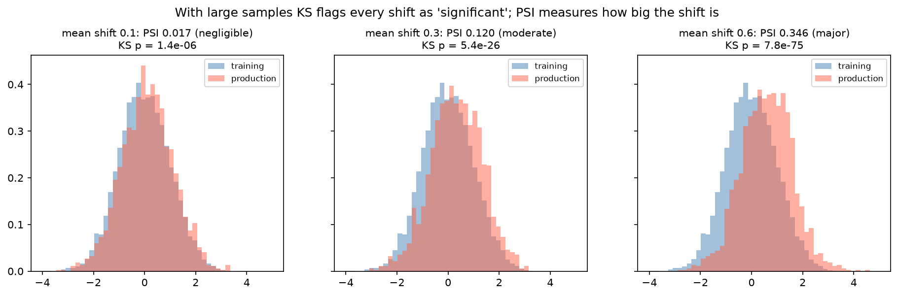

[Machine Learning](../README.md) › [上線與維運](README.md) › 部署與監控

# 部署與監控 (Deployment and Monitoring)

真正上線的不是單一 estimator，而是一整條從輸入到輸出的推論流程。訓練與上線的前處理只要有一點不一致，再高分的模型都可能立刻失真；而模型退化通常**不會報錯**，只能靠監控發現。

## 上線前要準備什麼

| 項目 | 說明 |
| --- | --- |
| 完整的推論流程 | 前處理 + 模型一起存成一個 [Pipeline](../workflow/pipeline-basic.md) |
| 輸入 schema | 欄位名稱、順序、型別、允許的類別值與範圍 |
| 版本資訊 | 模型版本、訓練時間、資料版本、重要超參數、套件版本 |
| 基準分布 | 訓練資料各特徵與預測分數的分布，供日後比較漂移 |
| 回滾方案 | 舊版本仍可隨時切回 |

## 部署型態

| 型態 | 適合情境 | 主要風險 |
| --- | --- | --- |
| 批次推論 (batch) | 每日 / 每小時對整批資料預測 | 資料延遲、排程失敗、回填邏輯 |
| 即時推論 (real-time API) | 需要立即回應 | 延遲、吞吐量、服務穩定性 |
| 串流 / 事件驅動 (streaming) | 持續處理事件資料 | schema 漂移、事件遺失、順序問題 |

## 四層監控

| 層級 | 監控什麼 |
| --- | --- |
| 系統 | 延遲、吞吐量、錯誤率、逾時與重試次數 |
| 資料 | 缺失率突然升高、出現新類別、特徵分布偏移、schema 改變 |
| 模型 | 預測分數分布、預測類別比例、[校準](../evaluation/classification-thresholds-and-calibration.md#校準-calibration)；有標籤回流後的實際效能 |
| 業務 / 臨床 | 下游 KPI（轉換率、違約率、再入院率）；決策是否對特定族群產生偏差 |

## 漂移的類型

| 類型 | 變的是什麼 | 偵測方式 |
| --- | --- | --- |
| 資料漂移 / 共變量偏移 (data / covariate drift) | P(X)：輸入分布 | 比較特徵分布（PSI、KS），不需要標籤 |
| 預測漂移 (prediction drift) | P(ŷ)：預測分布 | 比較預測分數分布 |
| 概念漂移 (concept drift) | P(y \| X)：X 與 y 的關係 | 需要標籤：監控實際效能 |
| 標籤漂移 (label / prior shift) | P(y)：盛行率 | 標籤回流後比較；影響 precision 與校準 |

> 資料漂移不一定讓模型變差（偏移的特徵可能不重要）；概念漂移可能在輸入分布完全沒變時發生。兩者都要看。

## 漂移指標：PSI vs KS 檢定

```python
import numpy as np
from scipy.stats import ks_2samp

def psi(expected, actual, bins=10):
    """Population Stability Index：以訓練資料的分位數切箱。"""
    edges = np.quantile(expected, np.linspace(0, 1, bins + 1))
    edges[0], edges[-1] = -np.inf, np.inf
    e = np.histogram(expected, edges)[0] / len(expected)
    a = np.histogram(actual, edges)[0] / len(actual)
    e, a = np.clip(e, 1e-6, None), np.clip(a, 1e-6, None)        # 避免 log(0)
    return np.sum((a - e) * np.log(a / e))

psi(train_feature, prod_feature)
ks_2samp(train_feature, prod_feature).pvalue
```

| PSI | 常用解讀（業界慣例，非統計檢定） |
| --- | --- |
| < 0.1 | 穩定 |
| 0.1–0.25 | 中度偏移，需要調查 |
| > 0.25 | 明顯偏移，考慮重訓 |



訓練 5,000 筆、上線 2,000 筆，平均分別平移 0.1、0.3、0.6 個 SD：PSI 為 0.017、0.12、0.35，對應穩定 / 中度 / 明顯；KS 檢定的 p 值卻**三個都極小**。樣本大時檢定會把微小、無實務意義的差異判為顯著，所以監控應看**效果量**（PSI、分布差異大小），而不是只看 p 值。

## 何時重訓

| 觸發條件 | 說明 |
| --- | --- |
| 效能**持續**下降 | 不是單日波動；先定義退化門檻與觀察期 |
| 重要特徵明顯漂移 | 搭配 [特徵重要性](../interpretability-and-diagnostics/model-interpretability.md) 判斷影響 |
| 上游改變 | 資料收集流程、標註規則、目標定義、檢驗儀器、定序平台 |
| 外部環境的制度性改變 | 政策、市場、臨床指引 |
| 固定週期 | 漂移難以偵測時，定期重訓 + 比較新舊版本 |

> 新模型上線前，在**同一份最新資料**上和舊模型比較；可以先 shadow deployment（並行預測但不使用結果）或 A/B 測試。

## 常見錯誤

| 錯誤 | 後果 |
| --- | --- |
| 只存模型，不存前處理與欄位順序 | 上線結果和訓練時不一致 |
| 上線服務用不同規則處理缺失值或新類別 | 默默產生錯誤預測 |
| 只有技術監控，沒有和業務結果對照 | 系統健康但模型早已沒用 |
| 重訓時覆蓋舊模型，沒有版本與回滾 | 新版出問題時無法退回，見 [MLflow](mlflow.md) |
| 用 p 值監控漂移 | 大流量下天天告警 |

> 無法在上線環境穩定重現訓練時的資料轉換與欄位定義，這個模型就還不能算可部署。
