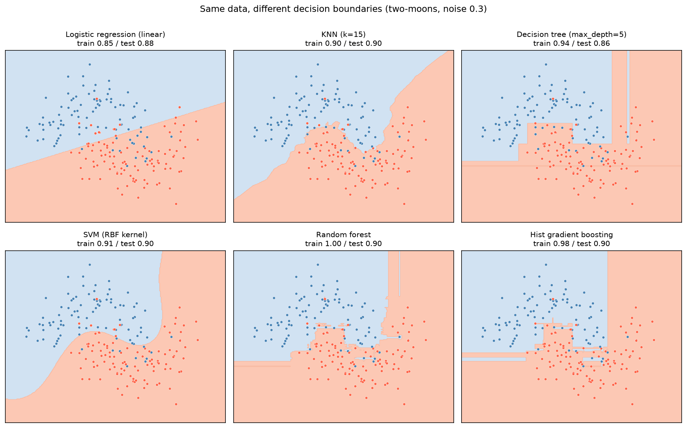

[Machine Learning](../../README.md) › [監督式學習](../README.md) › 分類

# 分類 (Classification)

預測離散類別：垃圾郵件 / 正常、流失 / 留存、腫瘤亞型、致病 / 良性變異。多數分類器先輸出**分數或機率**，再用閾值變成類別，見 [閾值與校準](../../evaluation/classification-thresholds-and-calibration.md)。

## 筆記

| 筆記 | 內容 | 回答的問題 |
| --- | --- | --- |
| [邏輯斯迴歸](logistic-regression.md) | 線性決策邊界、odds ratio、正則化 | 最強的簡單 baseline 怎麼用？ |
| [KNN](knn.md) | 最近鄰投票、k 的選擇、縮放 | 「像誰就是誰」怎麼做？ |
| [決策樹](decision-tree.md) | 規則式切分、剪枝 | 怎麼得到可讀的規則？ |
| [SVM](svm.md) | 最大間隔、kernel、C 與 gamma | 怎麼找最穩健的邊界？ |
| [Naive Bayes](naive-bayes.md) | 條件獨立假設、計數資料 | 文字 / k-mer 計數怎麼快速分類？ |

## 決策邊界比較

同一份兩彎月資料：邏輯斯迴歸只能畫直線；KNN 與 SVM 給出平滑曲線；樹模型的邊界由垂直 / 水平線段組成；隨機森林訓練 accuracy 1.0 但測試只有 0.90，表示它在訓練資料上記住了雜訊。測試 accuracy 差距（0.86–0.90）遠小於邊界外觀的差距。

| 模型 | 邊界形狀 | 需要縮放 | 輸出機率品質 |
| --- | --- | --- | --- |
| 邏輯斯迴歸 | 線性（可加特徵變非線性） | 是 | 通常校準良好 |
| KNN | 任意，k 越小越崎嶇 | **是** | 粗糙（k 個鄰居的比例） |
| 決策樹 | 軸平行的矩形 | 否 | 差（葉節點比例） |
| SVM (RBF) | 平滑曲線 | **是** | 預設不輸出機率 |
| Naive Bayes | 二次曲線（Gaussian） | 否 | 常過度極端 |
| 樹集成 | 細碎的矩形組合 | 否 | 中，需檢查 [校準](../../evaluation/classification-thresholds-and-calibration.md#校準-calibration) |

## 提醒

| 提醒 | 說明 |
| --- | --- |
| 先用邏輯斯迴歸當 baseline | 表格資料上常常已經足夠好 |
| Accuracy 不夠 | 尤其 [類別不平衡](../../evaluation/class-imbalance.md) 時；看 recall、precision、PR-AUC |
| 多類別 | sklearn 分類器都原生支援；評估用 macro 平均，見 [混淆矩陣指標](../../evaluation/confusion-metrics.md) |
| 閾值跟模型一起考慮 | 不是事後才想 |
