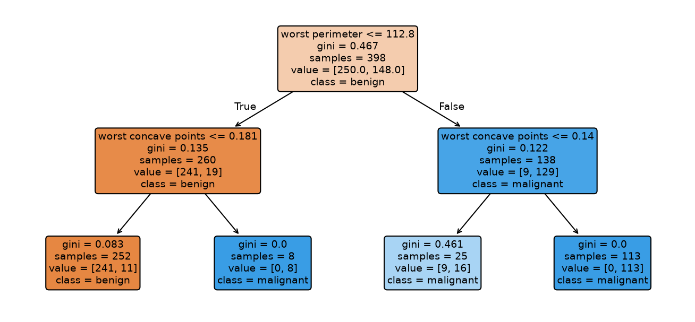

[Machine Learning](../../README.md) › [監督式學習](../README.md) › [分類](README.md) › 決策樹

# 決策樹：分類 (Decision Tree Classification)

決策樹反覆挑一個特徵與切點，把資料分成更「純」的子群，直到停止條件。結果是一組 if-else 規則，容易解讀，但單棵樹**很不穩定、容易過擬合**，實務上多作為 [隨機森林](../ensemble/random-forest.md)、[Gradient Boosting](../ensemble/gradient-boosting.md) 的基本單元。迴歸版本見 [迴歸樹](../regression/decision-tree.md)。



乳癌資料深度 2 的樹：先看 `worst perimeter`，再看 `worst concave points`。每個節點顯示樣本數、`value = [良性, 惡性]` 與 Gini 不純度。最左葉 252 筆中有 11 筆惡性被歸為良性。這棵 4 個葉節點的樹測試 accuracy 0.906。

## 分裂準則

| `criterion` | 公式 | 說明 |
| --- | --- | --- |
| `"gini"`（預設） | $1 - \sum_k p_k^2$ | 計算快 |
| `"entropy"` / `"log_loss"` | $-\sum_k p_k \log p_k$ | 資訊增益；結果通常與 Gini 相近 |

每次分裂選「子節點加權不純度下降最多」的特徵與切點（貪婪演算法，不保證全域最佳）。

## 控制複雜度

| 參數 | 作用 |
| --- | --- |
| `max_depth` | 最大深度 |
| `min_samples_leaf` | 葉節點最少樣本數（常是最有效的單一參數） |
| `min_samples_split` | 節點至少要有多少樣本才能再分 |
| `max_leaf_nodes` | 葉節點上限 |
| `ccp_alpha` | 成本複雜度剪枝 (cost-complexity pruning)：長完再剪 |
| `class_weight` | 不平衡資料 |

```python
from sklearn.tree import DecisionTreeClassifier, export_text, plot_tree
from sklearn.model_selection import GridSearchCV, StratifiedKFold

# 承乳癌範例
full = DecisionTreeClassifier(random_state=0).fit(X_train, y_train)
full.get_depth(), full.get_n_leaves()      # 8 層、19 葉
full.score(X_train, y_train)               # 1.0   ← 記住了訓練資料
full.score(X_test, y_test)                 # 0.901

search = GridSearchCV(DecisionTreeClassifier(random_state=0),
                      {"max_depth": [2, 3, 4, 5, None], "min_samples_leaf": [1, 5, 10],
                       "ccp_alpha": [0, 0.005, 0.01, 0.02]},
                      cv=StratifiedKFold(5, shuffle=True, random_state=0), scoring="roc_auc")
search.fit(X_train, y_train)               # 最佳：min_samples_leaf=5，CV AUC 0.954

# 讀規則
print(export_text(DecisionTreeClassifier(max_depth=2).fit(X_train, y_train),
                  feature_names=list(X.columns)))
# |--- worst perimeter <= 112.80
# |   |--- worst concave points <= 0.18  → class 0
# ...
plot_tree(search.best_estimator_, feature_names=list(X.columns), filled=True, max_depth=3)
```

調過參的單棵樹 CV AUC 0.954，仍明顯低於邏輯斯迴歸（0.992）與隨機森林（0.986）。

## 優缺點

| 優點 | 缺點 |
| --- | --- |
| 規則可讀，可直接給領域專家審查 | **不穩定**：資料稍變，樹結構就大幅改變 |
| 不需縮放，能處理 NaN（sklearn ≥ 1.3） | 容易過擬合，需剪枝 |
| 自動捕捉非線性與交互作用 | 邊界只能是軸平行的矩形 |
| 混合數值與類別特徵 | 機率輸出粗糙（葉節點比例） |
| — | `feature_importances_` 偏好高基數特徵，見 [可解釋性](../../interpretability-and-diagnostics/model-interpretability.md#mdi-的偏誤) |

> 需要「可解釋的規則」又要準確度時：用淺樹當作解釋工具，主模型用集成方法；或檢查淺樹與集成模型的表現差距是否可以接受。
