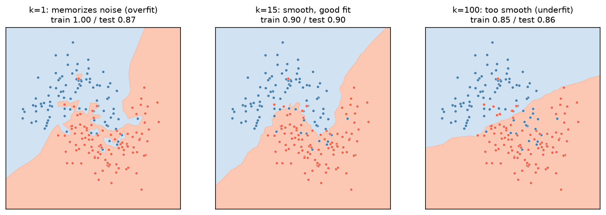

[Machine Learning](../../README.md) › [監督式學習](../README.md) › [分類](README.md) › KNN

# K 近鄰 (K-Nearest Neighbors, KNN)

要分類一個新樣本，找訓練資料中距離最近的 k 個鄰居，用多數決（或依距離加權）決定類別。沒有真正的「訓練」步驟，只是把資料存起來（instance-based、無母數）。迴歸版本 `KNeighborsRegressor` 改成取鄰居 y 的平均。

## k 的影響



| k | 邊界 | 偏誤 / 變異 |
| --- | --- | --- |
| 小（k = 1） | 崎嶇，每個點都有自己的小島；訓練 accuracy = 1 | 低偏誤、高變異 → [過擬合](../../foundations/overfitting-underfitting.md) |
| 適中（k = 15） | 平滑，訓練與測試分數接近 | 平衡 |
| 大（k = 100） | 過度平滑，邊緣細節被抹平 | 高偏誤 → 欠擬合 |

二元分類時 k 用奇數可避免平手。

## 用法

```python
from sklearn.pipeline import make_pipeline
from sklearn.preprocessing import StandardScaler
from sklearn.neighbors import KNeighborsClassifier
from sklearn.model_selection import GridSearchCV, StratifiedKFold, cross_val_score

# 承乳癌範例（X_train, y_train；1 = 惡性）
cv = StratifiedKFold(5, shuffle=True, random_state=0)

# 1. 一定要縮放：未縮放時「worst area」（數百到數千）主導距離
cross_val_score(KNeighborsClassifier(), X_train, y_train, cv=cv).mean()                                 # 0.930
cross_val_score(make_pipeline(StandardScaler(), KNeighborsClassifier()), X_train, y_train, cv=cv).mean()  # 0.962

# 2. 調 k 與加權方式
search = GridSearchCV(make_pipeline(StandardScaler(), KNeighborsClassifier()),
                      {"kneighborsclassifier__n_neighbors": [1, 3, 5, 7, 11, 15, 21, 31],
                       "kneighborsclassifier__weights": ["uniform", "distance"]},
                      cv=cv, scoring="roc_auc").fit(X_train, y_train)
search.best_params_      # n_neighbors=31, weights="distance"；CV AUC 0.988
```

## 參數

| 參數 | 選項 | 說明 |
| --- | --- | --- |
| `n_neighbors` | 整數 | 最重要的參數，用 CV 選 |
| `weights` | `"uniform"`、`"distance"` | distance：越近的鄰居權重越大 |
| `metric` | `"minkowski"`（預設，p=2 即歐氏距離）、`"manhattan"`、`"cosine"` | 文字、表現量 profile 常用 cosine |
| `algorithm` | `"auto"`、`"kd_tree"`、`"ball_tree"`、`"brute"` | 只影響速度 |

## 優缺點

| 優點 | 缺點 |
| --- | --- |
| 直覺、無需訓練 | 預測慢：每次都要算與所有訓練點的距離 |
| 可以畫任意形狀的邊界 | **對縮放與無關特徵極度敏感** |
| 自然支援多類別 | 高維時距離失去意義（維度詛咒），見 [高維小樣本](../../foundations/high-dimensional-data.md) |
| — | 機率輸出粗糙（只是 k 個鄰居的比例） |

> 生資中的 KNN：單細胞分析的 KNN 圖（Leiden / Louvain 分群、UMAP 的基礎）、`KNNImputer` 補值、以已知標註細胞做 label transfer。這些都是在 **PCA 降維後**的空間計算距離，避免高維的距離集中問題。

相關：[特徵縮放](../../preprocessing/feature-scaling.md)、[補值](../../preprocessing/imputation.md)、[分群](../../unsupervised-learning/clustering/README.md)。
